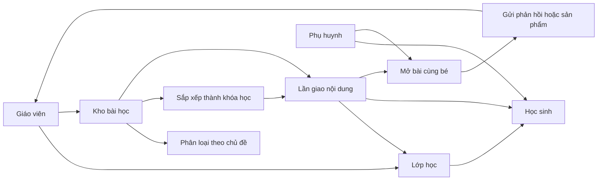
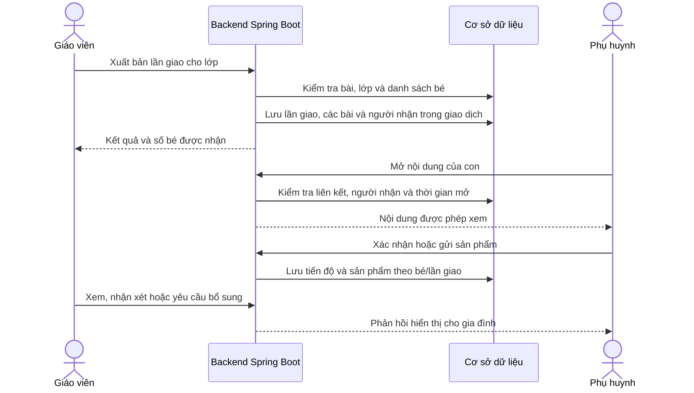
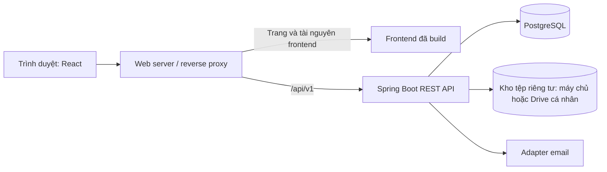
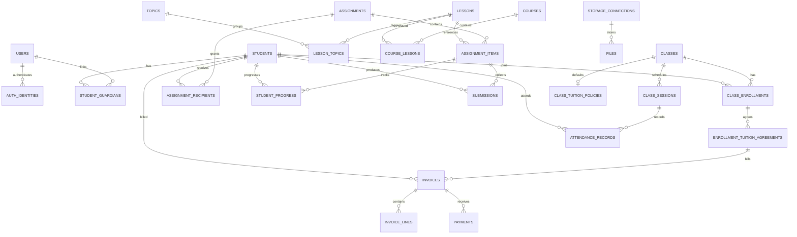

# TinyClass — Đặc tả hệ thống quản lý dạy học tại nhà

Tên chính thức: **TinyClass**  
Phiên bản tài liệu: **0.19 — Tổng quan giáo viên và gia đình**<br>
Ngày cập nhật: **03/11/2026**, múi giờ nghiệp vụ **Asia/Ho_Chi_Minh**<br>
Đối tượng sử dụng: **một giáo viên cá nhân dạy trẻ mầm non tại nhà**.

Tài liệu mô tả sản phẩm mục tiêu. Các module đã có gồm tài khoản/lớp/gia đình/email, LOCAL, thư viện/giao bài, sản phẩm/phản hồi, lịch dạy/điểm danh, nhận xét/hành trình V11, điều kiện học phí V12, preview/phiếu/giữ buổi V13–V15 sổ ghi thu V16, bảng tin/cập nhật V17 và tổng quan cô/gia đình TC-025 (không migration mới). Xem [cấu hình](13-cau-hinh-hoc-phi.md), [phiếu](14-phieu-hoc-phi.md), [thanh toán](15-thanh-toan.md), [thông báo](16-thong-bao-va-cap-nhat.md), [tổng quan](17-tong-quan-va-trai-nghiem.md), [spec](spec/README.md) và [backlog](plan/02-backlog.md). Google thật tiếp tục tạm hoãn. **Người dùng xác nhận tạm thời chưa cần học bù ngày 02/11/2026**; mô hình bù từng bé trong các đề xuất cũ chưa chốt. Drive chưa triển khai; thông báo trong ứng dụng đã có, gửi nghiệp vụ qua email/SMS chưa bật.

Điểm vào tài liệu: [README](README.md). Đặc tả theo module nằm trong [spec/](spec/README.md); lộ trình, công việc và kế hoạch nghiệm thu nằm trong [plan/](plan/README.md). Tài liệu hiện tại giữ schema/API/AC tổng quan để các phần cùng đối chiếu.

## Mục lục

1. [Thông tin đã xác nhận và các đề xuất](#s01)
2. [Mục tiêu và mô hình sản phẩm](#s02)
3. [Phạm vi chức năng](#s03)
4. [Người dùng và phân quyền](#s04)
5. [Các luồng hoạt động](#s05)
6. [Quy tắc và trạng thái nghiệp vụ](#s06)
7. [Màn hình và trải nghiệm sử dụng](#s07)
8. [Kiến trúc và cấu trúc thư mục dự kiến](#s08)
9. [Mô hình và từ điển dữ liệu](#s09)
10. [Hợp đồng API dự kiến](#s10)
11. [Yêu cầu vận hành và chất lượng](#s11)
12. [Dữ liệu cần chuẩn bị và bộ dữ liệu minh họa](#s12)
13. [Kịch bản nghiệm thu](#s13)
14. [Các quyết định còn cần chốt](#s14)
15. [Trình tự triển khai sau bước tài liệu](#s15)
16. [Tài liệu kỹ thuật tham chiếu](#s16)

<a id="s01"></a>
## 1. Thông tin đã xác nhận và các đề xuất

### 1.1. Đã được người dùng xác nhận

| Mã | Nội dung |
|---|---|
| XN-01 | Hệ thống phục vụ một giáo viên cá nhân, có thể dạy thêm tại nhà. |
| XN-02 | Đối tượng học là trẻ mầm non. |
| XN-03 | Giáo viên phải có chức năng tạo và quản lý nhiều lớp học. |
| XN-04 | Hoạt động giảng dạy chính diễn ra trực tiếp tại nhà. |
| XN-05 | Giáo viên đăng video, bài học và tài liệu để trẻ xem thêm. |
| XN-06 | Nội dung cần tổ chức được theo chủ đề hoặc khóa học. |
| XN-07 | Frontend sử dụng React; backend sử dụng Spring Boot. |
| XN-08 | Dự kiến tách mã nguồn thành hai thư mục `frontend/` và `backend/`. |
| XN-09 | Hiện tại ưu tiên tạo thư mục `doc/` và tài liệu chuẩn bị trước khi code. |
| XN-10 | Phụ huynh có tài khoản liên kết với hồ sơ của bé; mô hình này đã được người dùng đồng ý. Cơ chế đăng nhập kỹ thuật còn là đề xuất. |
| XN-11 | Giáo viên tải trực tiếp video/tài liệu lên từ ứng dụng. |
| XN-12 | Giáo viên quyết định tài liệu cho phép tải xuống hay chỉ xem trong ứng dụng. |
| XN-13 | Khi bé rời lớp, ngừng quyền xem bài và khóa học được cấp từ lớp đó. |
| XN-14 | Hỗ trợ lựa chọn nơi lưu tệp: máy chủ của hệ thống hoặc Google Drive cá nhân (Gmail). |
| XN-15 | Thiết kế học phí cần có lựa chọn cách tính/thu, bao gồm theo buổi và thanh toán trọn khóa từ đầu; các chính sách nghỉ và mặc định cụ thể cần được đề xuất, chốt thêm. |
| XN-16 | Hỗ trợ đăng nhập và đăng ký bằng Google bên cạnh email/mật khẩu; áp dụng cùng hồ sơ, phân quyền và quan hệ phụ huynh–bé. |
| XN-17 | Tên chính thức của hệ thống là **TinyClass**. |
| XN-18 | Viết bộ spec và plan trước khi làm tính năng; đặt hai thư mục tại `doc/spec/` và `doc/plan/`. |
| XN-19 | Ngày 02/11/2026: tạm hoãn cấu hình đăng nhập Google thật, tiếp tục các phần còn lại bằng email/mật khẩu. |
| XN-20 | Ngày 02/11/2026: tạm thời chưa cần thêm quản lý học bù. TC-018 chỉ triển khai điểm danh; khi xem lại bù cần ưu tiên lịch cô có dạy, không mặc định theo người học. |

### 1.2. Đề xuất dùng làm cơ sở cho bản thiết kế này

Những nội dung dưới đây đã được thảo luận hoặc được bổ sung để luồng hoạt động đầy đủ, nhưng chưa được xem là lựa chọn cuối cùng của người dùng.

| Mã | Đề xuất | Mục đích |
|---|---|---|
| DX-02 | Một phụ huynh có thể liên kết với nhiều bé; một bé có thể liên kết với nhiều người giám hộ. | Phản ánh quan hệ gia đình thực tế. |
| DX-03 | Một bé có thể tham gia nhiều lớp; một bài học có thể dùng lại trong nhiều lớp và khóa học. | Tránh nhập lại hồ sơ và học liệu. |
| DX-04 | Bổ sung lịch dạy, điểm danh, ghi nhận học bù và nhận xét từng bé. | Hỗ trợ quản lý việc dạy trực tiếp. |
| DX-05 | Cấu hình học phí theo buổi, tháng hoặc trọn đợt/khóa; tách cách tính khỏi thời điểm thu. Giáo viên duyệt phiếu và ghi nhận thanh toán. | Có thể áp dụng chính sách khác nhau cho từng lớp/bé. |
| DX-06 | Bài học hỗ trợ xem/nghe, thực hành, xác nhận hoàn thành và gửi sản phẩm theo yêu cầu của giáo viên. | Kết nối học liệu với hoạt động ở nhà. |
| DX-07 | Dùng PostgreSQL, TypeScript và Vite; chi tiết kiến trúc nằm ở mục 8. | Có phương án kỹ thuật cụ thể để review. |
| DX-08 | Có nơi lưu mặc định và cho giáo viên đổi nơi lưu khi upload; Google Drive giữ riêng tư, backend kiểm tra quyền trước khi phục vụ tệp. | Kết hợp hai kho lưu mà giữ một luồng học tập trong ứng dụng. |
| DX-09 | Bản đầu gồm các chức năng đã liệt kê ở mức cơ bản; triển khai theo P0 rồi P1 trước khi phát hành đủ phạm vi. | Giáo viên có thể vừa quản lý việc dạy tại nhà vừa chia sẻ nội dung. |

Các quy tắc chi tiết bên dưới là **mặc định đề xuất của phiên bản 0.8**, ngoại trừ các yêu cầu đã ghi rõ ở bảng xác nhận. Khi thay đổi một quyết định, cần cập nhật đồng thời phần luồng, dữ liệu, API và nghiệm thu có liên quan. Danh sách cần chốt nằm ở mục 14 và được theo dõi chi tiết trong [sổ quyết định](spec/06-decisions.md).

### 1.3. Nhật ký cập nhật

- Phiên bản 0.19: TC-025 tổng quan cô theo lớp và gia đình theo bé; còn phải thu/quá hạn/tháng Việt Nam theo paidAt, tổng nguyên dạng chuỗi, tiến độ/tiếp tục/lịch/phản hồi/bảng tin/cập nhật theo quyền nguồn. 196 backend test, 44 E2E và build/lint đạt; V1–V17 giữ nguyên. [Hướng dẫn](17-tong-quan-va-trai-nghiem.md), [bằng chứng](verification/2026-11-03-dashboard.md).
- Phiên bản 0.18: TC-024/V17 bảng tin nháp/đăng/sửa/lưu trữ, dấu đọc theo bản công bố và cập nhật cá nhân theo nguồn hiện còn quyền. Sự kiện BEFORE_COMMIT nguyên tử, dedupe, chuông/bộ lọc; không gửi bù lịch sử hoặc gửi nghiệp vụ ra email/SMS.
- Phiên bản 0.17: TC-022/023/V16 ghi thu từng phần/đủ, idempotency và phiên bản/khóa chống thu vượt, void nhập sai giữ audit, chặn hủy phiếu còn khoản thu. Gia đình có tổng tiền/lịch sử công khai đúng bé; không cổng ngân hàng, hoàn tiền hoặc học bù.
- Phiên bản 0.16: TC-021/V13–V15 preview, nháp/phát hành/hủy, snapshot/audit, giữ buổi chống tính trùng, hạn thu trước độc lập và family invoice công khai đúng bé. Chưa ghi nhận thanh toán hoặc triển khai học bù.

- Phiên bản 0.15: V12 chính sách lớp, snapshot học phí từng bé, hiệu lực/thay mức/kết thúc/hủy, lịch sử riêng và điều kiện công khai gia đình. Cô chọn rõ quy tắc nghỉ; không tính khoản phải thu, lập phiếu hoặc ghi nhận thanh toán trong TC-020.

- Phiên bản 0.14: V11 nhận xét riêng/chia sẻ, tệp gắn một nhận xét, lịch sử/lưu trữ/khôi phục và hành trình chung với sản phẩm đã gửi; giữ quyền đúng bé, ngừng tệp khi chuyển riêng hoặc thu hồi guardian.
- Phiên bản 0.13: V10 điểm danh theo buổi, giữ tên/danh sách, lưu nguyên tử, ghi chú riêng/chia sẻ, hoàn thành/mở lại và lịch sử đúng bé. Ghi nhận XN-20 tạm hoãn học bù. Các module sản phẩm/phản hồi và lịch V8/V9 tiếp tục được giữ.

- Phiên bản 0.1: phác thảo chức năng, dữ liệu, API và tiêu chí nghiệm thu ban đầu.
- Phiên bản 0.2: ghi nhận tài khoản phụ huynh, tải trực tiếp, lựa chọn máy chủ/Drive cá nhân, quyền tải xuống và dừng xem khi rời lớp; bổ sung đề xuất học phí và phạm vi phát hành đầu.
- Phiên bản 0.3: thêm Google vào đăng nhập/đăng ký; mô tả liên kết với tài khoản có sẵn, dữ liệu định danh ngoài, API và nghiệm thu; tách quyền đăng nhập Google khỏi kết nối Drive.
- Phiên bản 0.4: xác nhận tên TinyClass, thống nhất tên hiển thị, namespace Java dự kiến và tên miền email minh họa.
- Phiên bản 0.5: tổ chức `doc/spec/` và `doc/plan/`, thêm đặc tả theo module, 28 task, ánh xạ 48 AC; ghi nhận React/Spring Boot đã khởi tạo và giới hạn kiểm tra backend.
- Phiên bản 0.6: sửa wrapper, chuẩn hóa namespace TinyClass, PostgreSQL local/test, Flyway V1/audit, API health/common và proxy frontend; verify đạt 12 test, frontend build/lint đạt. TC-005 tiếp tục triển khai UI.
- Phiên bản 0.7: React Router/CSS/API client và UI thật; setup giáo viên/session/CSRF, lớp/bé/thành viên/version/audit; V2/schema rỗng/nâng cấp, kiểm tra cạnh tranh sĩ số và thêm trùng; build/lint/E2E. Chi tiết kết quả ở báo cáo tài khoản/lớp.
- Phiên bản 0.8: V3/lời mời/quan hệ gia đình/token; đăng ký PARENT, xác minh/reset qua SMTP/Mailpit, UI gia đình và thu hồi quyền. Verify 41 test và 7 E2E đạt; SMTP nhà cung cấp thật/Google chưa nghiệm thu.
- Phiên bản 0.9: V4/Google issuer-subject/credential version; OIDC PKCE/state/nonce, UI link/unlink/reauth/SET_PASSWORD. Verify 57 test và 10 E2E đạt với provider OIDC có chữ ký thử nghiệm; thêm hướng dẫn Web OAuth client, chưa nghiệm thu Google thật.
- Phiên bản 0.10: V5–V7/LOCAL/tài liệu/chủ đề/bài/khóa/lần giao/tiến độ; quyền tệp theo bé/item và thu hồi khi rời lớp. Verify 70 test, 13 E2E với upload/phát video và gia đình xác nhận; cấu hình Google thật tạm hoãn theo yêu cầu. Drive/sản phẩm/lịch/phí tiếp tục.
- Phiên bản 0.11: V8/sản phẩm/phản hồi, nháp và upload riêng, phản hồi chữ/âm thanh, duyệt và mở vòng mới; giữ lịch sử theo quyền gia đình. Verify 83 test và 19 E2E đạt, build/lint sạch. [Hướng dẫn](09-san-pham-va-phan-hoi.md), [bằng chứng](verification/2026-11-02-submissions.md). Drive/lịch/nhận xét định kỳ/phí chưa triển khai.
- Phiên bản 0.12 tại mốc TC-017: V9/lịch tuần, preview/xung đột, sinh/đổi/hủy buổi và lịch sử, lịch gia đình theo quyền, dashboard hôm nay. Verify 96 test và 22 E2E đạt, build/lint sạch. [Hướng dẫn](10-lich-day.md), [bằng chứng](verification/2026-11-02-schedule.md). Tại mốc này điểm danh/bù/nhận xét/phí/thông báo còn theo backlog; các phiên bản sau ghi riêng phía trên.

### 1.4. Quy ước đặt tên

Tên hiển thị **TinyClass** đã được xác nhận. Các định danh kỹ thuật sau là quy ước đề xuất để dùng khi khởi tạo mã nguồn:

| Thành phần | Tên |
|---|---|
| Tên sản phẩm/giao diện | `TinyClass` |
| Định danh ngắn | `tinyclass` |
| Maven group / package gốc Java | `com.tinyclass` |
| Maven artifact của backend | `backend` |
| Tên dịch vụ backend | `tinyclass-backend` |
| Tên database đề xuất | `tinyclass` |
| Thư mục module | `frontend/`, `backend/`, `doc/` |

Workspace hiện nằm tại `D:\Project\LearnManager`; đây là đường dẫn thực tế của thư mục làm việc. Việc chốt thương hiệu không tự đổi đường dẫn này. Cây thư mục ở mục 8 sử dụng đường dẫn workspace hiện tại và namespace TinyClass cho mã nguồn dự kiến.

<a id="s02"></a>
## 2. Mục tiêu và mô hình sản phẩm

### 2.1. Mục tiêu

- Giáo viên biết hôm nay dạy lớp nào, có những bé nào và cần chuẩn bị nội dung gì.
- Giáo viên tạo bài một lần rồi chia sẻ lại cho nhiều lớp hoặc từng bé.
- Gia đình tìm được lịch học, tài liệu, hoạt động ở nhà và phản hồi của giáo viên trong cùng một nơi.
- Giáo viên theo dõi riêng việc mở bài, xác nhận của gia đình và kết quả đã nhận xét.
- Các thao tác thường dùng thực hiện thuận tiện trên điện thoại lẫn máy tính.

### 2.2. Phân biệt các khái niệm

| Khái niệm | Ý nghĩa | Ví dụ |
|---|---|---|
| Lớp học | Nhóm trẻ học thực tế với giáo viên, có danh sách và lịch riêng. | Lớp chiều thứ Bảy, lớp kèm riêng bé An. |
| Chủ đề | Nhãn phân loại học liệu; một bài có thể có nhiều chủ đề. | Màu sắc, động vật, chữ cái. |
| Khóa học | Lộ trình gồm các bài có thứ tự; có thể bao phủ nhiều chủ đề. | Làm quen chữ cái trong 8 tuần. |
| Bài học | Đơn vị nội dung có tiêu đề, hướng dẫn và các khối video/ảnh/âm thanh/tài liệu. | Nhận biết chữ A. |
| Buổi học | Một lần gặp trực tiếp, có ngày giờ, điểm danh và nội dung chuẩn bị. | Buổi học từ 17:00 đến 18:00 ngày 03/11/2026. |
| Lần giao nội dung | Việc chia sẻ một bài hoặc một khóa cho một lớp hoặc một bé, kèm thời gian mở và yêu cầu hoàn thành. | Giao khóa Màu sắc cho lớp A trong tuần này. |
| Sản phẩm học tập | Nội dung gia đình gửi lại để thể hiện hoạt động của trẻ. | Ảnh tranh tô màu, ghi âm đọc chữ A. |

Bài học được phép tồn tại độc lập theo chủ đề, không bắt buộc thuộc khóa học. Một lớp có thể nhận nhiều khóa và nhiều bài riêng. Lớp kèm một bé vẫn dùng mô hình lớp học thông thường.



### 2.3. Phạm vi tổ chức

Một hệ thống có một không gian quản lý của giáo viên. Thiết kế hiện tại không có nghiệp vụ ban giám hiệu, cơ sở trường hay phân công nhiều giáo viên. Các lớp, trẻ và học liệu thuộc cùng không gian đó; việc mở rộng thành dịch vụ cho nhiều giáo viên độc lập cần một thiết kế phân tách dữ liệu riêng.

<a id="s03"></a>
## 3. Phạm vi chức năng

Quy ước: **P0** là luồng cốt lõi để giáo viên chia sẻ bài cho gia đình; **P1** là phần quản lý dạy học đề xuất bổ sung trong bản đầu sau khi P0 chạy được; **P2** là hướng mở rộng. Đây là thứ tự ưu tiên đề xuất, chưa phải lịch phát hành đã cam kết.

| Mã | Nhóm | Yêu cầu | Ưu tiên |
|---|---|---|---|
| FR-01 | Tài khoản | Khởi tạo giáo viên; phụ huynh đăng ký qua lời mời; email/mật khẩu và Google; liên kết phương thức vào tài khoản có sẵn, đăng xuất và khôi phục mật khẩu nội bộ. | P0 |
| FR-02 | Lớp học | Tạo, sửa, tìm kiếm, kết thúc và lưu trữ lớp; xem chi tiết lớp. | P0 |
| FR-03 | Học sinh | Tạo hồ sơ, thêm bé có sẵn vào lớp, rút khỏi lớp và tìm kiếm học sinh. | P0 |
| FR-04 | Gia đình | Mời, liên kết và thu hồi quyền truy cập của phụ huynh theo từng bé. | P0 |
| FR-05 | Chủ đề | Tạo và gắn nhiều chủ đề cho bài; lọc kho học liệu. | P0 |
| FR-06 | Bài học | Lưu nháp, xuất bản, sửa nội dung đã xuất bản và lưu trữ bài. | P0 |
| FR-07 | Tài liệu | Tải video/ảnh/âm thanh/PDF, chọn máy chủ hoặc Drive cá nhân, đặt quyền tải xuống và sắp xếp các khối nội dung. | P0 |
| FR-08 | Khóa học | Tạo khóa, chọn bài có sẵn, đổi thứ tự và xuất bản khóa. | P0 |
| FR-09 | Giao nội dung | Giao một bài hoặc khóa cho lớp/từng bé, hẹn mở, đặt yêu cầu và thu hồi. | P0 |
| FR-10 | Xem bài | Gia đình xem nội dung được giao, chọn bé, tiếp tục học và xem tiến độ. | P0 |
| FR-11 | Hoạt động ở nhà | Xác nhận hoàn thành hoặc gửi chữ/ảnh/âm thanh/video theo cấu hình của bài được giao. | P0 |
| FR-12 | Phản hồi | Giáo viên xem sản phẩm, chấp nhận hoặc yêu cầu bổ sung, gửi nhận xét. | P0 |
| FR-13 | Lịch dạy | Tạo lịch lặp, sinh buổi học, sửa riêng một buổi và hủy buổi. | P1 |
| FR-14 | Điểm danh | Ghi có mặt, đi muộn, nghỉ có phép/chưa báo; đối chiếu học bù. | P1 |
| FR-15 | Hồ sơ tiến bộ | Ghi nhận xét theo bé, phân biệt ghi chú riêng và nhận xét chia sẻ với gia đình. | P1 |
| FR-16 | Học phí | Chọn cách tính/thu theo lớp và bé; lập phiếu từ thỏa thuận hoặc gợi ý điểm danh; duyệt, ghi thu và xem số còn lại. | P1 |
| FR-17 | Thông báo | Đăng thông báo cho lớp; thông báo trong hệ thống về bài mới, đổi lịch và phản hồi. | P1 |
| FR-18 | Tổng quan | Hiển thị lịch hôm nay, việc cần xem, bài mới và khoản phí theo đúng vai trò. | P0/P1 theo module |
| FR-19 | Trò chơi | Chọn hình, ghép màu, nghe rồi chọn đáp án. | P2 |
| FR-20 | Tích hợp | Thanh toán trực tuyến, tự động gửi qua dịch vụ bên ngoài, học trực tuyến trực tiếp. | P2 |

Phạm vi phát hành đầu **đề xuất** gồm P0 và mức cơ bản của P1: tài khoản, lớp/học sinh, học liệu/khóa, giao bài/phản hồi, lịch, điểm danh, nhận xét, học phí và thông báo trong ứng dụng. P0/P1 chỉ thứ tự phát triển; P1 được làm tiếp trước khi phát hành đủ phạm vi này. Trò chơi, thanh toán trực tuyến, nhúng nguồn video ngoài và tự động gửi qua dịch vụ nhắn tin thuộc mở rộng P2. Các module P1 có thể được triển khai sau mà không thay đổi mô hình lớp/học sinh/nội dung của P0.

<a id="s04"></a>
## 4. Người dùng và phân quyền

### 4.1. Vai trò

- **TEACHER:** chủ hệ thống, quản lý toàn bộ nghiệp vụ trong không gian cá nhân.
- **PARENT:** người giám hộ đã được liên kết với một hoặc nhiều bé.
- **Góc học của bé:** chế độ giao diện trong tài khoản phụ huynh; không phải một vai trò hay tài khoản độc lập. Chế độ này ưu tiên nút xem/nghe và hoạt động; ẩn các thao tác quản lý. Nếu cần khóa việc thoát về giao diện người lớn bằng mã PIN thì chốt thêm trước khi triển khai tính năng đó.

### 4.2. Ma trận quyền

| Tài nguyên/thao tác | Giáo viên | Phụ huynh |
|---|---|---|
| Tạo/sửa/lưu trữ lớp | Có | Không |
| Danh sách toàn bộ học sinh, liên hệ gia đình | Có | Không |
| Hồ sơ bé | Toàn bộ hồ sơ quản lý | Chỉ hồ sơ các bé được liên kết; không có ghi chú riêng của cô |
| Mời/thu hồi liên kết gia đình | Có | Không |
| Kho bài, chủ đề và khóa chưa được giao | Có | Không |
| Bài đã giao | Quản lý và xem trước | Chỉ nội dung đang được cấp cho bé của mình, đúng thời gian mở |
| Gửi sản phẩm học tập | Xem và nhận xét | Gửi cho bé được liên kết; theo yêu cầu của lần giao |
| Sản phẩm và phản hồi của trẻ khác | Có | Không |
| Lịch, thông báo lớp | Quản lý | Xem lớp đang tham gia của bé |
| Điểm danh | Ghi/sửa có lịch sử | Xem kết quả của con |
| Nhận xét | Tạo, sửa và chia sẻ | Xem nhận xét đã chia sẻ cho con |
| Học phí | Tạo khoản thu và ghi nhận thanh toán | Xem các khoản của con; không xác nhận thay giáo viên |
| Tệp | Theo tài nguyên mà tệp gắn vào | Theo quyền với bài/sản phẩm/hồ sơ tương ứng |
| Tải học liệu xuống | Giáo viên xem/tải tài liệu thuộc quản lý của mình và đặt chính sách | Chỉ khi có quyền xem và giáo viên bật cho phép tải đối với tệp đó |
| Nơi lưu tệp | Chọn nơi lưu, quản lý kết nối Drive và mặc định upload | Không được xem cấu hình hoặc thông tin kết nối kho lưu |

Backend phải kiểm tra quyền trên từng tài nguyên. Việc ẩn nút ở React chỉ hỗ trợ giao diện. Biết ID hoặc có đường dẫn tệp không tự tạo ra quyền truy cập.

### 4.3. Điều kiện xem bài

Một yêu cầu xem bài hợp lệ khi đồng thời thỏa các điều kiện:

1. Tài khoản đang hoạt động và là giáo viên, hoặc là phụ huynh có liên kết còn hiệu lực với bé.
2. Bé có trong danh sách nhận của lần giao; quyền nhận chưa bị thu hồi.
3. Lần giao đã xuất bản, chưa bị thu hồi và đã đến thời điểm mở.
4. Bài nằm trong danh sách nội dung của lần giao đó.
5. Nếu nguồn giao là lớp, bé còn quyền tham gia lớp tương ứng. Quy tắc khi rời lớp nằm ở mục 6.

Mọi truy vấn tệp bài học và gửi sản phẩm phải áp dụng cùng điều kiện nghiệp vụ, thay vì chỉ kiểm tra đã đăng nhập.

<a id="s05"></a>
## 5. Các luồng hoạt động

### 5.1. Khởi tạo giáo viên

1. Khi triển khai lần đầu, khởi tạo một tài khoản giáo viên bằng quy trình cấu hình riêng.
2. Giáo viên đăng nhập, cập nhật tên hiển thị và thông tin liên hệ.
3. Hệ thống hiển thị trạng thái chưa có lớp và nút “Tạo lớp đầu tiên”.

Tài khoản giáo viên không mở đăng ký công khai. Mật khẩu khởi tạo được cung cấp qua cấu hình an toàn khi triển khai, không ghi sẵn trong tài liệu, dữ liệu mẫu hoặc kho mã nguồn.

### 5.2. Tạo lớp và thêm học sinh

1. Giáo viên nhập tên lớp, mô tả; tùy chọn độ tuổi, sĩ số tối đa, địa điểm và ngày hoạt động.
2. Lớp được lưu nháp hoặc chuyển sang hoạt động.
3. Giáo viên chọn bé đã có hồ sơ hoặc tạo hồ sơ mới, sau đó thêm vào lớp.
4. Nếu bé đã tham gia lớp, hệ thống báo rõ và không tạo dòng trùng.
5. Khi thêm bé vào lớp đã có bài, giáo viên có thể chọn những lần giao cũ muốn chia sẻ thêm. Mặc định, hệ thống không tự giao toàn bộ bài cũ.
6. Từ trang lớp, giáo viên truy cập danh sách trẻ, nội dung đã giao, lịch, điểm danh, nhận xét và học phí khi module tương ứng có mặt.

### 5.3. Mời phụ huynh và liên kết với bé

1. Giáo viên chọn bé, nhập email phụ huynh và tạo lời mời riêng.
2. Hệ thống tạo đường dẫn/mã QR; giáo viên có thể sao chép để tự gửi. Gửi email tự động phụ thuộc cấu hình dịch vụ ở mục 14.
3. Phụ huynh mở lời mời; người đã có tài khoản đăng nhập, người mới đăng ký. Cả hai màn hình có lựa chọn email/mật khẩu hoặc Google theo mục 5.9.
4. Email đã được xác minh theo chính sách của ứng dụng phải khớp email được mời trước khi nhận quyền với bé. Với Google, áp dụng kiểm tra độ tin cậy email ở mục 8.3; nếu cần thì xác minh bổ sung qua email của ứng dụng.
5. Backend kiểm tra token, hạn dùng và trạng thái lời mời rồi tạo liên kết trong một giao dịch.
6. Nếu tài khoản đã liên kết với bé, thao tác kết thúc thành công mà không tạo quan hệ trùng.
7. Lời mời bị thu hồi, đã dùng hoặc hết hạn không cấp quyền mới; giáo viên có thể tạo lời mời thay thế.

Mặc định đề xuất: lời mời có hiệu lực **48 giờ**, token lưu dạng băm và chỉ được nhận một lần. Người giám hộ thứ hai nhận lời mời riêng. Thu hồi liên kết với một bé không thu hồi quyền của phụ huynh với những bé khác.

### 5.4. Tạo bài và khóa học

1. Giáo viên đặt tên bài, gắn chủ đề, viết hướng dẫn và thêm các khối nội dung.
2. Khi tải tệp, giáo viên chọn “Máy chủ hệ thống” hoặc “Google Drive cá nhân” đã kết nối; hệ thống điền nơi mặc định và cho thay đổi. Giáo viên đặt “Cho phép tải xuống” cho từng học liệu, mặc định đề xuất là tắt.
3. Backend kiểm tra và lưu tệp vào kho đã chọn, ghi metadata rồi chuyển sang sẵn sàng trước khi dùng trong bài xuất bản. Nếu kho lỗi/hết chỗ/mất kết nối, giữ phần bài nháp và báo lỗi; không tự lưu sang kho khác.
4. Giáo viên chọn cách hoàn thành mặc định: tham khảo, gia đình xác nhận hoặc giáo viên xem sản phẩm.
5. Lưu nháp cho phép thiếu nội dung; xuất bản yêu cầu dữ liệu hợp lệ và ít nhất một khối nội dung.
6. Để tạo khóa, giáo viên chọn các bài có sẵn và sắp xếp thứ tự.
7. Khóa chỉ xuất bản khi có ít nhất một bài và các bài thành phần đã xuất bản.

Chủ đề dùng để phân loại, không tự cấp quyền xem. Xuất bản vào kho cũng chưa đồng nghĩa đã chia sẻ cho các gia đình.

### 5.5. Giao bài hoặc khóa cho lớp/từng bé

1. Giáo viên chọn một bài hoặc một khóa đã xuất bản.
2. Chọn đích là một lớp hoặc một bé. Để chia sẻ cho nhiều lớp, giao diện hỗ trợ chọn nhiều lớp nhưng backend tạo một lần giao độc lập cho mỗi lớp.
3. Đặt tiêu đề hiển thị, thời điểm mở và hạn khuyến nghị nếu có.
4. Danh sách bài và yêu cầu mặc định được sao chép vào nháp tại lúc tạo. Giáo viên xem lại thứ tự, bài bắt buộc/tùy chọn và cách hoàn thành; các thay đổi ở khóa nguồn không tự sửa bản nháp này.
5. Khi xuất bản, hệ thống đóng băng danh sách bài, thứ tự và yêu cầu đã xem lại, đồng thời chụp danh sách bé nhận.
6. Gia đình thấy nội dung khi đã đến thời điểm mở. Hạn khuyến nghị không tự khóa việc gửi bài trong mặc định phiên bản 0.2.



### 5.6. Gia đình học và gửi phản hồi

1. Phụ huynh chọn bé nếu có nhiều con, mở lớp hoặc danh sách nội dung được giao.
2. Mở bài ghi nhận thời điểm đã mở, chưa tự xác nhận bé hoàn thành.
3. Bài tham khảo có thể xem/nghe tự do trong phạm vi quyền truy cập.
4. Bài gia đình xác nhận có nút “Đã cùng con thực hiện”.
5. Bài cần giáo viên xem sản phẩm cho phép lưu nháp, thêm nội dung đúng loại được yêu cầu rồi gửi.
6. Giáo viên chấp nhận hoặc yêu cầu bổ sung, kèm nhận xét; mỗi lần gửi lại được giữ thành một lượt riêng.
7. Các người giám hộ đang liên kết với cùng bé xem được kết quả của bé; chỉ người tạo được sửa bản nháp sản phẩm của mình.

### 5.7. Lịch, điểm danh và học bù

1. Giáo viên tạo lịch lặp theo tuần với ngày hiệu lực hoặc tạo một buổi riêng.
2. Hệ thống tạo các buổi cụ thể trong khoảng thời gian giáo viên chọn; chạy lại không tạo trùng.
3. Khi bắt đầu quản lý một buổi, hệ thống tạo danh sách điểm danh từ học sinh đang tham gia; danh sách này được giữ làm dữ liệu lịch sử.
4. Giáo viên đánh dấu có mặt, đi muộn, nghỉ có phép hoặc nghỉ chưa báo. Chưa đánh dấu là một trạng thái riêng.
5. Buổi bị hủy giữ lịch sử hủy và không được tính như một buổi đã học.
6. Giáo viên quyết định bé có cần học bù hay không, chọn buổi bù và liên kết với lần nghỉ gốc.
7. Buổi bù có thể ghi nhận bé tham gia bổ sung mà không cần đổi danh sách lớp dài hạn; một lần nghỉ không đồng thời có hai lịch bù còn hiệu lực.

### 5.8. Nhận xét và học phí

Nhận xét: giáo viên chọn bé, tùy chọn lớp/buổi và nhập nội dung. Ghi chú riêng chỉ giáo viên thấy. Nhận xét được chia sẻ mới xuất hiện ở trang gia đình. Phản hồi sản phẩm và nhận xét tổng quát là hai nguồn thông tin riêng trong hồ sơ tiến bộ.

Học phí: giáo viên cấu hình mặc định của lớp rồi lập thỏa thuận cho từng bé, có thể đổi đơn giá/chính sách cho bé đó. Chọn cách tính theo buổi, cố định theo tháng hoặc trọn đợt/khóa; chọn thời điểm thu tương ứng. Khi đến kỳ, giáo viên tạo phiếu từ thỏa thuận hoặc xem gợi ý dựa trên điểm danh, kiểm tra rồi phát hành. Giáo viên ghi nhận số thực tế đã thu bằng tiền mặt/chuyển khoản/phương thức khác; gia đình xem số cần thu, đã thu và còn lại. Điểm danh hỗ trợ tính gợi ý nhưng không tự phát hành phiếu, trừ tiền hoặc đổi phiếu đã công bố.

### 5.9. Đăng ký, đăng nhập và liên kết Google

**Phụ huynh mới qua lời mời:**

1. Mở lời mời và chọn “Tiếp tục với Google” trên màn hình đăng ký.
2. Backend khởi tạo luồng đăng ký, giữ ngữ cảnh lời mời trong phiên phía server; chuyển người dùng đến Google chọn tài khoản.
3. Sau callback, backend xác minh danh tính Google và kiểm tra lại lời mời còn hiệu lực, email khớp và chưa bị thu hồi.
4. Nếu chưa có tài khoản tương ứng và email đạt yêu cầu xác minh, tạo tài khoản `PARENT`, định danh Google và liên kết với bé trong giao dịch; tiêu thụ lời mời một lần. Người dùng không phải đặt mật khẩu nội bộ. Nếu Google không cung cấp tên hiển thị, cho bổ sung tên trước khi hoàn tất đăng ký.
5. Nếu cần xác minh email bổ sung, giữ trạng thái chờ xác minh và chưa cấp quyền với bé; sau xác minh, phụ huynh quay lại lời mời để nhận liên kết như luồng chung.
6. Nếu người dùng hủy ở Google hoặc lời mời/email không hợp lệ, trở lại màn hình ứng dụng với thông báo phù hợp; không tạo quan hệ với bé.

**Người đã liên kết Google:** chọn Google ở màn hình đăng nhập; backend tìm đúng định danh đã liên kết, kiểm tra trạng thái tài khoản và tạo session ứng dụng. Vai trò lấy từ tài khoản nội bộ. Theo mô hình đăng ký qua lời mời hiện tại, một định danh mới chưa có lời mời được hướng dẫn nhận lời mời, không tự cấp hồ sơ bé hoặc tài khoản giáo viên.

**Tài khoản email/mật khẩu đã có cùng email:** không tự ghép hoặc đăng nhập vào tài khoản đó chỉ vì email trùng. Người dùng đăng nhập bằng phương thức đang có, xác thực lại khi cần, rồi chọn “Liên kết Google” trong cài đặt tài khoản. Sau khi liên kết, hai cách đăng nhập cùng trỏ đến một tài khoản, giữ nguyên bé, lớp, sản phẩm và học phí. Định danh Google đã gắn với tài khoản khác không được gắn tiếp.

**Giáo viên:** tài khoản chủ hệ thống vẫn được khởi tạo riêng theo mục 5.1; giáo viên đăng nhập và liên kết Google để dùng cho những lần sau. Đăng ký Google không tự sinh thêm giáo viên và không suy ra vai trò từ email hoặc dữ liệu gửi từ React.

**Phương thức đăng nhập:** tài khoản chỉ có Google được để trống mật khẩu nội bộ. Nếu muốn thêm mật khẩu, người dùng đang đăng nhập yêu cầu thiết lập, xác minh email ứng dụng rồi đặt mật khẩu bằng token một lần. Quên mật khẩu chỉ khôi phục phương thức nội bộ đã tồn tại; không dùng luồng đó để âm thầm tạo thêm phương thức cho tài khoản Google-only. Hủy liên kết Google yêu cầu xác thực lại và còn ít nhất một phương thức đăng nhập hợp lệ.

**Kết nối Drive:** Google dùng để đăng nhập chỉ xác minh danh tính. Khi giáo viên chọn lưu tệp trên Drive, ứng dụng thực hiện luồng cấp quyền Drive riêng. Đăng nhập Google không tự bật Drive cho giáo viên/phụ huynh, không xin quyền Drive của phụ huynh và không lưu tệp vào Drive của người vừa đăng nhập.

<a id="s06"></a>
## 6. Quy tắc và trạng thái nghiệp vụ

### 6.1. Danh mục trạng thái

| Đối tượng | Trạng thái | Ý nghĩa chính |
|---|---|---|
| Tài khoản | `PENDING_VERIFICATION`, `ACTIVE`, `DISABLED` | Chưa xác minh, sử dụng được, bị ngừng truy cập. |
| Lớp | `DRAFT`, `ACTIVE`, `COMPLETED`, `ARCHIVED` | Chuẩn bị, đang dạy, kết thúc, lưu trữ. |
| Tham gia lớp | `ACTIVE`, `WITHDRAWN`, `COMPLETED` | Đang tham gia, đã rút, đã học xong. |
| Liên kết gia đình | `ACTIVE`, `REVOKED` | Có quyền với bé hoặc đã thu hồi. |
| Lời mời | `PENDING`, `ACCEPTED`, `EXPIRED`, `REVOKED` | Trạng thái nhận quyền; quá hạn phải được kiểm tra theo thời gian kể cả khi tác vụ nền chưa chạy. |
| Bài/khóa | `DRAFT`, `PUBLISHED`, `ARCHIVED` | Chưa chia sẻ được, có thể giao, ngừng giao mới. |
| Lần giao | `DRAFT`, `PUBLISHED`, `REVOKED` | Chưa mở cho gia đình, đã có thể mở theo lịch, bị thu hồi. |
| Cách hoàn thành | `REFERENCE`, `PARENT_CONFIRM`, `TEACHER_REVIEW` | Tham khảo, gia đình xác nhận, giáo viên duyệt sản phẩm. |
| Tiến độ một bé/một bài được giao | `NOT_STARTED`, `OPENED`, `SUBMITTED`, `NEEDS_REVISION`, `COMPLETED` | Thời điểm xác nhận của gia đình và giáo viên được lưu riêng. |
| Sản phẩm | `DRAFT`, `SUBMITTED`, `ACCEPTED`, `CHANGES_REQUESTED` | Nháp, đã gửi, được chấp nhận, cần bổ sung. |
| Buổi học | `SCHEDULED`, `COMPLETED`, `CANCELLED` | Có lịch, đã diễn ra, bị hủy. |
| Điểm danh | `UNMARKED`, `PRESENT`, `LATE`, `ABSENT_EXCUSED`, `ABSENT_UNEXCUSED` | Chưa đánh dấu, có mặt, đi muộn, hai loại nghỉ. |
| Kế hoạch học bù | `PENDING`, `SCHEDULED`, `COMPLETED`, `CANCELLED` | Chờ xếp, đã xếp, đã học bù, đã hủy kế hoạch. |
| Phiếu học phí | `DRAFT`, `ISSUED`, `CANCELLED` | Chưa công bố, đã phát hành, đã hủy. |
| Tình trạng thanh toán | `UNPAID`, `PARTIAL`, `PAID`, `NO_PAYMENT_DUE` | V16 suy ra từ tổng RECORDED trên phiếu ISSUED; phiếu 0 là NO_PAYMENT_DUE. Nháp/hủy có trạng thái và số còn lại null; không sửa trực tiếp. |
| Khoản thanh toán | `RECORDED`, `VOIDED` | Ghi nhận còn hiệu lực hoặc bị hủy do nhập sai. |
| Tệp | `PENDING`, `READY`, `REJECTED`, `DELETED` | Đang xử lý, dùng được, bị từ chối, đã xóa vật lý. |
| Kho lưu | `ACTIVE`, `REAUTH_REQUIRED`, `DISCONNECTED` | Dùng được, cần giáo viên cấp quyền lại, đã ngắt kết nối. |
| Cách tính học phí | `PER_SESSION`, `MONTHLY_FIXED`, `FULL_PROGRAM` | Theo buổi, cố định tháng, trọn đợt/khóa. |
| Thỏa thuận học phí | `ACTIVE`, `ENDED`, `CANCELLED` | V12 giữ bản hiện hành/kết thúc/hủy; periodState CURRENT/UPCOMING/ENDED/CANCELLED tính theo ngày. |
| Buổi được ghi tính phí | `RESERVED`, `CHARGED`, `VOIDED` | Đang nằm trong phiếu nháp, đã phát hành, đã hủy liên kết tính phí có lịch sử. |

### 6.2. Lớp và hồ sơ

- Mỗi cặp lớp/bé có một bản ghi tham gia. Khi bé quay lại lớp, cập nhật trạng thái bản ghi và lưu sự kiện thay đổi; không xóa lịch sử điểm danh cũ.
- Không thêm cùng một bé vào một lớp hai lần. Hai bé trùng tên vẫn là hai hồ sơ khác nhau; không tự gộp theo tên hoặc ngày sinh.
- Lớp có sĩ số tối đa thì việc thêm bé phải kiểm tra số thành viên đang hoạt động trong giao dịch để tránh vượt sĩ số khi hai yêu cầu đến cùng lúc.
- Chỉ lớp `ACTIVE` nhận lịch giao mới. Lớp `COMPLETED` giữ nội dung cũ ở chế độ xem; gia đình không gửi sản phẩm mới cho lớp đó.
- Quan hệ tham gia `COMPLETED` vẫn cho xem nội dung cũ được cấp khi lớp còn `ACTIVE` hoặc `COMPLETED`. Để gửi mới trong lần giao lớp, hồ sơ bé, quan hệ tham gia và lớp đều phải đang hoạt động; lần giao riêng chỉ yêu cầu hồ sơ bé hoạt động cùng quyền nhận hợp lệ.
- Khi bé rút lớp, thu hồi các quyền nhận nội dung có nguồn từ lớp đó. Gia đình vẫn có thể xem sản phẩm đã gửi, phản hồi đã chia sẻ và phí của chính bé ở phần lịch sử; quyền xem lại bài gốc cần được giao riêng nếu giáo viên muốn duy trì.
- Khi tham gia lại, những lần giao cũ không tự phục hồi; giáo viên chọn cấp lại. Nội dung giao riêng cho bé có vòng đời độc lập với lớp.
- Lưu trữ lớp ngừng việc truy cập nội dung lớp cho gia đình, nhưng giữ hồ sơ lịch sử. Giáo viên có thể khôi phục lớp và chọn khôi phục quyền nhận; không tự hồi sinh các quyền đã thu hồi.
- Lưu trữ hồ sơ bé ngừng giao mới và gửi sản phẩm mới; dữ liệu lịch sử vẫn giữ. Thu hồi liên kết phụ huynh mới là thao tác ngừng toàn bộ quyền với bé của tài khoản đó.
- Ghi chú nội bộ của bé và nhận xét chia sẻ phải là các trường/bản ghi tách biệt để tránh lộ ghi chú riêng khi trả API.

### 6.3. Nội dung và lần giao

- Bài có ít nhất một khối nội dung hợp lệ mới được xuất bản. Tệp chưa `READY` không được xuất hiện trong bài xuất bản.
- Một bài có thể gắn nhiều chủ đề và thuộc nhiều khóa. Một bài chỉ xuất hiện một lần trong cùng khóa và một lần giao.
- Lần giao có đúng một nguồn: một bài **hoặc** một khóa; và đúng một đích: một lớp **hoặc** một bé.
- Khi tạo nháp lần giao, sao chép các bài và mặc định vào danh sách item để lưu các điều chỉnh của giáo viên. Khi xuất bản, kiểm tra các bài vẫn được phép giao, đóng băng danh sách item và lưu người nhận. Sửa thứ tự/thêm bài trong khóa chỉ tác động những bản nháp tạo sau đó; muốn lấy danh sách mới, giáo viên tạo lại nháp hoặc đổi nguồn nháp có xác nhận.
- Nội dung hiển thị sử dụng bản bài đang được lưu. Trong bản đầu, sửa bài đã xuất bản dùng hành động rõ tên “Lưu và cập nhật các nơi đang dùng”; trước khi lưu, hiển thị số lần giao bị ảnh hưởng. Các thay đổi lưu nguyên tử, không lộ trạng thái sửa dở.
- Bản đầu chỉ có nháp cho bài chưa xuất bản; nếu cần quy trình sửa nháp riêng rồi duyệt xuất bản lại hoặc lưu nhiều phiên bản nội dung, bổ sung mô hình phiên bản trước khi triển khai chức năng đó.
- Sửa nội dung không tự xóa tiến độ cũ. Với yêu cầu học mới cần theo dõi lại, giáo viên tạo lần giao mới.
- Lưu trữ bài/khóa ngừng chọn cho lần giao mới; bài trong lần giao cũ vẫn đọc được nếu lần giao và quyền nhận còn hiệu lực. Muốn dừng chia sẻ phải thu hồi lần giao hoặc người nhận tương ứng.
- Bài mới trong khóa cần được chia sẻ qua lần giao mới. Không âm thầm đổi mẫu số tiến độ của gia đình đang học.
- Thời gian mở phải có trước hạn khuyến nghị nếu cả hai được đặt. Gia đình được gửi muộn; giao diện đánh dấu nộp sau hạn.
- Bài chưa đến giờ mở không được đọc qua API hoặc đường dẫn tải tệp. Người nhận có thể thấy tiêu đề và thời điểm mở trong danh sách chờ.

### 6.4. Tiến độ và sản phẩm

- “Đã mở” chỉ ghi nhận mở trang; không suy diễn trẻ đã xem hết video hoặc nắm được kiến thức.
- `REFERENCE`: ghi nhận lượt mở; không đưa vào mẫu số hoàn thành và không có yêu cầu nộp.
- `PARENT_CONFIRM`: hoàn thành khi người giám hộ còn quyền xác nhận; lưu người xác nhận và thời gian.
- `TEACHER_REVIEW`: hoàn thành khi một lượt gửi được giáo viên chấp nhận. Gửi lên hệ thống mới là `SUBMITTED`.
- Trạng thái yêu cầu bổ sung cho phép tạo lượt gửi tiếp theo. Lượt cũ và phản hồi cũ được giữ; chỉ có một lượt đang chờ duyệt cho một bé/một bài được giao.
- Sau khi đã hoàn thành, muốn làm lại cần giáo viên mở lại yêu cầu, có ghi lý do. Người giám hộ không sửa sản phẩm đã được gửi hoặc đã chấp nhận.
- Khi mở lại, tiến độ hiện tại được đặt về `OPENED` hoặc `NOT_STARTED` theo việc đã mở, các mốc xác nhận/hoàn thành của vòng hiện tại được xóa và lưu giá trị cũ vào lịch sử. Những lượt đã chấp nhận trước đó vẫn giữ nhưng không tự làm hoàn thành yêu cầu mới; chỉ hành động xác nhận/duyệt mới cập nhật lại tiến độ.
- Tiến độ định danh theo **bé + bài trong lần giao**, không chỉ theo bài gốc. Cùng một bài được giao lần khác có tiến độ mới.
- Chỉ những bài được đánh dấu bắt buộc và có cách hoàn thành khác `REFERENCE` được tính vào tiến độ khóa: `số bài bắt buộc hoàn thành / tổng bài bắt buộc`.
- Nếu không có bài bắt buộc, hiển thị “Nội dung tham khảo”, không tính `0/0` hoặc tự hiển thị 100%.
- Các mốc `first_opened_at`, `parent_confirmed_at`, `submitted_at`, `reviewed_at`, `completed_at` được giữ riêng để giải thích tiến độ.

### 6.5. Lịch và học bù

- Giờ bắt đầu phải trước giờ kết thúc; lịch lặp gồm các quy tắc theo ngày trong tuần và thời gian hiệu lực.
- Buổi học cụ thể có khóa duy nhất theo quy tắc lịch + tuần ISO gốc, để sinh lại lịch không nhân đôi buổi kể cả sau khi chuyển riêng sang ngày/tuần khác. Đây là khóa thực tế V9 thay cho đề xuất rule + giờ bắt đầu ban đầu.
- Sửa quy tắc lịch chỉ cập nhật các buổi tương lai chưa có điểm danh và chưa được chỉnh riêng. Các buổi đã diễn ra giữ nguyên.
- Cảnh báo khi hai buổi của giáo viên trùng giờ; chỉ lưu khi giáo viên xác nhận ngoại lệ.
- Khi lập danh sách điểm danh, chụp danh sách trẻ cho buổi đó. Thay đổi danh sách lớp sau này không tự viết lại dữ liệu điểm danh quá khứ.
- Buổi đã hủy không được điểm danh hoàn thành. Nếu cần hủy buổi đã có điểm danh, yêu cầu xác nhận và lưu lý do; các bản ghi cũ được giữ nhưng không tính vào thống kê đã học.
- Một dòng điểm danh duy nhất cho mỗi bé/buổi, kể cả bé học bù. Buổi bù liên kết lần nghỉ gốc và ghi nguồn tham gia là `MAKEUP`.
- Khi đã ghi có mặt/đi muộn ở buổi bù, kế hoạch bù thành `COMPLETED`. Hủy hoặc thay đổi kết quả buổi bù phải cập nhật lại trạng thái kế hoạch.
- Điểm danh là nguồn gợi ý số buổi tính phí khi chọn tính theo buổi. Giáo viên xem trước và chốt phiếu; điểm danh không tự phát hành phiếu hoặc sửa khoản đã phát hành.

### 6.6. Học phí

**Tách hai lựa chọn:** cách tính giá và thời điểm thu. “Thu trước” không tự xác định là giá theo buổi hay trọn khóa.

| Cách tính đề xuất | Cách xác định số tiền | Thời điểm thu phù hợp |
|---|---|---|
| `PER_SESSION` — theo buổi | Số buổi đủ điều kiện tính phí × đơn giá đã thỏa thuận | Cuối kỳ, dựa trên điểm danh đã được giáo viên kiểm tra |
| `MONTHLY_FIXED` — cố định theo tháng | Mức đã thỏa thuận cho kỳ tháng; điều chỉnh/giảm trừ được giáo viên ghi rõ | Đầu hoặc cuối tháng |
| `FULL_PROGRAM` — trọn đợt/khóa | Tổng tiền đã chốt cho đợt dạy/lộ trình đăng ký | Thu trước khi bắt đầu; vẫn ghi được các khoản trả từng phần nếu thực tế phát sinh |

“Trọn khóa” ở đây là thỏa thuận học phí của đợt dạy thực tế trong lớp, không bắt buộc là đối tượng `courses` trong kho học liệu và không tạo quyền xem vĩnh viễn. Khi rời lớp, bài đã giao từ lớp vẫn bị ngừng quyền xem dù đã thanh toán cả đợt. Quyết toán phần chưa học do giáo viên quyết định theo thỏa thuận; hệ thống không tự hoàn tiền.

Đề xuất mặc định về nghỉ/bù để review:

| Tình huống | Theo buổi | Cố định tháng/trọn đợt |
|---|---|---|
| Có mặt hoặc đi muộn | Tính một buổi | Đã nằm trong mức thỏa thuận |
| Nghỉ có phép | Mặc định không tính; có thể chọn tính và cho học bù | Giữ mức đã chốt, có thể cho học bù hoặc giáo viên điều chỉnh thủ công |
| Nghỉ chưa báo | Mặc định tính; giáo viên được đổi theo thỏa thuận | Giữ mức đã chốt; quyền bù tùy cấu hình |
| Giáo viên hủy buổi | Không tính buổi đã hủy | Xếp bù/điều chỉnh lịch hoặc phí theo thỏa thuận, không tự sửa phiếu đã phát hành |
| Bé đến học bù | Cùng lần nghỉ gốc chỉ tính tối đa một buổi; nếu lần nghỉ chưa tính thì tính khi học bù, nếu đã tính thì không thu thêm | Buổi bù thuộc mức đã chốt, không tự thêm phí |

Các mặc định về nghỉ trên là **đề xuất**, không phải chính sách đã được người dùng chọn. Cấu hình lớp có thể được sao chép thành thỏa thuận riêng cho bé. Khi đổi giá/quy tắc, tạo thỏa thuận hiệu lực mới và giữ điều kiện cũ cho các buổi/phiếu đã chốt. Giá áp dụng cho chuỗi nghỉ/bù lấy theo thỏa thuận của buổi gốc để tránh đổi cách tính khi học bù sang kỳ khác.

- Đơn vị tiền ban đầu là **VND**, lưu số nguyên; số lượng là số nguyên dương trong bản đầu. Phí theo tháng có thể dùng số lượng 1, phí theo buổi dùng số buổi giáo viên nhập.
- Mỗi phiếu học phí thuộc một bé và một lớp. Một kỳ có thể có nhiều phiếu; mã phiếu duy nhất giúp phân biệt khoản bổ sung, không tự coi trùng kỳ là trùng phí.
- Tổng phiếu bằng tổng `số lượng × đơn giá − giảm trừ` của các dòng; giảm trừ không được làm dòng âm.
- Số đã thu bằng tổng thanh toán `RECORDED`; với phiếu ISSUED, số còn lại bằng tổng phiếu trừ số đã thu. Nháp/hủy có số còn lại và trạng thái tiền null.
- Khi phiếu ISSUED có tổng lớn hơn 0: chưa thu là `UNPAID`, đã thu một phần là `PARTIAL`, thu đủ là `PAID`. Phiếu ISSUED tổng 0 có `paymentStatus=NO_PAYMENT_DUE`, hiển thị “Không cần thu” và không tạo thanh toán 0 VND.
- Giáo viên chỉ sửa dòng tiền ở phiếu `DRAFT`. Phát hành khóa các dòng tính tiền. Gia đình chỉ nhìn thấy phiếu đã phát hành hoặc lịch sử phiếu từng phát hành đã hủy.
- Một lần ghi thanh toán phải lớn hơn 0 và không vượt số còn lại. Khóa bản ghi hoặc kiểm tra phiên bản trong giao dịch để tránh hai khoản đồng thời thu vượt.
- Ghi thanh toán hỗ trợ khóa chống gửi lặp. Gửi lại cùng khóa và cùng dữ liệu trả cùng kết quả; cùng khóa nhưng khác dữ liệu báo xung đột.
- Khoản nhập sai được `VOIDED` kèm lý do và dấu vết người sửa; không xóa để giả như chưa từng có. Thao tác này chỉ sửa sổ ghi nhận, không thực hiện hoàn tiền ngoài thực tế.
- Phiếu đang có khoản thanh toán còn hiệu lực không được hủy. Nghiệp vụ hoàn tiền, giữ tiền dư, ví số dư/gói trả trước N buổi và tự động tính lại học phí thuộc quyết định riêng trước khi bổ sung.

### 6.7. Xóa và lưu trữ

Chỉ xóa cứng các bản nháp chưa được tham chiếu hoặc tệp rời chưa sử dụng. Hồ sơ, bài đã giao, điểm danh, sản phẩm và khoản thu có lịch sử dùng lưu trữ/hủy/thu hồi. Không xóa dây chuyền dữ liệu học tập hoặc học phí khi xóa một chủ đề, khóa hay quan hệ lớp. Thời hạn giữ và quy trình xóa dữ liệu thực tế phải được chốt trước vận hành theo mục 14.

### 6.8. Nơi lưu và quyền tải học liệu

- Mỗi tệp gắn với đúng một kho lưu. Chọn nơi mặc định chỉ tác động các lần tải mới; không tự di chuyển hoặc nhân bản tệp cũ. Nếu sau này có chức năng chuyển kho, phải kiểm tra bản sao thành công rồi mới đổi tham chiếu.
- Cùng một giao diện upload áp dụng cho lưu trên máy chủ và Drive. Phụ huynh xem qua ứng dụng; không cần được cấp quyền trực tiếp vào Drive của giáo viên.
- Với học liệu `LESSON_ASSET`, giáo viên đặt `learner_download_allowed` theo từng tệp. Nếu tệp được dùng lại ở nhiều lớp, đổi cờ ảnh hưởng tất cả nơi dùng và cần hiển thị phạm vi trước khi lưu.
- “Chỉ xem” cho phép endpoint preview/phát, nhưng từ chối endpoint tải xuống và ẩn nút tải trong giao diện. “Cho phép tải” vẫn yêu cầu đầy đủ quyền xem hiện tại; rời lớp không tải được chỉ vì cờ này đang bật.
- Preview cần truyền dữ liệu đến trình duyệt, vì vậy cờ chỉ xem không phải bảo vệ chống mọi cách sao chép, lưu lại hoặc quay màn hình. [Google cũng phân biệt hạn chế tải trong giao diện với việc ngăn chia sẻ nội dung bằng cách khác](https://support.google.com/a/users/answer/13004062?hl=en).
- Thu hồi lớp chặn các yêu cầu xem/tải mới; không thể thu hồi một bản đã được tải hợp lệ hoặc những byte đã truyền trước thời điểm thu hồi.
- Với Drive, tệp/folder thuộc vùng quản lý của ứng dụng phải ở chế độ riêng tư, không phát liên kết công khai hoặc chia sẻ trực tiếp cho gia đình. Backend dùng quyền của giáo viên để đọc rồi kiểm tra quyền trong ứng dụng. Nếu giáo viên tự chia sẻ công khai tệp ngoài ứng dụng, quyền của ứng dụng không kiểm soát đường đi đó.
- Sản phẩm gia đình gửi và tệp nhận xét giữ quyền theo bé/tài nguyên; cờ học liệu không tự hạn chế việc gia đình tải sản phẩm của chính bé khi còn quyền xem lịch sử.

<a id="s07"></a>
## 7. Màn hình và trải nghiệm sử dụng

### 7.1. Màn hình giáo viên

| Mã | Đường dẫn dự kiến | Nội dung/thao tác chính |
|---|---|---|
| UI-T01 | `/teacher` | Lịch hôm nay, sản phẩm chờ xem, thao tác tạo lớp/đăng bài/điểm danh. |
| UI-T02 | `/teacher/classes` | Danh sách lớp, tìm tên, lọc trạng thái, tạo lớp. |
| UI-T03 | `/teacher/classes/:classId` | Thông tin, học sinh, bài được giao, lịch, điểm danh, nhận xét, học phí. |
| UI-T04 | `/teacher/students` | Danh sách trẻ dùng chung giữa các lớp; tìm kiếm, thêm hồ sơ. |
| UI-T05 | `/teacher/students/:studentId` | Thông tin bé, lớp đang học, người giám hộ, sản phẩm và nhận xét theo thời gian. |
| UI-T06 | `/teacher/library` | Kho bài, chủ đề, trạng thái và bộ lọc; upload chọn kho, đặt quyền tải từng tệp. |
| UI-T07 | `/teacher/lessons/:lessonId/edit` | Nội dung theo khối, xem trước, nháp/xuất bản, cấu hình mặc định hoạt động. |
| UI-T08 | `/teacher/courses/:courseId/edit` | Tên khóa, mô tả, chọn bài, sắp thứ tự, xuất bản. |
| UI-T09 | `/teacher/assignments/:assignmentId` | Người nhận, bài thành phần, lịch mở, thống kê và thu hồi quyền. |
| UI-T10 | `/teacher/reviews` | Lọc sản phẩm chờ xem theo lớp/bé/bài; nhận xét và duyệt. |
| UI-T11 | `/teacher/calendar` | Lịch tuần/tháng, tạo buổi/lịch lặp, đổi và hủy lịch. |
| UI-T12 | `/teacher/sessions/:sessionId/attendance` | Danh sách trẻ, điểm danh nhanh, thêm bé học bù. |
| UI-T13 | `/teacher/billing` | Chính sách lớp/thỏa thuận của bé, gợi ý số buổi, phiếu theo kỳ hoặc trọn khóa, khoản thu và số còn lại. |
| UI-T14 | `/teacher/settings` | Hồ sơ giáo viên; kho mặc định, kết nối/ngắt Drive cá nhân, trạng thái kết nối. |

Thanh điều hướng chính đề xuất: **Tổng quan · Lớp học · Học sinh · Học liệu · Lịch dạy · Học phí**. Những màn hình thuộc P1 chỉ xuất hiện khi module được triển khai.

### 7.2. Màn hình gia đình

| Mã | Đường dẫn dự kiến | Nội dung/thao tác chính |
|---|---|---|
| UI-P01 | `/invite/:token` | Kiểm tra lời mời, đăng ký/đăng nhập, nhận liên kết với bé. |
| UI-P02 | `/family` | Chọn con, bài mới, buổi sắp tới, phản hồi gần đây. |
| UI-P03 | `/family/children/:studentId/classes` | Các lớp con đang tham gia và lịch sử được phép xem. |
| UI-P04 | `/family/children/:studentId/assignments` | Nội dung được giao, thời điểm mở, tiến độ và hạn khuyến nghị. |
| UI-P05 | `/family/children/:studentId/assignments/:assignmentId/items/:itemId` | Bài học, hướng dẫn, xem tệp; nút tải chỉ hiện khi được phép; xác nhận/gửi sản phẩm. |
| UI-P06 | `/family/children/:studentId/progress` | Sản phẩm, các lượt gửi và nhận xét đã chia sẻ. |
| UI-P07 | `/family/children/:studentId/calendar` | Lịch của con, thay đổi lịch và kết quả điểm danh của con. |
| UI-P08 | `/family/children/:studentId/billing` | Phiếu học phí, các khoản ghi nhận đã thu và số còn lại. |
| UI-P09 | `/learn/:studentId/:assignmentId/:itemId` | Góc học của bé với nút lớn, ít chữ và nội dung của bài đang chọn. |

Đăng nhập/đăng ký có nút “Tiếp tục với Google” bên cạnh biểu mẫu email/mật khẩu. Cài đặt tài khoản có danh sách phương thức đã liên kết và thao tác thêm mật khẩu/liên kết Google. Xác minh email, quên/đặt lại mật khẩu và trang hết quyền là các màn hình dùng chung. Liên kết có token không đưa vào lịch sử phân tích hoặc log chứa URL đầy đủ.

### 7.3. Nguyên tắc giao diện

- Ngôn ngữ ban đầu là tiếng Việt; dùng nhãn “Lớp học”, “Khóa học”, “Bài học” nhất quán.
- Thiết kế cho điện thoại trước; bảng dài có cách xem dạng thẻ hoặc cuộn phù hợp.
- Mọi danh sách có trạng thái đang tải, rỗng, lỗi và nút thử lại.
- Lưu nháp và xuất bản là hai thao tác có tên rõ ràng. Khi rời trang còn thay đổi chưa lưu, hiển thị nhắc giữ nội dung.
- Tệp có trạng thái tải lên và thông báo lỗi riêng; gửi lại không mất phần chữ đã nhập.
- Các thao tác ảnh hưởng nhiều người như cập nhật bài đã giao, thu hồi, hủy lịch và hủy ghi nhận tiền có màn hình xác nhận nêu đúng phạm vi ảnh hưởng.
- Góc học của bé không tự phát video có âm thanh; có nút nghe/xem rõ ràng, mô tả ảnh và điều khiển bằng bàn phím ở nơi phù hợp.

<a id="s08"></a>
## 8. Kiến trúc và cấu trúc thư mục dự kiến

### 8.1. Công nghệ

| Thành phần | Lựa chọn | Trạng thái |
|---|---|---|
| Frontend | React | Đã xác nhận; đã có bộ khung trong `frontend/` |
| Backend | Spring Boot 4.1.2 | Wrapper verify và startup local/test đã xác minh |
| Tổ chức mã nguồn | `frontend/` và `backend/` riêng | Đã xác nhận hướng tổ chức |
| Ngôn ngữ frontend/build | TypeScript + Vite | Đã có trong bộ khung; lượt build frontend gần nhất thành công |
| Điều hướng/lấy dữ liệu | React Router 7, provider session, fetch/API client cùng origin | Đã áp dụng cho tài khoản/lớp/bé |
| Giao diện | Token tím, Nunito tiếng Việt tự phục vụ, CSS Modules cho thành phần dùng chung theo [Design.md](../frontend/Design.md) | Đã áp dụng cho các module hiện có; [bằng chứng UI](verification/2026-11-02-design.md) |
| Java/build backend | Java 21 + Maven Wrapper | TC-001 đã sửa wrapper, compile/verify thành công |
| API/xác thực | Spring Web, Spring Security, OAuth2 Client/OIDC cho Google, Bean Validation | Google đã xác nhận; cấu hình thư viện là đề xuất |
| Truy cập dữ liệu | Spring Data JPA/JdbcTemplate; PostgreSQL 17.11 local/test | V1–V11, audit JSONB, schema rỗng, nâng V1, V7, V8, V9 và V10 có dữ liệu đã kiểm tra |
| Quản lý schema | Flyway; Hibernate kiểm tra schema; theo [hướng dẫn khởi tạo dữ liệu Spring Boot](https://docs.spring.io/spring-boot/how-to/data-initialization.html) | Đề xuất |
| Lưu tệp | Hai lựa chọn `LOCAL` (máy chủ/ổ bền vững) và `GOOGLE_DRIVE` (Drive cá nhân qua API); adapter tách khỏi nghiệp vụ | Hai lựa chọn đã xác nhận; chi tiết tích hợp là đề xuất |
| Tài khoản/email | Email/mật khẩu + Google; Spring Security và adapter gửi thư xác minh/khôi phục | Hai cách đăng nhập đã xác nhận; dịch vụ email chưa chốt |

Phiên bản thư viện theo manifest/lockfile và POM hiện có, được ghi tại [spec kỹ thuật](spec/05-data-api-and-quality.md). Dùng bộ khung đang có và kiểm tra tương thích khi thay đổi phụ thuộc. [Tài liệu React có hướng dẫn Vite/TypeScript](https://react.dev/learn/build-a-react-app-from-scratch); yêu cầu Java/build tool cần đối chiếu [tài liệu Spring Boot](https://docs.spring.io/spring-boot/system-requirements.html) khi thay phiên bản.

### 8.2. Luồng kỹ thuật



Frontend và backend là hai ứng dụng được build riêng. Mặc định triển khai cùng một origin: web server phục vụ React và chuyển `/api/` sang Spring Boot. Khi phát triển, Vite proxy `/api` đến backend. API là nơi quyết định quyền, kiểm tra dữ liệu và tính toán nghiệp vụ.

### 8.3. Phương án đăng nhập đề xuất

- Dùng session phía server với cookie `HttpOnly`; `Secure` khi chạy HTTPS và `SameSite=Lax` trong mô hình cùng origin.
- Dùng Spring Security kiểm tra phiên, mật khẩu băm và quyền. Đổi mật khẩu/khóa tài khoản phải làm mất hiệu lực các phiên cũ theo chính sách phiên.
- Google dùng Authorization Code/OIDC ở backend với [Spring Security OAuth2 Login](https://docs.spring.io/spring-security/reference/servlet/oauth2/login/core.html). React bắt đầu chuyển hướng; backend xử lý callback rồi tạo cùng loại session ứng dụng như đăng nhập mật khẩu. Chỉ yêu cầu `openid`, `email`, `profile` cho đăng nhập; quyền Drive được yêu cầu ở luồng lưu trữ riêng.
- React gọi endpoint lấy CSRF token rồi gửi token cho các yêu cầu thay đổi dữ liệu, kể cả upload. Lấy lại token sau đăng nhập/đăng xuất; giữ cơ chế chống CSRF theo [hướng dẫn SPA của Spring Security](https://docs.spring.io/spring-security/reference/servlet/exploits/csrf.html).
- ID phiên không đưa vào local storage. Cookie, proxy và origin được cấu hình qua môi trường.
- Mặc định phiên local được lưu trong tiến trình backend; khởi động lại sẽ yêu cầu đăng nhập lại. Nếu triển khai nhiều instance hoặc cần giữ phiên qua restart, chốt kho session dùng chung trước triển khai.

Backend xác minh state, nonce, chữ ký, issuer, audience, hạn dùng qua thư viện OIDC; dùng [issuer + `sub` để định danh Google](https://developers.google.com/identity/openid-connect/openid-connect), không dùng email làm khóa định danh ngoài. Ngữ cảnh đăng nhập/đăng ký/liên kết được gắn với state một lần, phiên và hạn dùng; callback không nhận vai trò, user ID hoặc URL chuyển hướng tùy ý từ client.

Khi nhận lời mời lần đầu, email phải khớp và đạt yêu cầu xác minh. Theo [hướng dẫn Google về độ tin cậy email](https://developers.google.com/identity/gsi/web/guides/verify-google-id-token), Gmail hoặc tài khoản Workspace có `hd` và email được xác minh có thể dùng xác minh Google; địa chỉ bên thứ ba cần thử thách xác minh email của ứng dụng. Không tự gộp tài khoản khi email trùng, không tự thay email liên hệ khi email từ Google thay đổi.

Mô hình hai cách email/mật khẩu + Google đã xác nhận; đã áp dụng session cookie cho cả hai cùng lời mời/xác minh/reset và phương thức Google. TC-009 đã kiểm tra bằng provider OIDC thử nghiệm, Google thật cần cấu hình/nghiệm thu. Đăng xuất kết thúc session ứng dụng; đổi mật khẩu hoặc phương thức làm mất hiệu lực snapshot phiên cũ ở request tiếp theo qua credential version. Cấu hình khác origin hoặc nhiều instance cần review khi triển khai.

### 8.4. Cấu trúc dự kiến sau khi bắt đầu code

Hiện có namespace `com.tinyclass`, auth/classes/family/common/config/health và UI tài khoản/lớp/bé/gia đình. Cây dưới ghi vị trí thực tế; nội dung, lần giao, lịch, phí và thông báo bổ sung theo backlog.

```text
LearnManager/
  doc/
    README.md
    01-mo-ta-he-thong.md
    spec/
    plan/
  frontend/
    src/
      App.tsx                       router
      auth/                         provider và context phiên
      layouts/                      bố cục và guard theo role
      pages/                        đăng nhập/setup/lớp/bé/tổng quan
      components/                   thành phần dùng chung
      lib/                          API client, ngày giờ, định dạng
      assets/
    e2e/                            Playwright với API/database thật
  Backend/
    pom.xml
    src/main/java/com/tinyclass/
      auth/
      classes/                      lớp, bé và thành viên
      family/                       lời mời, người giám hộ và DTO gia đình
      common/
      config/
      health/
    src/main/resources/
      db/migration/
    src/test/
```

Backend chia theo nghiệp vụ; mỗi module có controller/DTO, service, repository và entity theo nhu cầu. Controller nhận/trả DTO, service xử lý giao dịch và quyền, repository truy vấn dữ liệu. Không trả trực tiếp entity JPA chứa quan hệ hoặc trường nội bộ ra API.

### 8.5. Kho lưu có thể lựa chọn

Ứng dụng quản lý metadata và quyền trong database; byte của video/tài liệu nằm trong một kho lưu. Một interface lưu tệp phía backend có hai adapter ở phạm vi yêu cầu hiện tại. Giáo viên chọn mặc định trong cài đặt và có thể chọn lại trên màn hình upload; phụ huynh dùng cùng một luồng xem bài ở cả hai trường hợp.

**Máy chủ hệ thống (`LOCAL`):** backend ghi tệp vào thư mục riêng được cấu hình bằng `UPLOAD_STORAGE_ROOT`, ngoài thư mục static/public và ngoài gói build. Khi triển khai container hoặc nền tảng có filesystem tạm, thư mục này phải gắn ổ/volume bền vững. Backend sinh đường dẫn tương đối, kiểm tra nó luôn nằm trong root cho phép và stream sau khi kiểm tra quyền. Dữ liệu video không đưa vào cột BLOB của database và không đưa vào Git. Đây là đề xuất cho kho mặc định ban đầu khi hạ tầng có ổ bền vững.

**Google Drive cá nhân (`GOOGLE_DRIVE`):** giáo viên kết nối bằng [OAuth dành cho ứng dụng server](https://developers.google.com/identity/protocols/oauth2/web-server); backend dùng quyền đã cấp để upload/đọc trong folder do ứng dụng quản lý. Ưu tiên scope [`drive.file`](https://developers.google.com/workspace/drive/api/guides/api-specific-auth) cho tệp tạo qua ứng dụng; việc nhập tệp cũ từ Drive là tính năng bổ sung cần người dùng chọn/cấp quyền cho từng tệp. [Service account không có dung lượng sở hữu tệp riêng](https://developers.google.com/workspace/drive/api/guides/about-shareddrives), nên phương án Drive cá nhân dùng ủy quyền tài khoản giáo viên thay vì mặc định service account.

Với Drive, backend lưu refresh token đã mã hóa để tiếp tục phục vụ tệp khi giáo viên không mở ứng dụng; token và OAuth client secret không trả xuống React. Phụ huynh không cần đăng nhập Google. Chỉ backend truy cập tệp Drive, sau đó kiểm tra quyền gia đình và stream qua API. Upload lớn sử dụng cơ chế phù hợp của [Drive API](https://developers.google.com/workspace/drive/api/guides/manage-uploads); đọc video phải hỗ trợ byte Range theo [hướng dẫn tải nội dung](https://developers.google.com/workspace/drive/api/guides/manage-downloads).

Đổi kho mặc định không di chuyển tệp cũ. Ngắt Drive làm những tệp ở kết nối đó tạm không đọc được nhưng giữ metadata để kết nối lại; backend trả lỗi rõ, không tự công khai tệp hoặc thay kho. Khi nối lại phải xác nhận đúng tài khoản/kết nối cũ trước khi dùng lại các file ID. S3/object storage và chức năng chuyển kho có thể thêm sau thông qua adapter, chưa thuộc hai lựa chọn cần có ở bản đầu.

<a id="s09"></a>
## 9. Mô hình và từ điển dữ liệu

Đây là mô hình logic để chuẩn bị entity, migration và DTO. Tên bảng/cột dùng `snake_case`; JSON API dùng `camelCase`.

### 9.1. Quy ước chung

- Khóa chính là `id: UUID`, do backend tạo, trừ bảng nối có khóa ghép được ghi rõ.
- Ký hiệu `?` sau kiểu dữ liệu nghĩa là được để trống; các trường khác bắt buộc khi bản ghi được tạo hợp lệ. Điều kiện riêng ở trạng thái nháp được ghi trong từng bảng.
- Các bảng nghiệp vụ có `created_at: timestamptz`, `updated_at: timestamptz`, `version: bigint` để kiểm soát sửa đồng thời, trừ bảng nối bất biến và sự kiện chỉ ghi thêm. Các trường này không lặp lại trong từng dòng.
- Mọi mốc thời gian tuyệt đối lưu UTC, trả ISO 8601 có offset. Ngày sinh/ngày kỳ học phí dùng `date`, giờ lịch tuần dùng `time` kèm múi giờ cấu hình.
- `teacher_id` tham chiếu tài khoản vai trò `TEACHER`. Trường này xác định chủ sở hữu các dữ liệu gốc; các bảng con lấy chủ sở hữu từ quan hệ cha.
- `enum` tham chiếu danh mục trạng thái ở mục 6 hoặc tập giá trị ghi tại bảng.
- Kiểu `money` đề xuất là `numeric(14,0)`, miền giá trị từ 0 đến `1_000_000_000_000` VND. JSON trả số nguyên trong miền này; frontend/backend kiểm tra tổng và không dùng số thực để tính tiền.
- Các khóa ngoại trỏ tới dữ liệu đã có lịch sử dùng cơ chế chặn xóa hoặc lưu trữ, không tự xóa dây chuyền.

### 9.2. Tài khoản, học sinh và gia đình

| Bảng | Trường nghiệp vụ ngoài quy ước chung | Ràng buộc/ghi chú |
|---|---|---|
| `users` | `email: varchar(254)`, `password_hash: varchar(255)?`, `display_name: varchar(100)`, `phone: varchar(30)?`, `role: enum`, `status: enum`, `email_verified_at: timestamptz?`, `password_changed_at: timestamptz?`, `credential_version: bigint` | Email liên hệ trim, chuẩn hóa chữ thường và duy nhất; không dùng để tự ghép Google. Vai trò `TEACHER`/`PARENT`. Password hash bắt buộc cho phương thức nội bộ, được trống với Google-only; tài khoản ACTIVE phải còn ít nhất một phương thức đăng nhập. credential_version tăng khi đổi mật khẩu/phương thức để từ chối phiên cũ; không trả hash qua API. |
| `auth_identities` | `user_id: UUID`, `provider: enum`, `issuer: varchar(255)`, `provider_subject: varchar(255)`, `provider_email: varchar(254)?`, `provider_email_verified: boolean`, `linked_at: timestamptz`, `last_login_at: timestamptz?`, `unlinked_at: timestamptz?` | Provider ban đầu `GOOGLE`; issuer chuẩn hóa sau xác minh. Unique định danh còn liên kết `(provider, issuer, provider_subject)` và tối đa một Google còn liên kết trên mỗi user. Email provider là thông tin tham chiếu, không tự đổi email liên hệ hoặc vai trò. |
| `auth_tokens` | `user_id: UUID`, `purpose: enum`, `token_hash: varchar(128)`, `expires_at: timestamptz`, `consumed_at: timestamptz?` | Mục đích `VERIFY_EMAIL`/`RESET_PASSWORD`/`SET_PASSWORD`; token băm duy nhất; tiêu thụ một lần trong giao dịch. SET_PASSWORD cần chủ tài khoản đang đăng nhập và xác minh email, không thay luồng khôi phục. Đây không phải token đăng nhập. |
| `students` | `teacher_id: UUID`, `full_name: varchar(150)`, `preferred_name: varchar(100)?`, `birth_date: date?`, `avatar_file_id: UUID?`, `internal_note: text?`, `status: enum`, `archived_at: timestamptz?` | Trạng thái `ACTIVE`/`ARCHIVED`. Ngày sinh không ở tương lai. `internal_note` chỉ có trong DTO giáo viên. Tên/ngày sinh không phải khóa duy nhất. |
| `student_guardians` | `student_id: UUID`, `guardian_user_id: UUID`, `relationship_label: varchar(50)?`, `status: enum`, `linked_at: timestamptz`, `revoked_at: timestamptz?` | Duy nhất `(student_id, guardian_user_id)`. Người được liên kết có vai trò `PARENT`. Kích hoạt lại phải có thao tác cấp quyền rõ ràng. |
| `guardian_invitations` | `teacher_id: UUID`, `student_id: UUID`, `invited_email: varchar(254)`, `token_hash: varchar(128)`, `status: enum`, `expires_at: timestamptz`, `accepted_by: UUID?`, `accepted_at: timestamptz?`, `revoked_at: timestamptz?` | Token duy nhất. Email đã xác minh của người nhận phải khớp. Mỗi bé/email chỉ có tối đa một lời mời đang hiệu lực; tạo lại phải thu hồi lời mời cũ. |

Session đăng nhập dùng cơ chế của Spring Security theo phương án đã chọn. Ngữ cảnh OAuth ngắn hạn lưu phía server, gồm intent đăng nhập/đăng ký/liên kết, lời mời đã kiểm tra, user hiện tại nếu liên kết, state/nonce và hạn dùng; không cần thêm bảng token đăng nhập Google vào mô hình nghiệp vụ. Không lưu Google password, không trả ID/access token cho React và không lưu refresh token Drive vào `auth_identities`. Nếu dùng kho session JDBC sau này, bổ sung bảng kỹ thuật bằng migration, không gộp vào `auth_tokens`.

### 9.3. Lớp và thành viên

| Bảng | Trường nghiệp vụ ngoài quy ước chung | Ràng buộc/ghi chú |
|---|---|---|
| `classes` | `teacher_id: UUID`, `name: varchar(150)`, `description: text?`, `min_age_months: int?`, `max_age_months: int?`, `capacity: int?`, `location: varchar(300)?`, `start_date: date?`, `end_date: date?`, `cover_file_id: UUID?`, `status: enum` | Sĩ số nếu đặt phải lớn hơn 0. Tuổi tối đa không nhỏ hơn tối thiểu; ngày kết thúc không trước bắt đầu. |
| `class_enrollments` | `class_id: UUID`, `student_id: UUID`, `status: enum`, `joined_at: timestamptz`, `status_changed_at: timestamptz`, `ended_at: timestamptz?`, `note: text?` | Duy nhất `(class_id, student_id)`; lớp và bé cùng giáo viên. `joined_at` là lần tham gia đầu; lịch sử rút/quay lại lưu sự kiện, không dùng trường này để tái tạo điểm danh quá khứ. |

### 9.4. Kho nội dung

| Bảng | Trường nghiệp vụ ngoài quy ước chung | Ràng buộc/ghi chú |
|---|---|---|
| `topics` | `teacher_id: UUID`, `name: varchar(100)`, `normalized_name: varchar(100)`, `description: text?`, `archived_at: timestamptz?` | Duy nhất `(teacher_id, normalized_name)`; bản đầu dùng danh sách chủ đề một cấp. |
| `lessons` | `teacher_id: UUID`, `title: varchar(200)`, `summary: varchar(1000)?`, `parent_guidance: text?`, `activity_instructions: text?`, `estimated_minutes: int?`, `default_completion_mode: enum`, `default_response_types: jsonb`, `status: enum`, `published_at: timestamptz?`, `archived_at: timestamptz?` | `default_response_types` là tập `TEXT`, `IMAGE`, `AUDIO`, `VIDEO`; cần ít nhất một loại nếu yêu cầu sản phẩm. Thời lượng nếu có phải dương. |
| `lesson_topics` | `lesson_id: UUID`, `topic_id: UUID` | Khóa chính ghép `(lesson_id, topic_id)`; không cần UUID/version. Các đối tượng cùng giáo viên. |
| `lesson_blocks` | `lesson_id: UUID`, `position: int`, `type: enum`, `text_content: text?`, `file_id: UUID?`, `external_url: varchar(2048)?`, `caption: varchar(500)?`, `alt_text: varchar(500)?` | Loại `TEXT`, `IMAGE`, `AUDIO`, `VIDEO`, `PDF`, `LINK`. Vị trí duy nhất trong bài. Payload phải đúng loại, xem bên dưới. |
| `courses` | `teacher_id: UUID`, `title: varchar(200)`, `description: text?`, `cover_file_id: UUID?`, `min_age_months: int?`, `max_age_months: int?`, `status: enum`, `published_at: timestamptz?`, `archived_at: timestamptz?` | Xuất bản cần ít nhất một bài hợp lệ. Độ tuổi chỉ để gợi ý, không tự chặn học sinh. |
| `course_lessons` | `course_id: UUID`, `lesson_id: UUID`, `position: int`, `is_required: boolean` | Duy nhất `(course_id, lesson_id)` và `(course_id, position)`. Trong khóa, bài có mặc định `REFERENCE` phải là tùy chọn; khi giao có thể đổi đồng thời cách hoàn thành và yêu cầu bắt buộc. |

Payload khối: `TEXT` dùng `text_content`; `IMAGE`/`AUDIO`/`PDF` dùng `file_id`; `VIDEO` dùng đúng một trong `file_id` hoặc `external_url`; `LINK` dùng `external_url`. Liên kết ngoài dùng HTTPS. Nguồn nhúng video phải nằm trong danh sách nhà cung cấp đã cấu hình; những nguồn khác hiển thị thành liên kết mở ngoài. Nội dung chữ ban đầu dùng plain text; nếu thêm rich text, phải bổ sung bộ lọc nội dung và quy tắc render.

Các trường `external_url`/loại `LINK` dự trù hướng mở rộng. Trong phạm vi phát hành đầu đề xuất, video và tài liệu dùng `file_id` từ upload trực tiếp vào LOCAL/Drive; giao diện/API chưa bật nhập URL ngoài.

### 9.5. Lần giao và tiến độ

| Bảng | Trường nghiệp vụ ngoài quy ước chung | Ràng buộc/ghi chú |
|---|---|---|
| `assignments` | `teacher_id: UUID`, `title: varchar(200)`, `source_type: enum`, `lesson_id: UUID?`, `course_id: UUID?`, `target_type: enum`, `class_id: UUID?`, `student_id: UUID?`, `available_at: timestamptz?`, `due_at: timestamptz?`, `status: enum`, `published_at: timestamptz?`, `revoked_at: timestamptz?`, `revoke_reason: text?`, `client_request_id: UUID` | Nguồn `LESSON`/`COURSE`, đích `CLASS`/`STUDENT`, đúng một FK mỗi nhóm. `available_at` bắt buộc khi xuất bản. Duy nhất `(teacher_id, client_request_id)` để tạo lại an toàn khi mất kết nối. |
| `assignment_items` | `assignment_id: UUID`, `lesson_id: UUID`, `position: int`, `is_required: boolean`, `completion_mode: enum`, `allowed_response_types: jsonb` | Sao chép từ nguồn vào nháp và cố định khi xuất bản; duy nhất bài và vị trí trong lần giao. Các trường yêu cầu không đổi sau xuất bản. `REFERENCE` bắt buộc có `is_required=false`. |
| `assignment_recipients` | `assignment_id: UUID`, `student_id: UUID`, `source_enrollment_id: UUID?`, `granted_at: timestamptz`, `revoked_at: timestamptz?`, `revoke_reason: text?` | Duy nhất `(assignment_id, student_id)`. Giao lớp có nguồn tham gia lớp, giao riêng không có. Thu hồi giữ dữ liệu cũ. |
| `student_progress` | `assignment_item_id: UUID`, `student_id: UUID`, `status: enum`, `review_cycle: int`, `first_opened_at: timestamptz?`, `last_opened_at: timestamptz?`, `parent_confirmed_at: timestamptz?`, `confirmed_by: UUID?`, `completed_at: timestamptz?`, `teacher_accepted_at: timestamptz?`, `reopened_at: timestamptz?` | Duy nhất `(assignment_item_id, student_id)`. Chưa có dòng tương đương `NOT_STARTED`. Bé phải là người nhận của lần giao chứa item. Mở lại tăng vòng, xóa mốc hoàn thành/xác nhận hiện tại và giữ trạng thái cũ trong sự kiện. |
| `submissions` | `assignment_item_id: UUID`, `student_id: UUID`, `attempt_number: int`, `review_cycle: int`, `submitted_by: UUID`, `text_response: text?`, `status: enum`, `submitted_at: timestamptz?`, `reviewed_by: UUID?`, `reviewed_at: timestamptz?`, `feedback_text: text?`, `feedback_audio_file_id: UUID?` | Duy nhất `(assignment_item_id, student_id, attempt_number)`. Tối đa một lượt `SUBMITTED` cho cùng bé/item; một nháp mỗi tác giả/vòng. Cấp số lượt bằng giao dịch khóa tiến độ. Lượt đã gửi giữ nguyên nội dung; ACCEPTED chỉ hoàn thành vòng tương ứng. |
| `submission_attachments` | `submission_id: UUID`, `file_id: UUID`, `position: int` | Duy nhất `(submission_id, file_id)`; không cần UUID/version. Tệp đúng mục đích, thuộc người gửi và đúng ngữ cảnh bé/item. |
| `submission_events` | `assignment_item_id: UUID`, `student_id: UUID`, `submission_id: UUID?`, `actor_id: UUID`, `event_type: enum`, `review_cycle: int`, `reason: text?`, `before_state: jsonb`, `created_at: timestamptz` | V8 đã triển khai: lịch sử gửi/duyệt/yêu cầu bổ sung/mở lại. Mở lại giữ trạng thái tiến độ trước thay đổi; không cập nhật đè phản hồi lượt cũ. Không có `updated_at`/version vì sự kiện chỉ thêm mới. |

Việc tạo lần giao nháp lưu các item để giữ yêu cầu đã chỉnh, nhưng chưa tạo người nhận hay cấp quyền. Khi xuất bản, kiểm tra và đóng băng item, ghi người nhận và trạng thái xuất bản trong cùng giao dịch. Gửi lại yêu cầu xuất bản đã thành công trả kết quả hiện tại, không nhân đôi danh sách.

### 9.6. Lịch, điểm danh, học bù và nhận xét

| Bảng | Trường nghiệp vụ ngoài quy ước chung | Ràng buộc/ghi chú |
|---|---|---|
| `class_schedule_rules` | `class_id: UUID`, `weekday: smallint`, `start_time: time`, `end_time: time`, `timezone: varchar(64)`, `effective_from: date`, `effective_to: date?`, `location: varchar(300)?`, `is_active: boolean` | V9 đã triển khai. Thứ ISO 1–7, giờ Việt Nam, cùng ngày/tối đa 12 giờ; tối đa 50 rule/lớp. Khi sửa, `effective_from` là ngày áp dụng mới; dữ liệu cũ trong buổi/audit được giữ. |
| `class_sessions` | `class_id: UUID`, `schedule_rule_id: UUID?`, `occurrence_week: date?`, `starts_at: timestamptz`, `ends_at: timestamptz`, `title: varchar(200)`, `location: varchar(300)?`, `lesson_plan: text?`, `status: enum`, `is_manual_override: boolean`, `roster_created_at: timestamptz?`, `cancellation_reason: varchar(1000)?`, `cancelled_at: timestamptz?`, `client_request_id: UUID?`, `request_hash: varchar(64)?`, `completed_at: timestamptz?`, `completed_by: UUID?` | V9 lịch + V10 hoàn thành. Khóa rule/tuần gốc hoặc class/clientRequestId chống trùng. Roster đã chốt bảo vệ lịch. Hoàn thành sau giờ kết thúc và hết UNMARKED; sửa lại UNMARKED mở buổi, giữ mốc cũ trong audit. |
| `attendance_records` | `session_id: UUID`, `student_id: UUID`, `enrollment_id: UUID`, `student_name_snapshot: varchar(150)`, `is_active: boolean`, `status: varchar(30)`, `marked_by: UUID?`, `marked_at: timestamptz?`, `note: varchar(1000)?`, `family_note: varchar(1000)?` | V10 thực tế: duy nhất `(session_id, student_id)`. Enrollment cùng lớp bắt buộc; tên được giữ khi chốt. UNMARKED/PRESENT/LATE/ABSENT_EXCUSED/ABSENT_UNEXCUSED. Loại khỏi buổi chuyển inactive, không xóa. Note riêng; family_note chia sẻ. Có version/timestamps. Không có participation_type/MAKEUP trong phạm vi này. |
| `attendance_events` | `attendance_id: UUID`, `actor_id: UUID`, `event_type: varchar(30)`, `status_before: varchar(30)?`, `status_after: varchar(30)`, `family_note: varchar(1000)?`, `reason: varchar(1000)?`, `created_at: timestamptz` | V10: CREATED/ADDED/REMOVED/UPDATED, giữ sự kiện theo dòng. Gia đình chỉ nhận projection công khai, không reason riêng. Audit giáo viên giữ snapshot đầy đủ. |
| `makeup_plans` — đề xuất cũ, tạm hoãn | Chưa có bảng thực tế | Chưa triển khai hoặc chốt mô hình bù theo từng bé; xem lại theo nhu cầu lịch dạy trước khi mở task. |
| `student_notes` | `teacher_id: UUID`, `student_id: UUID`, `class_id: UUID?`, `session_id: UUID?`, `title: varchar(200)`, `body: text`, `observed_on: date`, `visibility: varchar(10)`, `shared_at: timestamptz?`, `archived_at: timestamptz?`, `client_request_id: UUID`, `create_hash: varchar(64)` | V11: body 1–10.000 ký tự, mặc định PRIVATE. Shared cần mốc, private mốc null; buổi cần lớp. Backend kiểm tra chủ sở hữu và membership/roster đúng thời gian/ngày Việt Nam. Unique `(teacher_id, client_request_id)` chống retry trùng; sửa/state có version, lý do, audit trước/sau. |
| `student_note_attachments` | `student_note_id: UUID`, `file_id: UUID`, `position: int` | V11: khóa ghép `(student_note_id, file_id)`, unique file và vị trí 0–4. Tối đa 5 tệp/250 MB; NOTE_ASSET READY của cô. File binding giữ sau gỡ/lưu trữ; quyền family theo note hiện tại. |

Một kế hoạch học bù `SCHEDULED` phải có dòng điểm danh đích; `COMPLETED` yêu cầu đích có mặt/đi muộn trong buổi không bị hủy. Không xếp học bù trùng với một dòng có mặt thông thường để tính hai lần cùng một buổi.

### 9.7. Học phí

Tập tham số học phí dùng chung cho mặc định lớp và bản sao thỏa thuận của bé:

| Trường cấu hình | Kiểu | Điều kiện |
|---|---|---|
| `pricing_mode` | enum | `PER_SESSION`, `MONTHLY_FIXED`, `FULL_PROGRAM` |
| `collection_timing` | varchar(30) | V12: `AT_PERIOD_START`, `AT_PERIOD_END`, `UPFRONT`; chọn riêng, không tự mặc định theo cách tính |
| `session_unit_price_vnd`, `monthly_amount_vnd`, `program_total_vnd` | BIGINT? | V12: chỉ đúng trường theo cách tính được đặt, 0–1.000.000.000.000; từ chối tiền lẻ |
| `program_label`, `expected_sessions` | varchar(200)?, int? | Chỉ trọn khóa: tên bắt buộc, số buổi tùy chọn 1–10.000 |
| `charge_excused_absence`, `charge_unexcused_absence` | boolean? | V12: theo buổi phải chọn rõ cả hai; chế độ khác null. Không mặc định false/true, không có trường allow_makeup |
| `fixed_fee_absence_rule` | enum | `KEEP_AGREED_AMOUNT` hoặc `MANUAL_ADJUSTMENT`, áp dụng tháng/trọn đợt |
| `public_terms` | text? | Điều kiện hiển thị cho gia đình; không suy ra nghĩa vụ thanh toán mới từ một ghi chú tự do |

| Bảng | Trường nghiệp vụ ngoài quy ước chung | Ràng buộc/ghi chú |
|---|---|---|
| `class_tuition_policies` — đã có V12 | `class_id: UUID`, tập tham số trên, `internal_note: varchar(5000)?`, version/timestamps | Duy nhất theo lớp, sửa ở DRAFT/ACTIVE có version/lý do. Không tự đổi bản của bé. |
| `enrollment_tuition_agreements` — đã có V12 | `enrollment_id: UUID`, `source_type: POLICY/CUSTOM`, `source_policy_id/version?`, bản sao tham số, `effective_from/to: date?`, `status: ACTIVE/ENDED/CANCELLED`, `cancelled_at?`, `replacement_id?`, `internal_note?`, `change_reason?`, `client_request_id`, `request_hash`, version/timestamps | From bắt buộc, to tùy chọn; khoảng bao gồm hai đầu, không chồng bản chưa CANCELLED dưới khóa lớp → bé → enrollment. Thay từ hôm nay tạo bản mới/đóng bản cũ; cùng ngày bắt đầu giữ bản cũ CANCELLED. End chỉ rút ngắn; cancel không cho ngày đã qua. Family chỉ nhận projection công khai đúng bé. Chưa có phiếu trong V12. |
| `invoices` — V13–V15 | teacher/student/class/enrollment/agreement UUID, `invoice_code`, snapshot tên/điều kiện, kỳ từ/đến, `due_on?`, `status`, `total_amount_vnd: BIGINT`, public/internal note, adjustment/cancel reason, review key, client request/hash, issued/cancelled/created/updated/version | Code/teacher-request duy nhất, tổng 0–1e12; DRAFT/ISSUED/CANCELLED. Kỳ gồm hai đầu, 1–366 ngày, trong nguồn; tháng một tháng lịch. Hạn độc lập kỳ để thu trước. Nháp được trống, phát hành cần dòng; chỉ ever-issued vào family. V16 thêm ledger, ghi thu/void tăng version phiếu; còn RECORDED không được hủy. |
| `invoice_lines` — V13 | `invoice_id`, position, is_active, description300, pricing_basis, quantity1–10000, unit_price/discount/amount BIGINT, attendance_id?, source_snapshot? | Nguồn PER_SESSION/MONTHLY_FIXED/FULL_PROGRAM hoặc OTHER thủ công/lý do. Vị trí duy nhất theo dòng active; chỉnh nháp giữ dòng cũ inactive. Backend tính số nguyên, không âm/quá miền; chỉ PER_SESSION gắn attendance. |
| `session_charge_entries` — V13 | invoice/line/agreement UUID, root/counted attendance UUID, unit_price_snapshot, RESERVED/CHARGED/VOIDED, void_reason/at, created_at | Duy nhất root khi RESERVED/CHARGED; hiện root=counted, không học bù. Nháp giữ, phát hành chốt, hủy/sửa nháp void dòng cũ. Ghi cùng giao dịch phiếu; không tính lại buổi đang giữ ở phiếu khác. |
| `payments` — V16 | `invoice_id: UUID`, `amount_vnd: BIGINT`, `method: varchar(30)`, `paid_at: timestamptz`, `recorded_by: UUID`, `status: varchar(20)`, `public_note/internal_note: varchar(1000)?`, `idempotency_key: varchar(100)`, `request_hash: varchar(64)`, `voided_at: timestamptz?`, `voided_by: UUID?`, `void_reason: varchar(1000)?`, created/updated/version | CASH/BANK_TRANSFER/OTHER; tiền nguyên 1–1e12, không quá phần còn lại của ISSUED. Unique `(recorded_by, idempotency_key)` giữ cả VOIDED; SHA-256 invoice/payload. CHECK trạng thái/void đầy đủ, ngày Việt Nam 1900–2200; service chặn tương lai quá 60 giây. Khóa cùng invoice chống thu vượt; chỉ mục RECORDED tính tổng. |

`total_amount_vnd` được backend tính và lưu khi thay đổi phiếu nháp; phát hành giữ bất biến. V16 trả `paidAmountVnd` = tổng RECORDED, `outstandingAmountVnd` = tổng phiếu − đã thu và `paymentStatus` suy ra cho ISSUED. Nháp/phiếu hủy có hai trường sau null; phiếu ISSUED 0 dùng NO_PAYMENT_DUE. Không lưu/tin tổng do client gửi. Gia đình chỉ có projection công khai đúng bé, không private note/reason/actor/version/key/hash/audit. Đây là sổ theo dõi học phí; tên “phiếu” không khẳng định một loại chứng từ kế toán/pháp lý cụ thể.

Gợi ý tính phí theo buổi là bản xem trước, không tự ghi thu. Khi giáo viên tạo phiếu từ gợi ý, backend kiểm tra lại điểm danh/thỏa thuận và giữ buổi bằng `session_charge_entries` trong cùng giao dịch; phát hành chuyển RESERVED thành CHARGED. Hủy nháp/phiếu hợp lệ chuyển các dòng giữ buổi sang VOIDED và giữ tham chiếu lịch sử, sau đó mới có thể lập lại buổi đó. Sửa điểm danh sau phát hành tạo cảnh báo đối chiếu, không sửa phiếu cũ. Phí tháng/trọn đợt không phát sinh dòng thu theo từng buổi.

### 9.8. Tệp, thông báo và lịch sử thay đổi

| Bảng | Trường nghiệp vụ ngoài quy ước chung | Ràng buộc/ghi chú |
|---|---|---|
| `storage_connections` | `teacher_id: UUID`, `provider: enum`, `display_name: varchar(100)`, `root_reference: varchar(500)`, `google_account_email: varchar(254)?`, `refresh_token_ciphertext: text?`, `token_key_version: varchar(100)?`, `granted_scopes: jsonb`, `status: enum`, `is_default: boolean`, `connected_at: timestamptz?` | Provider `LOCAL`/`GOOGLE_DRIVE`. Tối đa một mặc định cho giáo viên. LOCAL dùng alias root cấu hình server; Drive dùng folder ID và thông tin mã hóa. Bí mật không trả API. |
| `files` | `uploaded_by: UUID`, `storage_connection_id: UUID`, `purpose: enum`, `learner_download_allowed: boolean`, `context_student_id: UUID?`, `context_assignment_item_id: UUID?`, `context_student_note_id: UUID?`, `storage_key: varchar(500)`, `original_name: varchar(255)`, `mime_type: varchar(100)`, `size_bytes: bigint`, `status: enum`, `checksum_sha256: varchar(64)?`, `deleted_at: timestamptz?` | NOTE_ASSET sau khi gắn có context_student_note_id V11 giữ cố định; family đọc/tải qua note SHARED hiện tại. Parent upload sản phẩm cần bé/item. Unique `(storage_connection_id, storage_key)`; LOCAL là khóa tương đối, Drive là file ID tương lai. Không trả khóa kho ra family; cờ tải học liệu mặc định false, chỉ dùng cho học liệu. |
| `class_announcements` — V17 | `teacher_id/class_id: UUID`, title varchar(200), body text 1–10.000, status DRAFT/PUBLISHED/ARCHIVED, publication_revision BIGINT, published_at/archived_at?, client_request_id UUID/request_hash varchar(64), created/updated/version | Unique teacher/client request chống gửi lại; tạo ở lớp DRAFT/ACTIVE, đăng khi ACTIVE. Sửa có version/lý do/audit, bản đã đăng tăng revision. Lưu trữ kết thúc và ẩn gia đình; không xóa nội dung cũ. |
| `announcement_reads` — V17 | `announcement_id/user_id: UUID`, publication_revision BIGINT dương, read_at timestamptz | Khóa ghép announcement/user; đọc cần đúng revision hiện tại, sửa bản đã đăng yêu cầu đọc lại. Gửi lại cùng revision giữ thời gian đọc cũ. |
| `notifications` — V17 | `recipient_user_id/teacher_id/related_student_id: UUID`, related_class_id UUID?, type varchar(40), source_type varchar(20), source_id UUID, dedupe_key varchar(200), created_at/read_at? | Unique recipient/dedupe theo loại/nguồn/phiên bản/bé. Không lưu body/tiền/note riêng/token. BEFORE_COMMIT cùng giao dịch nghiệp vụ; rollback bỏ cả hai. Lọc quyền nguồn hiện tại trước list/count/badge/detail/read; câu chữ/đường dẫn do backend sinh. Không gửi bù sự kiện trước V17. |
| `audit_events` | `actor_id: UUID?`, `action: varchar(100)`, `entity_type: varchar(100)`, `entity_id: UUID?`, `changed_fields: jsonb?`, `reason: text?`, `request_id: varchar(100)?`, `created_at: timestamptz` | Bảng chỉ ghi thêm, không có `updated_at`/`version`. Actor trống dành cho hệ thống. Không ghi mật khẩu, token, cookie hay toàn bộ nội dung tệp. |

### 9.9. Quan hệ cốt lõi



Sơ đồ chỉ hiển thị các quan hệ cốt lõi để dễ đọc. Những khóa ngoại còn lại, điều kiện nguồn/đích của lần giao và quan hệ tệp đã được mô tả trong từ điển dữ liệu.

### 9.10. Chỉ mục và ràng buộc cần thiết

- Unique/index cho email chuẩn hóa, token hash, tên chủ đề theo giáo viên và mã phiếu.
- Unique cho định danh Google còn liên kết và provider theo user; tạo user/identity, nhận lời mời, liên kết/hủy liên kết có kiểm tra đồng thời trong giao dịch để không nhân đôi tài khoản hoặc mất phương thức đăng nhập cuối cùng.
- Unique cho lớp/bé, bé/người giám hộ, khóa/bài, bài/chủ đề, lần giao/bé, lần giao/bài và tiến độ bé/item.
- Index cho `classes(teacher_id, status)`, `students(teacher_id, full_name)`, `class_enrollments(student_id, status)`.
- Index cho `assignments(class_id, status, available_at)`, `assignment_recipients(student_id, revoked_at)` và `submissions(status, submitted_at)`.
- Index cho `class_sessions(class_id, starts_at)`, `attendance_records(student_id, session_id)`, `invoices(student_id, status)`, `notifications(recipient_user_id, read_at, created_at)`.
- Unique có điều kiện cho lượt nộp đang chờ duyệt, kế hoạch bù còn hiệu lực và buổi sinh từ quy tắc lịch. Cần thể hiện bằng migration, không chỉ kiểm tra ở giao diện.
- Unique cho nơi lưu mặc định của giáo viên và một khoản tính buổi gốc còn hiệu lực; kiểm tra khoảng hiệu lực thỏa thuận không chồng nhau. Sửa cấu hình kho không được đổi nơi vật lý của tệp cũ bằng cách chỉ thay FK.
- Kiểm tra ở service/giao dịch cho quan hệ cùng giáo viên, tư cách người giám hộ, sĩ số, tổng học phí và trạng thái liên bảng. Không thể thay những kiểm tra này chỉ bằng FK.

<a id="s10"></a>
## 10. Hợp đồng API dự kiến

Danh mục dưới đây là hợp đồng sản phẩm mục tiêu. Health, setup/session/CSRF, lớp/bé/thành viên/lịch sử đã có trong [OpenAPI hiện tại](spec/openapi.yaml) và được kiểm tra qua UI/backend thật; API khác tiếp tục theo module. PATCH lớp/bé nhận đủ biểu mẫu với version; bỏ trường tùy chọn sẽ xóa giá trị.

### 10.1. Quy ước

- Prefix: `/api/v1`; request/response JSON dùng UTF-8, ngoại trừ upload/download tệp.
- ID dùng UUID. API nhận kiểu nguồn/đích cùng ID và kiểm tra loại thực tế; client không được tự đặt `teacherId`, `submittedBy`, tổng tiền hoặc thời gian duyệt.
- Danh sách dùng `page` bắt đầu từ 0, `size` mặc định 20, tối đa 100; `sort` chỉ nhận tên trường được cho phép. Lọc theo trạng thái/lớp/chủ đề/ngày tùy tài nguyên.
- `POST` tạo mới trả 201; đọc/cập nhật hoặc hành động trả 200; xóa hợp lệ không có body có thể trả 204. Hành động đã thành công được gửi lại trả cùng kết quả khi được mô tả là idempotent.
- Sửa bản ghi có `version` gửi phiên bản đang thấy. Nếu đã bị người khác thay đổi, trả 409 và yêu cầu tải lại.
- `401`: chưa có phiên hợp lệ; `403`: vai trò hoặc CSRF không hợp lệ; `404`: không có tài nguyên hoặc tài nguyên ngoài quyền; `409`: xung đột trạng thái/dữ liệu; `413`: quá dung lượng; `400`: dữ liệu đầu vào không hợp lệ; `429`: quá tần suất.
- Chỉ trả DTO đúng vai trò. API gia đình không trả email gia đình khác, ghi chú nội bộ, khóa lưu trữ tệp, trường băm mật khẩu hoặc toàn bộ danh sách lớp.
- Không tự retry các `POST` tạo bản ghi nếu chưa có cơ chế chống gửi lặp. Tạo lần giao/phiếu học phí dùng `clientRequestId`; ghi thanh toán bắt buộc `Idempotency-Key`.

Response thành công dạng:

```json
{
  "data": {
    "id": "10000000-0000-4000-8000-000000000001",
    "name": "Lớp làm quen chữ cái",
    "status": "ACTIVE",
    "version": 0
  }
}
```

Response danh sách thêm `meta` gồm `page`, `size`, `totalElements`, `totalPages`. Response lỗi dạng:

```json
{
  "code": "CAPACITY_EXCEEDED",
  "message": "Lớp đã đủ sĩ số tối đa.",
  "fieldErrors": [],
  "traceId": "request-example-001"
}
```

### Tổng quan đã triển khai TC-025

| Method | Endpoint sau `/api/v1` | Hành vi |
|---|---|---|
| GET | `/dashboard?classId=...` | Tổng quan chủ hệ thống, lớp phải thuộc cô; phiếu còn tiền/quá hạn, tháng Việt Nam và cập nhật đúng phạm vi |
| GET | `/family/dashboard` | Phụ huynh đã xác minh: số hồ sơ liên kết và cập nhật toàn tài khoản theo nguồn còn quyền |
| GET | `/family/children/{child}/dashboard` | Guardian hiệu lực: tiến độ/tiếp tục, lịch/phản hồi/phí/bảng tin/cập nhật đúng bé; preview có giới hạn |

`GET /invoices` có thêm `collection=OPEN/OVERDUE/SETTLED` trước count/page. Tổng VND trong dashboard billing là chuỗi số nguyên, không đổi kiểu tiền từng phiếu. Xem [hướng dẫn tổng quan](17-tong-quan-va-trai-nghiem.md) và OpenAPI cho hợp đồng thực tế.

### 10.2. Tài khoản và gia đình

| Method | Endpoint sau prefix | Quyền và ý nghĩa |
|---|---|---|
| GET | `/auth/csrf` | Lấy token CSRF; gửi lại qua header do endpoint công bố. |
| POST | `/auth/login`, `/auth/logout` | Email/mật khẩu hoặc đăng xuất session ứng dụng; không trả token session trong JSON. Logout không tự ngắt Google/Drive. |
| GET | `/auth/me` | Tài khoản, vai trò và trạng thái xác minh; phương thức chi tiết xem `/auth/methods`. |
| GET | `/auth/providers` | Cho biết Google có được cấu hình/bật hay không, không tiết lộ credentials. |
| POST | `/auth/google/start` | Khởi tạo intent LOGIN/REGISTER/LINK/REAUTHENTICATE, trả URL để chuyển hướng. REGISTER theo mô hình lời mời cần token hợp lệ; LINK cần phiên hiện tại và xác thực lại phù hợp. |
| GET | `/auth/google/authorize` | Điểm chuyển hướng OAuth của Spring Security đã cấu hình; gắn ngữ cảnh phía server với state/nonce một lần. |
| GET | `/auth/google/callback` | Callback OIDC do Spring Security xử lý; kiểm tra giao thức, ánh xạ user/identity và quyền, tạo session hoặc trạng thái chờ xác minh. Không nhận vai trò từ query. |
| GET | `/auth/google/result` | Kết quả an toàn theo session, có hạn 10 phút; mã trạng thái và URL nội bộ để UI điều hướng, không có Google token. |
| GET | `/auth/methods` | Người đăng nhập xem các cách đăng nhập của mình, không trả provider subject hoặc token. |
| POST | `/auth/reauthenticate` | Xác thực lại bằng phương thức đã sở hữu trước thao tác liên kết/thay đổi nhạy cảm; Google dùng intent riêng của cùng luồng callback. |
| POST | `/auth/identities/{identityId}/unlink` | Chỉ chủ tài khoản đã xác thực lại; chặn nếu đây là phương thức hợp lệ cuối cùng. |
| POST | `/auth/invitations/preview` | Nhận token trong body; chỉ trả tên giáo viên, email đã che và trạng thái lời mời, chưa lộ hồ sơ bé. |
| POST | `/auth/register` | Đăng ký bằng email/mật khẩu với lời mời hợp lệ; Google dùng luồng start/callback riêng; chưa cấp quyền với bé khi email chưa đạt xác minh. |
| POST | `/auth/email-verifications`, `/auth/email-verifications/confirm` | Gửi lại thư/xác minh email. Sau xác minh, phụ huynh nhận lời mời bằng endpoint accept. |
| POST | `/auth/password-reset-requests`, `/auth/password-resets` | Khôi phục mật khẩu nội bộ đã tồn tại; Google-only tiếp tục dùng Google, không tự sinh mật khẩu; response yêu cầu không tiết lộ trạng thái tài khoản. |
| POST | `/auth/password-setup-requests`, `/auth/password-setups` | Chủ tài khoản Google-only đang đăng nhập yêu cầu/thực hiện thêm mật khẩu với token xác minh email một lần. |
| POST | `/students/{studentId}/guardian-invitations` | Giáo viên tạo lời mời, trả đường dẫn để sao chép. |
| POST | `/guardian-invitations/{invitationId}/revoke` | Giáo viên thu hồi lời mời. |
| POST | `/guardian-invitations/accept` | Phụ huynh đang đăng nhập, đã xác minh, nhận lời mời bằng token trong body. |
| POST | `/student-guardians/{linkId}/revoke` | Giáo viên thu hồi liên kết với một bé. |
| GET | `/family/children`, `/family/children/{studentId}` | Danh sách và hồ sơ được phép xem của các bé liên kết. |

Token trong đường dẫn frontend không được ghi nguyên vẹn vào log. Những endpoint đăng nhập, đăng ký, mời, xác minh và khôi phục phải có giới hạn tần suất.

Các endpoint OAuth redirect/callback cần cấu hình tương ứng trong Spring Security và Google Cloud; đường dẫn trong bảng là hợp đồng dự kiến, không mặc định giả định framework đã tự dùng các đường dẫn này. Callback chỉ chuyển về trang nội bộ được cho phép và không đưa Google token vào URL. Mã lỗi dự kiến gồm `GOOGLE_LOGIN_CANCELLED`, `GOOGLE_IDENTITY_ALREADY_LINKED`, `ACCOUNT_LINK_REQUIRED`, `INVITATION_EMAIL_MISMATCH`, `EMAIL_VERIFICATION_REQUIRED`, `LAST_LOGIN_METHOD` và lỗi state/nonce; thông báo không làm lộ hồ sơ của tài khoản khác.

### 10.3. Lớp, học liệu và giao nội dung

| Method | Endpoint sau prefix | Quyền và ý nghĩa |
|---|---|---|
| GET, POST | `/classes` | Giáo viên liệt kê/tạo lớp. |
| GET, PATCH | `/classes/{classId}` | Giáo viên xem/sửa thông tin lớp; chuyển trạng thái dùng hành động có kiểm tra nghiệp vụ. |
| POST | `/classes/{classId}/activate`, `/complete`, `/archive`, `/restore` | Các hậu tố hành động trên cùng tài nguyên lớp; kiểm tra chuyển trạng thái và quyền nhận liên quan. |
| GET, POST | `/students` | Giáo viên tìm/tạo hồ sơ bé. |
| GET, PATCH | `/students/{studentId}` | Giáo viên xem/sửa hồ sơ và lưu trữ qua trạng thái có kiểm tra. |
| GET, POST | `/classes/{classId}/enrollments` | Giáo viên xem danh sách/thêm bé có sẵn. |
| PATCH | `/enrollments/{enrollmentId}` | Giáo viên rút bé, hoàn thành hoặc kích hoạt lại; ghi lý do. |
| GET, POST | `/topics`, `/lessons`, `/courses` | Giáo viên liệt kê/tạo tài nguyên tương ứng. |
| PATCH | `/topics/{topicId}` | Giáo viên đổi tên/mô tả hoặc lưu trữ chủ đề. |
| GET, PUT | `/lessons/{lessonId}` | Giáo viên xem/sửa bài và các khối trong giao dịch, có `version`. |
| GET, PUT | `/courses/{courseId}` | Giáo viên xem/sửa khóa và danh sách bài có thứ tự, có `version`. |
| POST | `/lessons/{lessonId}/publish`, `/lessons/{lessonId}/archive` | Giáo viên xuất bản/lưu trữ bài. |
| POST | `/courses/{courseId}/publish`, `/courses/{courseId}/archive` | Giáo viên xuất bản/lưu trữ khóa. |
| GET | `/storage-connections` | Giáo viên xem các nơi lưu/trạng thái; DTO không chứa token hay đường dẫn vật lý. |
| POST | `/storage-connections/{connectionId}/set-default` | Giáo viên đặt nơi mặc định đang hoạt động; không di chuyển tệp đã có. |
| POST | `/storage/google-drive/authorization` | Giáo viên bắt đầu OAuth và nhận URL; lưu state dùng một lần, gắn với phiên giáo viên. |
| GET | `/storage/google-drive/callback` | Nhận OAuth callback, kiểm tra state/phiên và tài khoản, mã hóa token rồi hoàn tất kết nối. |
| POST | `/storage-connections/{connectionId}/disconnect` | Giáo viên ngắt kết nối Drive; giữ metadata tệp, không xóa hàng loạt tài liệu. |
| POST | `/files` | Upload multipart một tệp với purpose/ngữ cảnh. Giáo viên gửi thêm `storageConnectionId`, `learnerDownloadAllowed`; tệp phụ huynh dùng kho mặc định do server chọn. |
| PATCH | `/files/{fileId}/policy` | Giáo viên đổi quyền tải học liệu và kiểm tra version; không đổi nơi lưu bằng endpoint này. |
| GET | `/files/{fileId}/content` | Preview/phát sau kiểm tra quyền, trả inline, hỗ trợ Range; backend đọc từ LOCAL/Drive và không trả URL Drive công khai. |
| GET | `/files/{fileId}/download` | Tải attachment sau kiểm tra quyền; học liệu của gia đình cần thêm `learner_download_allowed=true`. |
| GET, POST | `/assignments` | Giáo viên liệt kê/tạo lần giao nháp; tạo mới dùng `clientRequestId`. |
| GET, PATCH | `/assignments/{assignmentId}` | Giáo viên xem/sửa nháp; sau xuất bản chỉ đổi thời gian/hạn hợp lệ, không đổi nguồn, đích hay item. |
| POST | `/assignments/{assignmentId}/publish`, `/assignments/{assignmentId}/revoke` | Giáo viên xuất bản/thu hồi. |
| POST | `/assignments/{assignmentId}/recipients` | Giáo viên cấp hoặc cấp lại cho bé hợp lệ; bài giao lớp chỉ thêm bé thuộc lớp đó. |
| POST | `/assignments/{assignmentId}/recipients/{studentId}/revoke` | Giáo viên thu hồi theo bé, giữ lịch sử. |

Giao diện chọn nhiều lớp tạo một yêu cầu cho từng lớp với `clientRequestId` riêng, hiển thị kết quả theo lớp. Nếu một lớp lỗi, những lớp đã thành công được giữ; thao tác thử lại không tạo trùng.

Khi gia đình mở/tải học liệu, yêu cầu tệp phải kèm ngữ cảnh `studentId` và `assignmentItemId`; backend kiểm tra tệp thực sự thuộc item, bé còn quyền với item và đã đến giờ mở. Tệp sản phẩm/nhận xét dùng ngữ cảnh bản ghi tương ứng, kiểm tra quyền lịch sử của đúng bé. Không chấp nhận chỉ một `fileId` rồi bỏ qua ngữ cảnh. Nơi lưu vật lý và OAuth token không xuất hiện trong các response cho gia đình.

Ví dụ tạo lần giao khóa cho lớp:

```json
{
  "title": "Cùng bé khám phá màu sắc",
  "sourceType": "COURSE",
  "sourceId": "20000000-0000-4000-8000-000000000001",
  "targetType": "CLASS",
  "targetId": "10000000-0000-4000-8000-000000000001",
  "availableAt": "2026-11-03T08:00:00+07:00",
  "dueAt": "2026-11-10T20:00:00+07:00",
  "clientRequestId": "30000000-0000-4000-8000-000000000001",
  "itemOverrides": []
}
```

`itemOverrides` nếu có chứa `lessonId`, `isRequired`, `completionMode`, `allowedResponseTypes`; khi tạo nháp chỉ được tham chiếu bài thực sự thuộc nguồn. Các mặc định còn lại lấy từ bài/khóa tại lúc tạo nháp, lưu trong item rồi cố định khi xuất bản.

### 10.4. Học tập, sản phẩm và nhận xét

| Method | Endpoint sau prefix | Quyền và ý nghĩa |
|---|---|---|
| GET | `/family/children/{studentId}/classes`, `/family/children/{studentId}/assignments` | Phụ huynh xem lớp/nội dung có quyền của bé. |
| GET | `/family/children/{studentId}/assignments/{assignmentId}` | Danh sách item và tiến độ trong một lần giao. |
| GET | `/family/children/{studentId}/assignment-items/{itemId}` | Nội dung bài đầy đủ sau khi kiểm tra quyền và thời gian mở. |
| POST | `/family/children/{studentId}/assignment-items/{itemId}/open` | Ghi lần đầu/lần gần nhất mở; không hoàn thành bài. |
| POST | `/family/children/{studentId}/assignment-items/{itemId}/confirm` | Xác nhận với loại `PARENT_CONFIRM`; gọi lại trong cùng vòng hoàn thành không tạo mốc mới hoặc thay người xác nhận đầu tiên. |
| POST | `/family/children/{studentId}/assignment-items/{itemId}/submissions` | Tạo lượt nháp nếu được phép gửi; backend cấp số lượt. |
| PATCH | `/submissions/{submissionId}` | Người tạo sửa lượt còn nháp, kiểm tra phiên bản. |
| POST | `/submissions/{submissionId}/submit` | Người tạo gửi nháp; kiểm tra loại tệp, yêu cầu và không có lượt khác đang chờ. |
| GET | `/submissions`, `/submissions/{submissionId}` | Giáo viên xem danh sách/chi tiết để duyệt. Gia đình dùng API lịch sử riêng. |
| POST | `/submissions/{submissionId}/review` | Giáo viên chọn `ACCEPTED` hoặc `CHANGES_REQUESTED`; cập nhật tiến độ cùng giao dịch. |
| POST | `/assignment-items/{itemId}/students/{studentId}/reopen` | Giáo viên mở lại bài đã hoàn thành, ghi lý do và giữ lượt cũ. |
| GET | `/family/children/{studentId}/submissions`, `/family/children/{studentId}/notes` | Lịch sử của bé, chỉ nhận xét được chia sẻ; không cấp lại quyền với bài gốc đã thu hồi. |
| GET, POST | `/students/{studentId}/notes` | Giáo viên xem/tạo nhận xét riêng hoặc chia sẻ. |
| GET, PATCH | `/student-notes/{noteId}` | Cô xem/sửa, đổi phạm vi; version và lý do riêng. |
| POST | `/student-notes/{noteId}/archive`, `/student-notes/{noteId}/restore` | Lưu trữ/khôi phục có version/lý do; khôi phục SHARED chia sẻ lại. |
| GET | `/student-notes/{noteId}/history` | Audit nội dung/phạm vi/tệp trước/sau, chỉ cô xem. |
| GET | `/students/{studentId}/note-contexts`, `/students/{studentId}/progress` | Ngữ cảnh lớp/buổi và hành trình giáo viên có ghi nhận riêng. |
| GET | `/family/children/{studentId}/notes/{noteId}`, `/family/children/{studentId}/progress` | Chi tiết SHARED và hành trình công khai đúng bé; không DRAFT sản phẩm/private metadata. |
| GET | `/student-notes/{noteId}/files/{fileId}/content`, `/download` | Tệp hiện tại của cô; family dùng `/family/children/{studentId}/notes/{noteId}/files/{fileId}/content` hoặc `/download`. |

Một lượt gửi yêu cầu bổ sung phải có nhận xét giải thích. Mã lỗi dự kiến gồm `ASSIGNMENT_NOT_OPEN`, `SUBMISSION_ALREADY_PENDING`, `SUBMISSION_NOT_EDITABLE`, `RESPONSE_TYPE_NOT_ALLOWED` và `VERSION_CONFLICT`.

### 10.5. Lịch, điểm danh, học phí và thông báo

| Method | Endpoint sau prefix | Quyền và ý nghĩa |
|---|---|---|
| GET, POST | `/classes/{classId}/schedule-rules` | Giáo viên xem/tạo quy tắc lịch tuần. |
| PATCH | `/schedule-rules/{ruleId}` | Giáo viên sửa quy tắc và chọn phạm vi áp dụng tương lai. |
| POST | `/classes/{classId}/sessions/generate` | Sinh buổi trong khoảng ngày, kiểm tra giới hạn khoảng và chống trùng. |
| GET, POST | `/sessions` | Giáo viên xem lịch theo khoảng/tạo buổi riêng. |
| PATCH | `/sessions/{sessionId}` | Giáo viên sửa riêng buổi học, lưu trạng thái chỉnh riêng. |
| GET | `/sessions/{sessionId}`, `/sessions/{sessionId}/history` | Giáo viên xem chi tiết, phiên bản và lịch sử thay đổi của buổi thuộc mình. |
| POST | `/sessions/{sessionId}/cancel` | Giáo viên hủy buổi với lý do. |
| POST | `/sessions/{sessionId}/attendance-roster` | Tạo danh sách điểm danh ban đầu một lần; gọi lại trả danh sách đã có. |
| GET, PUT | `/sessions/{sessionId}/attendance` | Giáo viên xem/lưu cả đợt điểm danh; giao dịch nguyên tử, có version từng dòng. |
| POST | `/sessions/{sessionId}/attendance-roster/members` | Thêm/loại/khôi phục bé cùng lớp với version buổi và lý do; không xóa lịch sử. |
| POST | `/sessions/{sessionId}/complete` | Hoàn thành buổi đã kết thúc giờ và đánh dấu đủ; buổi trống cần lý do. |
| GET | `/attendance`, `/attendance/{id}/history` | Cô tra cứu ngày/lớp/bé/trạng thái và lịch sử riêng có phân trang. |
| GET | `/family/children/{child}/attendance/{id}/history` | Gia đình xem lịch sử công khai của đúng bé còn liên kết. |
| Đề xuất cũ, tạm hoãn | `/makeup-plans`, `/makeup-plans/{planId}` | Chưa có API thực tế; mô hình bù cần xem lại khi người dùng mở phạm vi. |
| GET | `/family/children/{studentId}/sessions`, `/family/children/{studentId}/attendance` | Phụ huynh xem lịch/điểm danh của con. |
| GET, PUT | `/classes/{id}/tuition-policy` | V12: workspace/cập nhật mặc định lớp, version/lý do; không có cấu hình học bù. |
| GET | `/classes/{id}/tuition-policy/history` | V12: audit riêng chính sách lớp. |
| GET, POST | `/enrollments/{id}/tuition-agreements` | V12: workspace phân trang/tạo snapshot theo policy hoặc riêng cho bé. |
| GET | `/tuition-agreements/{id}`, `/tuition-agreements/{id}/history` | V12: chi tiết/lịch sử chỉ cô xem. |
| POST | `/tuition-agreements/{id}/replace`, `/tuition-agreements/{id}/end`, `/tuition-agreements/{id}/cancel` | V12: thay mức theo ngày, rút ngắn ngày cuối hoặc hủy bản bắt đầu hôm nay/tương lai, giữ lịch sử. |
| GET | `/family/children/{child}/tuition-agreements`, `/family/children/{child}/tuition-agreements/{id}` | V12: workspace/chi tiết công khai đúng bé còn guardian, gồm bản kết thúc/hủy lịch sử. |
| POST | `/billing/previews` | Giáo viên xem gợi ý từ thỏa thuận/điểm danh; chỉ xem trước, chưa giữ buổi hay tạo khoản thu. |
| GET, POST | `/invoices` | Giáo viên tìm/tạo phiếu nháp, có `agreementId` và `clientRequestId`; kiểm tra lại gợi ý và giữ buổi trong giao dịch nếu tính theo buổi. |
| GET, PUT | `/invoices/{id}` | TC-021: chi tiết cô/sửa nháp cùng dòng tiền, version/lý do và preview key. |
| POST | `/invoices/{id}/issue`, `/invoices/{id}/cancel` | TC-021: phát hành sau kiểm tra lại nguồn/hủy giữ lịch sử và giải phóng charge. |
| GET | `/invoices/{id}/history` | TC-021: audit trước/sau chỉ cô xem. |
| GET, POST | `/invoices/{invoiceId}/payments` | V16: giáo viên xem trang khoản thu/ghi thu, POST cần invoiceVersion và Idempotency-Key. |
| GET | `/payments/{paymentId}`, `/payments/{paymentId}/history` | V16: chi tiết/audit riêng của cô; không trả key/hash. |
| POST | `/payments/{paymentId}/void` | V16: giáo viên hủy bản ghi nhập sai, cần version khoản thu, invoiceVersion và lý do riêng. |
| GET | `/family/children/{child}/invoices`, `/family/children/{child}/invoices/{id}` | Workspace/chi tiết phiếu từng phát hành đúng bé, kể cả hủy; gồm tổng đã thu/còn lại, không nháp/private/version/source. |
| GET | `/family/children/{child}/invoices/{invoiceId}/payments` | V16: trang lịch sử công khai RECORDED/VOIDED đúng bé; còn guardian, giữ sau rời lớp/lưu trữ. |
| GET, POST | `/announcements` | V17: cô tìm/lọc classId/status/q hoặc tạo nháp với classId/clientRequestId/title/body. |
| GET, PUT | `/announcements/{id}` | V17: chi tiết cô/sửa có version/title/body/lý do riêng; bản đã đăng tăng revision. |
| POST | `/announcements/{id}/publish`, `/announcements/{id}/archive` | V17: đăng/lưu trữ có version, archive cần lý do; retry trạng thái đích không nhân đôi. |
| GET | `/announcements/{id}/history` | V17: audit trước/sau và lý do chỉ cô xem. |
| GET | `/family/children/{child}/announcements`, `/family/children/{child}/announcements/{id}` | V17: trang/nội dung PUBLISHED đúng bé và lớp còn quyền, không metadata riêng. |
| POST | `/family/children/{child}/announcements/{id}/read` | V17: xác nhận đúng revision đã xem; bản cũ trả 409, cần đọc lại. |
| GET | `/notifications`, `/notifications/unread-count`, `/notifications/{id}` | V17: hộp cập nhật/đếm chưa đọc/chi tiết của tài khoản, lọc nguồn hiện còn quyền trước count/page. |
| POST | `/notifications/{id}/read` | V17: kiểm tra lại nguồn, giữ readAt đầu tiên và trả đường dẫn nội bộ hiện tại; không tự xác nhận read revision bảng tin. |

Ví dụ ghi nhận 500.000 VND vào một phiếu còn thiếu ít nhất số tiền đó, với header `Idempotency-Key: payment-example-001`:

```json
{
  "invoiceVersion": 1,
  "amountVnd": 500000,
  "method": "BANK_TRANSFER",
  "paidAt": "2026-11-01T09:00:00+07:00",
  "publicNote": "Đợt thanh toán thứ nhất"
}
```

Backend tự xác định người ghi nhận, kiểm tra số còn lại, khóa chống gửi lặp và ghi lịch sử payment/invoice nguyên tử. Retry cùng key/payload trả bản gốc trước kiểm tra version/trạng thái/số còn lại, kể cả sau void/hủy; khác payload cùng key trả 409. Không nhận `paidAmountVnd`, `paymentStatus` hoặc `outstandingAmountVnd` do client tự tính. Chi tiết ở [hướng dẫn ghi thu](15-thanh-toan.md).

<a id="s11"></a>
## 11. Yêu cầu vận hành và chất lượng

### 11.1. Dữ liệu đầu vào và tính nhất quán

- Kiểm tra dữ liệu ở giao diện để hỗ trợ người dùng; backend kiểm tra lại toàn bộ trước khi lưu.
- Trim đầu/cuối các trường tên/email; chuỗi chỉ có khoảng trắng không hợp lệ. Tên lớp tối đa 150 ký tự, tên bé 150, tiêu đề bài/khóa/lần giao 200, tên chủ đề 100. Các trường hướng dẫn/nhận xét đề xuất giới hạn 10.000 ký tự mỗi trường.
- Kiểm tra email, URL, ngày giờ và các FK; không tự coi một UUID có định dạng đúng là một tài nguyên được phép dùng.
- Với tuổi, ngày, hạn và tiền, kiểm tra quan hệ giữa các trường thay vì chỉ kiểm tra từng trường độc lập.
- Việc xuất bản lần giao, nhận lời mời, gửi/duyệt sản phẩm, thêm bé vào lớp đủ sĩ số và ghi tiền cần giao dịch nguyên tử.
- Thống kê “chưa mở” dựa trên người nhận chưa có tiến độ; không chỉ đếm những bé đã có dòng trong `student_progress`.
- Thống kê lịch sử không thay đổi ngầm khi lớp có thêm/rút bé hoặc khóa có thêm/bớt bài.

### 11.2. Tệp và video

Các giá trị dưới đây đã áp dụng cho LOCAL; cần đối chiếu hạ tầng và khối lượng video trước vận hành. Dung lượng được kiểm tra bằng MiB (1.048.576 byte).

| Loại | Định dạng ban đầu | Dung lượng tối đa một tệp |
|---|---|---|
| Hình ảnh | JPEG, PNG, GIF, WebP | 10 MiB |
| Âm thanh | MP3, OGG, WAV | 20 MiB |
| Tài liệu | PDF, chỉ dùng làm học liệu | 50 MiB |
| Video | MP4, WebM; kiểm tra khả năng phát ở trình duyệt mục tiêu | 200 MiB |

- Một lượt sản phẩm tối đa 5 tệp và tổng 250 MiB; giới hạn từng tệp vẫn áp dụng. Ít nhất có chữ hoặc một tệp thuộc loại trả lời được phép trong snapshot lần giao.
- Kiểm tra kích thước và nội dung nhận dạng MIME, không chỉ tên đuôi. Đường dẫn lưu được backend tạo; không nhận đường dẫn vật lý do client cung cấp.
- Tệp phải hoàn tất kiểm tra và `READY` trước xuất bản/gửi bài. Trạng thái lỗi trả lý do phù hợp để tải lại.
- Upload của phụ huynh chỉ được dùng cho sản phẩm trong ngữ cảnh bé/item đã kiểm tra; việc gắn `fileId` của tài nguyên khác bị từ chối.
- Giáo viên chọn nơi lưu khi upload; phụ huynh không điều khiển kết nối Drive hoặc cờ tải học liệu. Tệp sản phẩm của gia đình được server lưu theo nơi mặc định giáo viên đã cấu hình.
- Kiểm tra quyền khi tải/phát; tệp giáo viên dùng trong bài không tự trở thành công khai, tệp sản phẩm không tự được dùng như học liệu chia sẻ cả lớp.
- Phục vụ video theo stream/Range, tránh nạp toàn bộ vào RAM. Bản đầu proxy qua backend ở cả LOCAL và Drive; kiểm tra quyền ở từng yêu cầu mới, không phát URL tải dài hạn cho gia đình. Dữ liệu đã truyền/buffer trước thu hồi không thể thu lại.
- Preview inline và download attachment là hai hành động của ứng dụng; cờ chỉ xem chặn chức năng tải do hệ thống cung cấp, không bảo đảm ngăn lưu byte đã nhận. Cache của response riêng tư phải cấu hình phù hợp, đề xuất `private, no-store`.
- Nếu sau này thêm nhúng liên kết ngoài hoặc URL ký object storage, phải review lại khả năng thu hồi/quyền tải; chúng không thuộc đường phục vụ mặc định của bản đầu.
- LOCAL cần ổ bền vững, đủ dung lượng và bản sao lưu tách khỏi gói deploy. Drive cần theo dõi kết nối, dung lượng và lỗi API; mất quyền đọc báo “Tài liệu tạm thời không khả dụng”, giữ lịch sử và phần nháp thay vì xóa hồ sơ bài.
- Dọn tệp rời chưa gắn tài nguyên sau khoảng thời gian đề xuất 24 giờ, có kiểm tra tham chiếu lại trước xóa. Tệp đã gắn lịch sử không bị dọn như tệp rời.
- Giới hạn upload ở reverse proxy, backend và kho tệp phải nhất quán; thông báo lỗi cần hiển thị cho người dùng mà không mất bản nháp.

### 11.3. Quyền truy cập và tài khoản

- Tách DTO giáo viên/gia đình, kiểm tra quyền theo bé/lớp/lần giao; áp dụng cùng quy tắc cho danh sách, chi tiết, thống kê và tệp.
- Mật khẩu được băm bằng cơ chế PasswordEncoder phù hợp của Spring Security; mật khẩu, cookie và token không xuất hiện trong log hay response.
- Google-only không nhận mật khẩu giả hoặc mật khẩu ngẫu nhiên để lấp trường database. Nhận diện bằng issuer/subject; không tự ghép chỉ theo email. Vai trò, trạng thái khóa và quyền theo bé luôn lấy từ dữ liệu hiện tại dù Google xác thực thành công.
- Luồng LINK/unlink và thêm mật khẩu cần xác thực lại phù hợp, cập nhật phiên khi cần và lưu audit. Chỉ phát quyền nghiệp vụ khi tài khoản ACTIVE; tài khoản chờ xác minh chỉ được thực hiện các thao tác xác minh phù hợp.
- Mặc định đề xuất cho mật khẩu: 12–128 ký tự, cho phép mật khẩu dài; cấu hình cụ thể cần đối chiếu thuật toán băm và chốt khi triển khai tài khoản.
- Token lời mời/xác minh/khôi phục có hạn dùng và chỉ dùng một lần. Thu hồi quyền được backend kiểm tra từ dữ liệu hiện tại, không chỉ thông tin đã cache ở frontend.
- Các thao tác tài chính, đổi quyền, sửa điểm danh và thay đổi nội dung đã chia sẻ lưu lịch sử người thực hiện, thời điểm, lý do khi cần.
- Các thao tác yêu cầu có session dùng CSRF theo mục 8. Nếu cho phép truy cập khác origin, cấu hình danh sách origin cụ thể cùng cookie/credential phù hợp.
- Production chạy HTTPS. Các thông báo lỗi cho client không chứa stack trace hoặc cấu hình hạ tầng.
- Giới hạn tần suất theo tài khoản/nguồn yêu cầu ở đăng nhập, nhận lời mời, xác minh và khôi phục; ngưỡng cụ thể là cấu hình triển khai.

### 11.4. Quy mô và mục tiêu chất lượng đề xuất

| Nội dung | Mốc tham chiếu để thiết kế/kiểm thử |
|---|---|
| Giáo viên | 1 chủ hệ thống |
| Quy mô dữ liệu ban đầu | Tối đa 20 lớp, 300 hồ sơ bé, 600 tài khoản phụ huynh để làm bộ tải thử |
| Đồng thời | 20 người dùng hoạt động, cần xác nhận bằng số thực tế |
| API danh sách thông thường | Mục tiêu p95 dưới 2 giây trên bộ dữ liệu tham chiếu và hạ tầng đã thống nhất; không gồm upload/video |
| Phân trang | Không tải toàn bộ kho bài, lịch sử học tập hay sản phẩm trong một yêu cầu |
| Giao diện | Hoạt động từ chiều rộng 360 px; kiểm tra trình duyệt desktop và điện thoại mục tiêu |
| Tính đúng dữ liệu | Không lộ hồ sơ trẻ khác, không nhân đôi lần giao/khoản thu khi gửi lặp, không mất lịch sử đã lưu |

Các mốc trên là mục tiêu kiểm thử, không phải kết quả đo hoặc giới hạn kinh doanh đã được xác nhận. Khối lượng tệp và băng thông video phải ước lượng riêng: số video × dung lượng trung bình; số lượt phát × lượng dữ liệu phát trung bình.

### 11.5. Cấu hình và môi trường cần chuẩn bị

| Nhóm | Tên cấu hình dự kiến | Nơi sử dụng |
|---|---|---|
| Dữ liệu | `DATABASE_URL`, `DATABASE_USERNAME`, `DATABASE_PASSWORD` | Backend |
| Địa chỉ ứng dụng | `WEB_ORIGIN`, `APP_TIME_ZONE` | Backend; múi giờ mặc định `Asia/Ho_Chi_Minh` |
| Session | Thời hạn phiên, tên cookie, `SESSION_COOKIE_SECURE` | Backend/reverse proxy |
| Google đăng nhập | `GOOGLE_LOGIN_CLIENT_ID`, `GOOGLE_LOGIN_CLIENT_SECRET`, `GOOGLE_LOGIN_REDIRECT_URI`, origin/URL quay lại cho phép | Backend cấu hình OIDC; tách registration, callback và scope khỏi kết nối Drive, có thể dùng chung Google Cloud project |
| Kho tệp máy chủ | `UPLOAD_STORAGE_ROOT`, dung lượng/giới hạn upload, cấu hình volume bền vững | Backend và nơi triển khai |
| Google Drive cá nhân | `GOOGLE_DRIVE_CLIENT_ID`, `GOOGLE_DRIVE_CLIENT_SECRET`, `GOOGLE_DRIVE_REDIRECT_URI`, khóa mã hóa token và phiên bản khóa | Backend; cấp quyền Drive riêng, folder ID và token mã hóa gắn với kết nối kho lưu, không gắn mặc định vào đăng nhập |
| Nơi lưu mặc định | Một `storage_connections` đang hoạt động được chọn mặc định | Backend đọc từ database; không suy ra từ nơi lưu của tệp cũ |
| Kho object mở rộng | Endpoint, bucket, region nếu cần, access key và secret key | Chỉ chuẩn bị khi bổ sung provider ngoài LOCAL/Drive |
| Email | Host, port, user, password, địa chỉ gửi; hoặc cấu hình adapter nhà cung cấp | Backend |
| Frontend | `VITE_API_BASE_URL`, mặc định `/api/v1` | Cấu hình công khai khi build frontend |
| Khởi tạo chủ hệ thống | Thông tin tài khoản/mật khẩu ban đầu qua quy trình riêng | Chỉ dùng lúc cấp tài khoản đầu tiên |

File môi trường mẫu khi code chỉ chứa tên và giá trị minh họa; khóa thật nằm ngoài kho mã nguồn. Tất cả cấu hình đưa vào bundle frontend phải được xem là công khai.

Các môi trường dự kiến: `local`, `test`, `production`. Dữ liệu demo tách khỏi production; migration có thứ tự và được chạy bằng một cơ chế quản lý schema thống nhất. Mỗi thay đổi schema cần có cách nâng cấp và phương án khôi phục dữ liệu nếu phát hành lỗi.

### 11.6. Sao lưu và giám sát

- Mục tiêu đề xuất ban đầu: sao lưu database mỗi ngày và bảo vệ kho tệp tương ứng; thời gian mất dữ liệu tối đa mục tiêu 24 giờ. Thời gian khôi phục mục tiêu một ngày làm việc, cần xác nhận theo nhu cầu thực tế.
- Sao lưu phải có cả dữ liệu và tệp tham chiếu hoặc cách phục hồi tệp; kiểm tra khôi phục thử trước khi đưa dữ liệu thật vào sử dụng. Với LOCAL, backup database không thay backup folder media; với Drive, folder đang hoạt động cũng không tự được xem là bản sao lưu độc lập. Cần lưu phương án phục hồi tệp bị xóa và token/khóa mã hóa theo đúng nơi lưu đã chọn.
- Có kiểm tra tình trạng backend/database, log lỗi có request ID, cảnh báo khi kho tệp gần đầy hoặc upload lỗi nhiều.
- Chỉ công bố endpoint sức khỏe tối thiểu cho bên ngoài; thông tin chẩn đoán và cấu hình thuộc quyền vận hành.
- Chốt thời hạn lưu bản sao lưu, hồ sơ đã nghỉ học, sản phẩm và nhật ký cùng chủ hệ thống. Các mốc lưu trữ chưa được xem là đã xác nhận ở phiên bản 0.8.

<a id="s12"></a>
## 12. Dữ liệu cần chuẩn bị và bộ dữ liệu minh họa

### 12.1. Thông tin giáo viên cần cung cấp

| Nhóm | Dữ liệu cần chuẩn bị | Mức cần thiết |
|---|---|---|
| Hồ sơ giáo viên | Tên hiển thị, email quản lý, thông tin liên hệ muốn công bố | Trước sử dụng thật |
| Lớp | Tên lớp, mô tả, nhóm tuổi, sĩ số dự kiến, địa điểm, ngày bắt đầu/kết thúc | Tên lớp là bắt buộc; phần còn lại theo cách dạy |
| Học sinh | Tên bé; ngày sinh/tên gọi/ảnh nếu cần; lớp tham gia | Hồ sơ tối thiểu cần tên và lớp |
| Gia đình | Email người giám hộ, tên hiển thị, số liên hệ tùy chọn, quan hệ với bé | Email bắt buộc theo phương án lời mời đề xuất |
| Lịch | Ngày trong tuần, giờ bắt đầu/kết thúc, ngày hiệu lực, lịch nghỉ và cách học bù | Trước triển khai lịch/điểm danh |
| Chủ đề | Danh sách chủ đề thường dạy, ví dụ chữ cái, đếm số, màu sắc | Có thể bắt đầu ít chủ đề và bổ sung dần |
| Bài học | Tiêu đề, hướng dẫn, video/tệp hoặc URL, chủ đề, cách hoàn thành | Cần tối thiểu một bài để thử luồng |
| Khóa học | Tên khóa, mô tả, thứ tự các bài, bài bắt buộc/tùy chọn | Cần khi dùng nội dung dạng khóa |
| Học phí | Mặc định từng lớp: theo buổi/tháng/trọn đợt, số tiền, thời điểm thu, nghỉ tính phí hay không, có bù hay không; điều kiện riêng từng bé | Trước triển khai phần tiền tương ứng |
| Lưu trữ | Nơi mặc định máy chủ/Drive; dung lượng dự kiến; nếu bật Drive thì chủ tài khoản thực hiện kết nối khi triển khai | Trước vận hành upload; tài liệu hiện chưa kết nối tài khoản thật |
| Chia sẻ nội dung | Nội dung nào chia sẻ cho lớp, cho từng bé; quyền sử dụng các tệp và ảnh dùng làm học liệu | Trước đăng nội dung thật |
| Vận hành | Số bé/lớp dự kiến, dung lượng video, nhu cầu xem đồng thời, ngân sách tháng, nơi triển khai nếu có | Trước chọn cấu hình chạy thật |

Khi có ngày sinh, tuổi được suy ra để gợi ý; không cần bắt nhập thêm tuổi cố định. Ảnh và ghi chú là tùy chọn. Giáo viên có thể nhập học sinh trước rồi mời gia đình sau; học sinh chưa có phụ huynh liên kết vẫn được quản lý và điểm danh.

### 12.2. Bộ dữ liệu giả để phát triển và kiểm thử

Những tên/email bên dưới hoàn toàn minh họa; miền `.example` không dùng để gửi thư thực tế. Đây là kế hoạch dữ liệu mẫu, chưa tạo tài khoản hoặc seed database.

| Mã tham chiếu | Dữ liệu |
|---|---|
| T01 | Giáo viên “Cô Lan”, `co.lan@tinyclass.example`. |
| P01 | Phụ huynh của bé An và bé Chi, `ph.an.chi@tinyclass.example`. |
| P02 | Phụ huynh của bé Bình, `ph.binh@tinyclass.example`. |
| P03 | Người giám hộ thứ hai của bé An, `nguoithan.an@tinyclass.example`. |
| S01, S02, S03 | Ba hồ sơ “Bé An”, “Bé Bình”, “Bé Chi”, không dùng dữ liệu thật. |
| C01 | Lớp Làm quen chữ cái: An và Bình. |
| C02 | Lớp Khám phá: An và Chi; kiểm tra một bé học nhiều lớp. |
| TP01, TP02 | Chủ đề Màu sắc và chủ đề Quan sát. |
| L01 | Bài Màu đỏ, video/ảnh và hoạt động tìm đồ vật, cách hoàn thành `PARENT_CONFIRM`. |
| L02 | Bài Màu vàng, hướng dẫn tô màu, `TEACHER_REVIEW`, nhận ảnh hoặc chữ. |
| L03 | Bài Màu xanh, nội dung `REFERENCE`. |
| K01 | Khóa Khám phá màu sắc: L01, L02 bắt buộc; L03 tùy chọn tham khảo. |
| A01 | Giao K01 cho C01: An và Bình là người nhận. |
| A02 | Giao lại K01 cho C02: An và Chi là người nhận; An có tiến độ độc lập với A01. |
| B01 | Một buổi chưa điểm danh, một buổi đã diễn ra, một buổi đã hủy và một kế hoạch bù. |
| I01 | Phiếu học phí của An/C01: 8 buổi × 100.000 VND, tổng 800.000 VND, đã ghi thu 500.000 VND, còn 300.000 VND. |
| TPOL01 | Thỏa thuận An tính theo buổi 100.000 VND; nghỉ có phép chưa tính, đến học bù tính một lần; nghỉ chưa báo mặc định tính. |
| TPOL02 | Thỏa thuận Bình cố định 1.000.000 VND/tháng; Chi trọn đợt 2.000.000 VND thu trước. Số tiền chỉ minh họa, không phải mức phí được đề xuất kinh doanh. |
| ST01, ST02 | Hai kết nối giả lập: LOCAL mặc định và Drive cá nhân đã kết nối; cùng một lớp có thể chứa tệp từ cả hai kho. Không ghi token thật vào dữ liệu mẫu. |
| AUTH01 | Một phụ huynh chỉ có mật khẩu, một chỉ có Google, một đã liên kết cả hai; dùng định danh giả lập trong test, không dùng token hoặc tài khoản Google thật trong seed. |

Tình huống tiến độ mẫu: An đã xác nhận L01 trong A01 và gửi L02 nhưng giáo viên chưa duyệt. Tiến độ A01 là **1/2 = 50%**; mở L03 không đổi tỷ lệ. A02 chưa tương tác vẫn là 0/2. Bình và Chi có tiến độ riêng dù xem cùng bài gốc.

### 12.3. Dữ liệu tình huống lỗi cần có khi kiểm thử

- Lời mời hết hạn, đã nhận, bị thu hồi và lời mời dành cho email khác.
- Google đã liên kết/chưa liên kết, email trùng tài khoản nội bộ, email bên thứ ba cần xác minh thêm, callback bị hủy/sai state và tài khoản Google-only chưa có mật khẩu.
- Hai bé trùng tên, bé đã rút lớp, bé chưa có người giám hộ và một phụ huynh có nhiều bé.
- Bài nháp, bài có tệp chưa sẵn sàng, khóa rỗng, khóa có bài chưa xuất bản và lần giao chưa đến giờ mở.
- Sản phẩm nháp, đang chờ, cần bổ sung, đã chấp nhận; hai người giám hộ cùng thao tác.
- Buổi trùng giờ, danh sách điểm danh được giữ sau khi bé rút, buổi bù bị hủy.
- Phiếu nháp/phát hành/hủy, trả từng phần, yêu cầu thu lặp và hai yêu cầu thu đồng thời.
- Upload sai loại/quá dung lượng, file của bé khác, mất kết nối sau khi lưu thành công và phiên đăng nhập đã hết hạn.

<a id="s13"></a>
## 13. Kịch bản nghiệm thu

Đây là các hành vi cần xác minh khi triển khai, chưa phải kết quả kiểm thử đã chạy.

| Mã | Tình huống | Kết quả cần đạt |
|---|---|---|
| AC-01 | Giáo viên tạo lớp và thêm một bé mới. | Lớp có trong danh sách, hồ sơ bé dùng lại được ở lớp khác. |
| AC-02 | Thêm cùng bé vào cùng lớp lần nữa hoặc hai yêu cầu cùng lúc. | Chỉ có một quan hệ tham gia hợp lệ. |
| AC-03 | Hai yêu cầu thêm học sinh vào chỗ cuối của lớp. | Không vượt sĩ số; yêu cầu không thành công nhận lỗi rõ. |
| AC-04 | Phụ huynh nhận lời mời bằng đúng email đã xác minh. | Liên kết đúng bé, lời mời được tiêu thụ một lần. |
| AC-05 | Lời mời hết hạn/thu hồi hoặc tài khoản khác email. | Không cấp quyền; không lộ hồ sơ trẻ. |
| AC-06 | Một phụ huynh có nhiều con, một bé có hai người giám hộ. | Hiển thị đúng quan hệ, quyền từng bé độc lập. |
| AC-07 | Phụ huynh đổi `studentId`, `itemId`, `submissionId` hoặc `fileId` sang bé khác. | Backend từ chối cả chi tiết, danh sách, thống kê và tệp. |
| AC-08 | Tạo bài độc lập theo chủ đề và khóa chứa lại bài đó. | Không nhân đôi bài gốc; dùng được cho nhiều lớp. |
| AC-09 | Xuất bản bài có tệp chưa READY hoặc khóa có bài nháp. | Bị chặn, chỉ rõ thành phần cần sửa. |
| AC-10 | Xuất bản vào kho nhưng chưa giao cho lớp. | Gia đình không tự có quyền xem. |
| AC-11 | Gọi lại tạo/xuất bản lần giao sau mất mạng. | Không tạo lần giao hoặc người nhận trùng. |
| AC-12 | Mở bài trước giờ qua URL trang và qua đường dẫn tệp. | Không nhận được nội dung hoặc link tải hợp lệ. |
| AC-13 | Đổi thứ tự/thêm bài trong khóa sau khi đã giao. | Danh sách và mẫu số tiến độ của lần giao cũ giữ nguyên. |
| AC-14 | Sửa bài đã xuất bản sau khi xác nhận phạm vi ảnh hưởng. | Nội dung cập nhật nguyên tử; tiến độ không bị xóa. |
| AC-15 | Bé mới vào lớp đã có nhiều bài cũ. | Chỉ nhận bài giáo viên chọn cấp thêm; bài giao mới sau đó nhận theo thành viên hiện tại. |
| AC-16 | Bé rút lớp hoặc phụ huynh bị thu hồi liên kết. | Quyền nội dung bị chặn đúng phạm vi; lịch sử không bị xóa. |
| AC-17 | Gia đình chỉ mở video. | Chỉ ghi “đã mở”, không tự coi hoàn thành. |
| AC-18 | Gia đình xác nhận bài PARENT_CONFIRM nhiều lần. | Một mốc xác nhận cho vòng hiện tại, tỷ lệ không tăng sai. |
| AC-19 | Gửi sản phẩm, yêu cầu bổ sung rồi gửi lại. | Giữ từng lượt và phản hồi; chỉ lượt được chấp nhận làm hoàn thành. |
| AC-20 | Hai người giám hộ gửi cùng lúc cho cùng bé/item. | Không có hai lượt SUBMITTED cùng lúc; dữ liệu không ghi đè nhau. |
| AC-21 | Giáo viên mở lại bài đã hoàn thành. | Có lý do và lịch sử; lượt chấp nhận cũ không tự hoàn thành yêu cầu mới. |
| AC-22 | Một bé nhận cùng bài qua hai lần giao; khóa chỉ có bài tham khảo. | Tiến độ hai lần độc lập; khóa tham khảo không chia cho 0. |
| AC-23 | Sinh lịch lại, đổi lịch tuần và chỉnh riêng một buổi. | Không tạo trùng; buổi đã học/chỉnh riêng giữ đúng lịch sử. |
| AC-24 | Đổi danh sách lớp sau khi đã có điểm danh. | Lịch sử buổi cũ vẫn đúng; không viết lại theo danh sách hiện tại. |
| AC-25 | Hủy buổi hoặc xếp hai lịch bù cho một lần nghỉ. | Buổi hủy không tính đã học; không có hai kế hoạch bù còn hiệu lực. |
| AC-26 | Giáo viên ghi chú riêng rồi chia sẻ một nhận xét khác. | Gia đình chỉ thấy phần đã chia sẻ và tệp tương ứng. |
| AC-27 | Phát hành phiếu 800.000 VND, thu 500.000 VND. | Trạng thái PARTIAL, còn 300.000 VND, không sửa trực tiếp dòng tiền đã phát hành. |
| AC-28 | Gửi lặp hoặc đồng thời các khoản thanh toán vượt số còn lại. | Gửi lặp không thu hai lần; giao dịch vượt số còn lại bị chặn. |
| AC-29 | Hủy ghi nhận nhập sai hoặc hủy phiếu còn khoản thu hợp lệ. | Hủy ghi nhận lưu lý do; hủy phiếu bị chặn khi còn tiền đã ghi nhận. |
| AC-30 | Hai phiên sửa cùng bài/lớp/điểm danh. | Phiên cũ nhận VERSION_CONFLICT, không ghi đè thầm lặng. |
| AC-31 | Upload sai loại, quá dung lượng, gắn file ngoài ngữ cảnh. | Bị từ chối; bản nháp chữ được giữ; không lộ file của người khác. |
| AC-32 | Yêu cầu thay đổi dữ liệu thiếu CSRF hoặc session đã hết hạn. | Bị từ chối; giao diện hướng dẫn đăng nhập/lấy lại token phù hợp. |
| AC-33 | Khôi phục từ bộ sao lưu thử nghiệm. | Database, các tệp tham chiếu và quan hệ quyền truy cập nhất quán. |
| AC-34 | Chọn LOCAL hoặc Drive khi upload, sau đó đổi nơi mặc định. | Tệp mới vào kho đã chọn; tệp cũ giữ nguyên nơi và nội dung. |
| AC-35 | Tệp chỉ xem, tệp được tải, sửa cờ khi dùng lại nhiều lớp. | Preview đúng quyền, download bị chặn/cho phép theo cờ hiện tại, hiển thị phạm vi ảnh hưởng; không tuyên bố chống mọi cách lưu nội dung. |
| AC-36 | Bé rời lớp sau khi đã thu toàn khóa và có URL/API tệp cũ. | Các yêu cầu xem/tải mới qua cả hai kho bị chặn; việc thanh toán không tự giữ quyền nội dung của lớp. |
| AC-37 | Drive hết dung lượng, bị thu hồi quyền hoặc OAuth callback sai state. | Không cấp kết nối trái quyền, không công khai file; giữ nháp/metadata và báo cần xử lý, không tự chuyển sang kho khác. |
| AC-38 | Hai bé cùng lớp có giá khác hoặc đổi giá giữa kỳ. | Áp dụng đúng thỏa thuận và ngày hiệu lực; phiếu đã chốt giữ điều kiện cũ. |
| AC-39 | Trọn khóa thu trước, gia đình trả từng phần, rồi bé rời lớp. | Số đã thu/còn lại chính xác; không tự hoàn tiền hoặc tự đổi tổng phí khi nghỉ. |
| AC-40 | Nghỉ có phép/chưa báo và học bù sang kỳ khác, lập phí đồng thời. | Chỉ tối đa một khoản tính theo buổi gốc; dùng điều kiện buổi gốc, không tự sửa phiếu đã phát hành. |
| AC-41 | Deploy/restart ứng dụng sau khi đã upload LOCAL và Drive. | Dữ liệu LOCAL còn trên volume bền vững; tham chiếu Drive giữ đúng kết nối; tệp không phụ thuộc gói build. |
| AC-42 | Phụ huynh mới đăng ký bằng Google với lời mời khớp và email đủ điều kiện xác minh. | Tạo đúng một user PARENT/identity/liên kết bé, không yêu cầu đặt mật khẩu nội bộ. |
| AC-43 | Google mới chưa có lời mời, email không khớp, hoặc email cần xác minh bổ sung. | Không tự có quyền với bé/giáo viên; hướng dẫn lời mời/xác minh đúng trạng thái. |
| AC-44 | Đăng nhập Google có email trùng tài khoản mật khẩu chưa liên kết. | Không tự ghép hoặc đăng nhập vào tài khoản đó; chủ tài khoản xác thực cách cũ rồi liên kết, giữ đúng toàn bộ dữ liệu. |
| AC-45 | Callback sai chữ ký/audience/issuer/hạn/state/nonce hoặc gửi lại callback. | Không tạo phiên có quyền, identity hoặc liên kết bé trái phép; ngữ cảnh một lần được bảo vệ. |
| AC-46 | Phụ huynh đăng nhập Google hoặc giáo viên đăng nhập mà chưa kết nối Drive. | Chỉ đăng nhập; không xin quyền Drive của phụ huynh, không tự kết nối/chuyển kho lưu. |
| AC-47 | Google-only quên mật khẩu, thêm mật khẩu rồi thử hủy phương thức cuối cùng. | Reset không âm thầm thêm phương thức; setup cần chủ tài khoản/xác minh email; chặn hủy phương thức cuối. |
| AC-48 | Google xác thực đúng nhưng user bị DISABLED, hoặc sửa role trong yêu cầu. | Backend chặn quyền theo trạng thái nội bộ và không nâng vai trò từ dữ liệu client/Google. |

Kiểm thử phù hợp khi code: unit test cho trạng thái/tính tiền/tiến độ; integration test cho quyền, giao dịch và ràng buộc database; kiểm thử giao diện đầu-cuối cho luồng giáo viên giao bài và gia đình thực hiện. Dùng database tương ứng phương án triển khai cho những kiểm thử phụ thuộc unique có điều kiện, JSON và khóa đồng thời.

<a id="s14"></a>
## 14. Các quyết định còn cần chốt

Các mục này giữ bản thiết kế trung thực với thông tin hiện có. Chúng được ghi thành quyết định để review, không xem các đề xuất trong tài liệu là đã được người dùng duyệt.

| Mã | Quyết định | Trạng thái và đề xuất trong bản 0.19 | Thời điểm cần chốt |
|---|---|---|---|
| Q-01 | Database và cách quản lý schema | PostgreSQL/Flyway/JPA local/test, V1–V17 schema rỗng và nâng V1/V7/V8/V9/V10/V11/V12/V15/V16 có dữ liệu đạt. V17 giữ khoản thu/version/note, không gửi bù cập nhật cũ | Trước migration nghiệp vụ mới |
| Q-02 | Cơ chế phiên và liên kết tài khoản | Setup/session/CSRF/PBKDF2, gia đình/email, OIDC issuer-subject, link/unlink, reauth 5 phút/một lần và credential version đã áp dụng; chưa nghiệm thu Google thật | Review cấu hình Google thật; OAuth login riêng Drive |
| Q-03 | Công cụ frontend và phiên bản runtime | Đã chuẩn hóa TinyClass, wrapper verify và frontend build/lint đạt; giữ manifest/lockfile hiện có | Kiểm tra lại khi đổi runtime/phụ thuộc |
| Q-04 | Cấu hình hai kho lưu và quyền tải | LOCAL đã có root riêng, quota kỹ thuật 5 GiB tính cả sản phẩm gia đình/giới hạn theo loại, cờ tải học liệu theo quyền hiện tại. Drive theo TC-011; ổ bền vững và sao lưu cần kiểm tra production | Chốt dung lượng/hạ tầng và tích hợp Drive |
| Q-05 | Quy mô và ngân sách | Dùng mốc tham chiếu mục 11 để thiết kế; cần số lớp/bé, video/tháng và ngân sách thực tế | Trước cấu hình tải và chọn nơi triển khai |
| Q-06 | Chính sách học phí/nghỉ | TC-020–023 có ba cách tính/nghỉ chọn rõ, snapshot/ngày/phiếu; thu từng phần/đủ, idempotency/khóa chống thu vượt, void có audit và chặn hủy phiếu còn khoản thu. Phiếu 0 NO_PAYMENT_DUE, nháp/hủy không có số còn phải thu. Học bù tạm hoãn | Cô đối chiếu khoản thực nhận/quyết toán; hoàn tiền, ví/số buổi trả trước và cổng ngân hàng ngoài phạm vi hiện tại |
| Q-07 | Kênh lời mời/xác minh/khôi phục và thông báo | SMTP/Mailpit local/test; xác minh 24 giờ, reset/SET_PASSWORD 30 phút, lời mời 48 giờ. Google-only thêm mật khẩu qua email; Google bật cần Web OAuth client. TC-024 có thông báo trong ứng dụng; chưa gửi email/SMS nghiệp vụ | Trước nghiệm thu SMTP/Google thật và phát hành |
| Q-08 | Thời hạn lưu và lịch sử của bé | Rời lớp dừng bài/lịch/bảng tin, giữ sản phẩm/phản hồi, điểm danh, nhận xét SHARED và phiếu/ghi thu khi guardian còn hiệu lực. Cập nhật theo quyền nguồn tương ứng; thu hồi guardian chặn cả lịch sử/tệp/cập nhật. PRIVATE/audit chỉ cô; không tự hoàn tiền hoặc cấp lại bài | Thời hạn lưu và quyết toán phần chưa học cần chốt trước áp dụng dữ liệu thật |
| Q-09 | Phạm vi phát hành đầu | Đề xuất đủ chức năng đã liệt kê ở mức cơ bản, làm P0 rồi P1 trước phát hành; trò chơi/tích hợp và gói số buổi trả trước tự động để mở rộng | Trước lập kế hoạch phát triển chi tiết |
| Q-10 | Giao diện và nhận diện | Đã chuyển các màn hình hiện có sang tím/Nunito, token + CSS Modules theo [Design.md](../frontend/Design.md); dashboard theo lớp, drawer và điều hướng gia đình | Dùng lại quy chuẩn khi triển khai các module tiếp theo |
| Q-15 | Tổng quan/trải nghiệm | TC-025 ngày/tháng Việt Nam, khoản RECORDED theo paidAt, phiếu còn tiền/quá hạn, tổng nhiều phiếu dạng chuỗi; REPEATABLE_READ và quyền nguồn trước count/limit. Tiến độ chỉ gồm bài đang được thực hiện; rời/lưu trữ giữ lịch sử nguồn phù hợp, thu hồi guardian chặn toàn bộ bé | Khi đổi chỉ số/quyền/múi giờ; tải thử và vận hành vẫn thuộc G4 |
| Q-14 | Thông báo/cập nhật | V17 bảng tin/read revision, dedupe và BEFORE_COMMIT nguyên tử; nguồn hiện còn quyền trước count/page/badge/open. Chuông mỗi 60 giây khi hiển thị/focus/read; không payload riêng hoặc gửi bù lịch sử | Khi mở thêm nguồn, WebSocket, gửi ra dịch vụ ngoài hoặc đổi chính sách lưu |

Những thông tin nội dung như môn dạy chính, nhóm tuổi cụ thể và bộ chủ đề mẫu có thể bổ sung dần; mô hình lớp/bài/khóa hiện tại không cố định vào một môn. Việc thay đổi mô hình tài khoản, nguồn/đích lần giao hoặc cách tính tiến độ cần cập nhật tài liệu trước khi sửa thiết kế dữ liệu.

<a id="s15"></a>
## 15. Trình tự triển khai sau bước tài liệu

Kế hoạch thực hiện chi tiết: [roadmap](plan/01-roadmap.md), [28 công việc có phụ thuộc](plan/02-backlog.md) và [kiểm tra/phát hành](plan/03-validation-and-release.md). Bảng dưới là tóm tắt nhóm kết quả, không phải trạng thái đã hoàn thành của tất cả module.

| Mốc | Công việc | Điều kiện hoàn thành |
|---|---|---|
| M0 — thiết kế | Review Q-01 đến Q-10 theo thời điểm cần chốt; vẽ wireframe các luồng cốt lõi; chuẩn hóa ERD và OpenAPI theo module | Phạm vi bản đầu, kiến trúc, quyền, dữ liệu và màn hình đủ rõ để chia việc |
| M1 — nền tảng | Hoàn thiện cấu hình/build của `frontend/` và `Backend/` đã có; môi trường/migration; tài khoản email/Google, lớp, hồ sơ bé và gia đình | Hai cách đăng nhập trỏ đúng tài khoản; phụ huynh xem đúng con; không tự cấp Drive hoặc vai trò |
| M2 — học liệu | Chủ đề, bài, upload LOCAL/Drive, quyền tải, khóa, lần giao, xem bài, sản phẩm và phản hồi | Chạy trọn luồng giao bài qua cả hai kho, đúng quyền xem/tải và dừng quyền khi rời lớp |
| M3 — quản lý dạy tại nhà | Lịch, điểm danh, bù, nhận xét, ba cách tính phí/thỏa thuận, xem trước và ghi thu, thông báo trong ứng dụng | Các quy tắc cơ bản được kiểm tra và dùng cùng học liệu; đây là phạm vi phát hành đầu đề xuất sau M2 |
| M4 — chạy thử | Kiểm tra quyền, tải tệp, điện thoại, gửi lặp, giao dịch tiền, sao lưu/khôi phục và cấu hình production | Đạt tiêu chí nghiệm thu của các module phát hành, có hướng dẫn sử dụng và vận hành |

### Danh sách kiểm tra trước khi bắt đầu code

- [x] Xác định đối tượng: một giáo viên cá nhân, trẻ mầm non, dạy tại nhà.
- [x] Xác định lớp là chức năng cốt lõi và phân biệt với chủ đề/khóa/bài.
- [x] Ghi nhận React, Spring Boot và hai thư mục mã nguồn riêng.
- [x] Chốt mô hình tài khoản phụ huynh, tải trực tiếp, hai kho có thể chọn, cờ tải và dừng xem khi rời lớp.
- [x] Chốt thêm đăng nhập/đăng ký Google bên cạnh email/mật khẩu; mô tả ràng buộc identity, liên kết tài khoản và tách quyền Drive.
- [x] Chốt tên chính thức TinyClass và ghi quy ước định danh kỹ thuật dự kiến.
- [x] Mô tả luồng, dữ liệu logic, quy tắc, API dự kiến và nghiệm thu trong tài liệu.
- [x] Tạo bộ đặc tả theo module ở `doc/spec/` và roadmap/backlog/kế hoạch kiểm tra ở `doc/plan/`.
- [x] Ghi nhận hai bộ khung đã tạo và các phiên bản từ manifest/POM.
- [ ] Review phạm vi P0/P1 và các mặc định đề xuất.
- [ ] Chốt phương án tài khoản, dữ liệu và media trước các module tương ứng.
- [x] Sửa build backend, chạy PostgreSQL local/test, ghi bằng chứng kiểm thử nền tảng/tài khoản/lớp.
- [x] Triển khai và kiểm tra UI/API giáo viên đăng nhập, lớp/bé/thành viên; migration V1/V2 và mobile.
- [x] Lời mời/đăng ký/xác minh/reset, gia đình xem con/lớp, thu hồi quyền, V3 và SMTP local/test.
- [ ] Review wireframe giáo viên tạo/giao bài và gia đình xem/gửi sản phẩm.
- [x] Có migration/OpenAPI cho phần đã triển khai; tiếp tục bổ sung theo từng module.

Trạng thái hiện tại: **TC-001–008 và TC-010/012/013/014/015/016/017/018/019/020/021 hoàn thành theo phạm vi từng task**. Backend 150 test, frontend build/lint và 35 E2E đạt; xem [phiếu học phí](verification/2026-11-02-invoices.md). Google thật và học bù tạm hoãn. Drive, ghi nhận thanh toán và thông báo theo backlog. Hướng dẫn chạy ở [README dự án](../README.md).

<a id="s16"></a>
## 16. Tài liệu kỹ thuật tham chiếu

Các nguồn chính thức được tham khảo ngày 01/11/2026 để hỗ trợ phương án kỹ thuật. Chúng không thay thế các quyết định sản phẩm của chủ hệ thống.

- [React — Build a React app from Scratch](https://react.dev/learn/build-a-react-app-from-scratch): hướng dẫn build tool, Vite/TypeScript và các lựa chọn routing/lấy dữ liệu.
- [Spring Boot — System Requirements](https://docs.spring.io/spring-boot/system-requirements.html): đối chiếu Java và công cụ build khi chọn phiên bản Spring Boot cụ thể.
- [Spring Security — CSRF](https://docs.spring.io/spring-security/reference/servlet/exploits/csrf.html): cơ chế CSRF và tích hợp với ứng dụng JavaScript/SPA.
- [Spring Security — OAuth2 Login](https://docs.spring.io/spring-security/reference/servlet/oauth2/login/core.html): tích hợp Google/OIDC với backend và session ứng dụng.
- [Google — OpenID Connect](https://developers.google.com/identity/openid-connect/openid-connect): định danh issuer/subject, claims và quy trình đăng nhập.
- [Google — Kiểm tra ID token](https://developers.google.com/identity/gsi/web/guides/verify-google-id-token): kiểm tra token và độ tin cậy email trước khi liên kết quyền tài nguyên.
- [Spring Boot — Database Initialization](https://docs.spring.io/spring-boot/how-to/data-initialization.html): lựa chọn một cơ chế quản lý schema và dùng migration có kiểm soát.
- [Google — OAuth cho ứng dụng server](https://developers.google.com/identity/protocols/oauth2/web-server): cấp quyền tài khoản Drive cá nhân và truy cập khi người dùng không mở ứng dụng.
- [Drive API — Scopes](https://developers.google.com/workspace/drive/api/guides/api-specific-auth): quyền theo tệp của ứng dụng, phù hợp luồng upload trực tiếp.
- [Drive API — Upload](https://developers.google.com/workspace/drive/api/guides/manage-uploads) và [đọc nội dung](https://developers.google.com/workspace/drive/api/guides/manage-downloads): truyền byte, upload lớn và byte Range.
- [Google — Giới hạn chia sẻ/tải](https://support.google.com/a/users/answer/13004062?hl=en): phân biệt hạn chế tải trong giao diện với việc sao chép nội dung bằng các cách khác.


