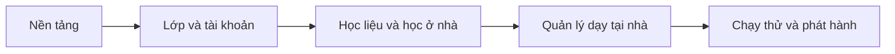

# TinyClass — Lộ trình triển khai

Nguồn yêu cầu: [spec sản phẩm](../spec/01-product.md), [quyết định](../spec/06-decisions.md). Công việc chi tiết: [backlog](02-backlog.md). Không đặt ngày hoàn thành hoặc ước lượng nhân lực khi chưa có thông tin kế hoạch làm việc.

## 1. Điểm xuất phát đã xác minh

| Nội dung | Trạng thái |
|---|---|
| Spec tổng quan và bộ spec/plan theo module | Đã có tài liệu để review |
| Khởi tạo React và Spring Boot | Đã có trong `frontend/` và `Backend/` |
| Frontend build | Lượt kiểm tra gần nhất thành công với `npm.cmd run build` |
| Backend compile/verify | Wrapper verify thành công, 70 test đạt |
| Runtime/database | Local/test PostgreSQL và Mailpit riêng; V1–V7 từ schema rỗng/nâng cấp đạt |
| React/tài khoản/lớp/gia đình | UI/API thật; LOCAL/bài/khóa/giao/học cùng các luồng cũ; 13 E2E đạt |
| Google | TC-009 có UI/API, protocol/E2E với OIDC thử nghiệm; còn nghiệm thu Google thật |
| Học liệu | TC-010/012/013/014 hoàn thành trong phạm vi LOCAL/xem/xác nhận; sản phẩm TC-015/016 tiếp theo |
| Lịch/phí và email ngoài | Theo backlog; chưa nghiệm thu Drive/SMTP ngoài |

TC-001–008 và TC-010/012/013/014 DONE theo phạm vi từng task. TC-009 giữ IN_PROGRESS; người dùng yêu cầu tạm hoãn cấu hình Google thật. Xem [báo cáo học liệu](../verification/2026-11-02-learning.md); tiếp tục TC-015/016 và các module dạy tại nhà, không cần chờ Google.

Không cần tạo lại project hoặc cài lại frontend từ đầu để bắt đầu kế hoạch. Giải quyết đường build/cấu hình backend và tiếp tục trên hai module hiện có.

## 2. Các mốc

| Mốc | Task | Kết quả phải có | Điều kiện qua mốc |
|---|---|---|---|
| G0 — nền tảng | TC-001 đến TC-005 | Build backend, naming, database/migration, API chung, khung React/API client | Chạy local có database; build/lint theo công cụ đã chọn; quy ước API và cấu hình rõ |
| G1 — lớp và tài khoản | TC-006 đến TC-009 | Giáo viên quản lý lớp/bé, lời mời gia đình, email/Google, quyền theo bé | Gia đình vào đúng con, sai quyền bị chặn, identity không bị ghép sai |
| G2 — học liệu và học ở nhà | TC-010 đến TC-016 | Hai kho lưu, bài/khóa, giao nội dung, sản phẩm và phản hồi | Trọn luồng qua cả hai kho; xem/tải đúng quyền; tiến độ đúng và rời lớp dừng nội dung |
| G3 — quản lý dạy tại nhà | TC-017 đến TC-025 | Lịch, điểm danh/bù, nhận xét, học phí, thông báo và dashboard | Quản lý một lớp thật bằng dữ liệu giả qua frontend/API; không tính trùng buổi/tiền |
| G4 — chạy thử/phát hành | TC-026 đến TC-028 | Kiểm thử tích hợp, cấu hình triển khai, backup/restore, hướng dẫn | Các AC trong phạm vi phát hành đạt; có kiểm tra phục hồi và danh sách giới hạn thực tế |

Các task lịch/nhận xét/chính sách phí có thể chuẩn bị khi đủ phụ thuộc dù luồng học liệu chưa xong; thứ tự phát hành vẫn cần nghiệm thu đủ các mốc. Sơ đồ này mô tả kết quả tích hợp, không yêu cầu tạo toàn bộ bảng hoặc mọi màn hình trong một lượt.

## 3. Những việc cần chốt theo thời điểm

- G0: Q-01/Q-03 về database, wrapper/runtime và naming; Q-10 cho hướng CSS/giao diện dùng chung.
- G1: Q-02/Q-07 về session/lời mời, phương thức xác minh và cấu hình Google login/email.
- G2: Q-04 về kho mặc định, quota và Drive; Q-08 cho quyền lịch sử bên cạnh yêu cầu rời lớp dừng bài đã chốt.
- G3: Q-06 về chính sách phí/nghỉ/bù; không mặc định chấp thuận bảng giá ví dụ.
- G4: Q-05/Q-08/Q-09 về quy mô, ngân sách, lưu trữ và phạm vi phát hành cuối cùng.

Mỗi task ghi rõ quyết định ảnh hưởng trực tiếp. Không cần tất cả thông tin production để sửa build local hoặc viết luồng độc lập, nhưng không nghiệm thu Google/Drive/email thật bằng kết quả mock.

## 4. Cách chia việc và Definition of Done

Một task cần có: mục tiêu, spec, phụ thuộc, đầu ra backend/frontend hoặc cấu hình, và tiêu chí xong. Các task backend thuần có thể DONE sau kiểm tra API; mốc nghiệp vụ chỉ qua khi giao diện liên quan dùng API thật.

Trước khi đánh dấu DONE:

- Hành vi đúng spec/quyết định đã chốt cho task.
- Migration/DTO/API/UI của phạm vi task thống nhất; không chỉ làm nút hoặc dữ liệu cứng.
- Kiểm tra phù hợp đã chạy và lưu kết quả thực tế, lỗi/giới hạn còn lại được nêu rõ.
- Kiểm tra quyền và lỗi của luồng, không chỉ trường hợp thành công.
- Cập nhật tài liệu nếu tên route/bảng/quy tắc đổi; không âm thầm chuyển đề xuất thành xác nhận.

## 5. Rủi ro và cách xử lý trong kế hoạch

| Vấn đề hiện có/cần kiểm tra | Xử lý |
|---|---|
| Lỗi build backend ban đầu | Đã xử lý TC-001; wrapper compile và verify thành công, cần giữ đường build tái lập |
| Namespace/brand | TC-002 đã chuẩn hóa com.tinyclass, tên artifact/service và nhãn frontend; build đạt |
| Có `.git` trong Backend, chưa có root Git | TC-002 ghi lựa chọn repository; thao tác gộp/tách lịch sử là công việc riêng, không suy ra đã thực hiện |
| Kho LOCAL có thể không bền khi deploy | TC-010/TC-027 kiểm tra volume, dung lượng, sao lưu và restart/redeploy |
| Google login/Drive/email cần cấu hình ngoài | Ghi kết quả local/mocked và tích hợp thật riêng; thiết kế hai luồng quyền Google độc lập |
| Chính sách nghỉ/bù/phí chưa duyệt | Triển khai cấu hình theo thỏa thuận, chốt giá trị thật trước nghiệm thu tính tiền |
| Trạng thái đồng thời làm sai tiền/tiến độ | Unique, khóa giao dịch và integration test ở các task liên quan |

## 6. Kết quả đầu tiên nên bàn giao

Sau G1: giáo viên đăng nhập, tạo lớp, thêm bé, gửi lời mời; phụ huynh đăng nhập email/Google và chỉ thấy con mình. Đây là mốc nhỏ có thể xem và thử trước khi làm đầy đủ kho học liệu, lịch và học phí.

