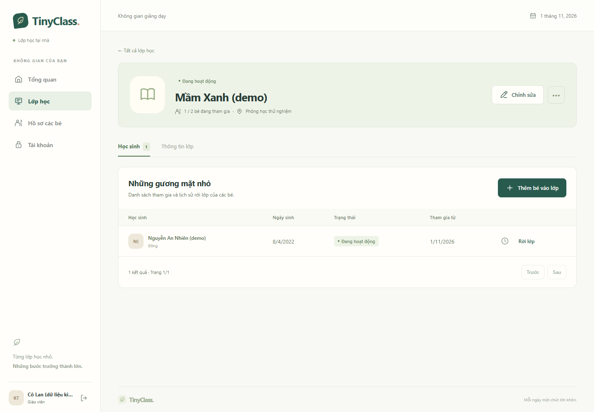

# TinyClass — Khung React, tài khoản và quản lý lớp

Ngày: 01/11/2026, múi giờ Asia/Ho_Chi_Minh. Phạm vi: TC-005, TC-006, TC-007, dùng tiếp nền tảng TC-001 đến TC-004.

## Chức năng đã triển khai

- React Router, layout theo role, provider phiên, API client cookie/CSRF, loading/empty/error/thử lại và biểu mẫu. CSS thuần, giao diện tiếng Việt, màu xanh lá/kem, dùng được trên điện thoại.
- Khởi tạo duy nhất một giáo viên bằng mã cài đặt ngẫu nhiên; không có mật khẩu mặc định. Đăng nhập email/mật khẩu, me, đăng xuất và xử lý hết phiên.
- Password PBKDF2-HMAC-SHA256, salt 16 byte, 310.000 lượt. Session HttpOnly/SameSite=Lax; đổi session ID và CSRF khi đăng nhập. Role/trạng thái được đối chiếu database trên yêu cầu tiếp theo.
- Setup/login mặc định tối đa 20 yêu cầu/địa chỉ kết nối/phút trên một instance. Không tin header IP tự khai; cấu hình proxy production và giới hạn tại proxy tiếp tục ở TC-027.
- Lớp: tìm/lọc/phân trang, tạo/sửa, mở/kết thúc, lưu trữ/khôi phục trạng thái trước đó.
- Bé: hồ sơ dùng chung giữa nhiều lớp, tạo/sửa/tìm/lưu trữ/khôi phục, ghi chú riêng; ngày sinh không vượt ngày nghiệp vụ Việt Nam.
- Thành viên: chọn hồ sơ có sẵn, chặn trùng, kiểm tra sĩ số bằng khóa giao dịch, rút/quay lại có lý do/version và lịch sử. Giữ ID enrollment và ngày tham gia đầu tiên.
- V2 tạo users/classes/students/class_enrollments, FK audit actor. Timestamp Java chuẩn hóa microsecond để khớp PostgreSQL từ response tạo mới.
- [OpenAPI](../spec/openapi.yaml): 26 thao tác trên 21 đường dẫn, schema, session/CSRF và lỗi. PATCH lớp/bé nhận đầy đủ biểu mẫu; bỏ qua trường tùy chọn sẽ xóa giá trị.

## Kết quả thực tế

| Kiểm tra | Kết quả |
|---|---|
| `Backend/mvnw.cmd -B verify` | BUILD SUCCESS; 30 test, 0 failure/error/skipped |
| `npm.cmd run build` | TypeScript + Vite thành công |
| `npm.cmd run lint` | Thành công, không có warning |
| `npm.cmd run test:e2e` | 3/3 đạt, Edge headless với frontend/API/database thật |

### Backend

| Nhóm | Số test | Nội dung |
|---|---|---|
| `AccountsAndClassesTests` | 15 | Setup/key/unique teacher/hash; session/CSRF/logout; khóa tài khoản/role/ownership; validation; nhiều lớp; lifecycle/version; thêm trùng/sĩ số đồng thời; lịch sử và lưu trữ |
| `AuthAttemptLimiterTests` | 1 | Giới hạn theo địa chỉ, địa chỉ khác vẫn hoạt động |
| `MigrationTests` | 2 | Schema rỗng; nâng V1 có dữ liệu audit lên V2 và giữ bản ghi cũ |
| Test nền tảng | 12 | Lỗi, local/test startup, health, CSRF, request ID và audit JSONB |

Hai yêu cầu tranh chỗ cuối trả đúng một 201 và một 409; chỉ một enrollment và một audit tạo thành viên được ghi. Rút/quay lại giữ ID/joinedAt; version cũ không ghi đè dữ liệu.

### Trình duyệt

1. Khởi tạo → đăng nhập → tải lại giữ phiên → đăng xuất → API quản lý trả 401.
2. Tạo/mở lớp → tạo hồ sơ từ luồng thêm bé → tham gia → rời/quay lại có lý do → đọc lịch sử → tải lại vẫn có dữ liệu; không có lỗi JavaScript.
3. Menu mobile 390 px → hồ sơ/ghi chú riêng giáo viên → không tràn ngang ở 390 và 360 px → kết thúc phiên qua API → yêu cầu dữ liệu tiếp theo đưa UI về đăng nhập và báo hết phiên.

Đã xem trực tiếp ảnh desktop/mobile. Tài khoản và hồ sơ trong ảnh hoàn toàn là dữ liệu giả trong database test.

[Tổng quan desktop](assets/2026-11-01-dashboard-desktop.png) · [Hồ sơ mobile](assets/2026-11-01-student-mobile.png)

## Giới hạn và bước tiếp theo

TC-001 đến TC-007 DONE theo phạm vi từng task. AC-01/02/03 có bằng chứng, gồm thêm trùng đồng thời và hai bé tranh chỗ cuối; chưa tuyên bố toàn bộ 48 AC sản phẩm đạt. Các tình huống quyền nội dung sau rời lớp và roster khác được kiểm tra ở TC-013/018.

TC-008 lời mời/đăng ký phụ huynh/email, TC-009 Google, tệp LOCAL/Drive, bài/khóa, lịch, điểm danh và học phí chưa triển khai. Layout gia đình mới là khung điều hướng theo role; chưa có API con/lớp của con. Dashboard hiện dùng số lớp/hồ sơ thật, chưa thay dashboard toàn sản phẩm TC-025.

Session bộ nhớ hết khi restart hoặc sau 30 phút không hoạt động. Production, email/Google thật, backup/restore và tải thử tiếp tục theo plan; chưa phát hành hosting.

## Tái lập

Theo [README](../../README.md). Chạy Maven rồi E2E lần lượt vì dùng chung database test riêng. Test reset dữ liệu `tinyclass_test`; database phát triển được giữ riêng và không tự tạo giáo viên/demo.

Log backend: `Backend/target/accounts-classes-verification.log`; Surefire: `Backend/target/surefire-reports/`. Log E2E: `frontend/e2e-verification.log`; ảnh gốc: `frontend/test-results/`. Các artifact này có thể tạo lại, không chứa thông tin đăng nhập thật.
