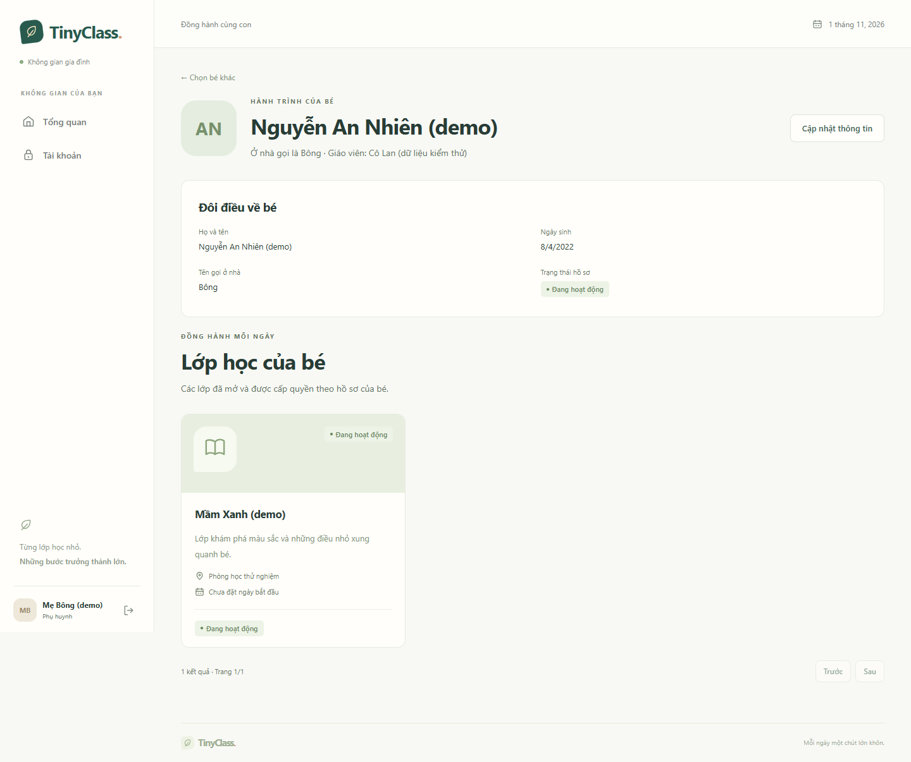

# TinyClass — Lời mời, tài khoản phụ huynh và gia đình

Bắt đầu: 01/11/2026; hoàn tất/cập nhật: 02/11/2026, múi giờ Asia/Ho_Chi_Minh. Phạm vi: TC-008, tiếp nối TC-001 đến TC-007. Google vẫn ở TC-009.

## Phần đã có

- Giáo viên tạo lời mời cho từng bé/email, sao chép liên kết, xem lịch sử và thu hồi lời mời/liên kết gia đình. Tạo lời mời không tự gửi tin nhắn cho người nhận.
- Phụ huynh đăng ký bằng lời mời còn hiệu lực hoặc dùng tài khoản đã có. Server luôn gán PARENT; không cấp quyền với bé chỉ từ việc đăng ký hay đăng nhập.
- Xác minh email qua SMTP, gửi lại thư và tiếp tục lời mời. Chỉ email đã xác minh, đúng người nhận mới được chấp nhận lời mời.
- Nhận lời mời và tạo/kích hoạt lại một liên kết là cùng giao dịch; khóa theo bé để chặn hai yêu cầu nhận đồng thời. Một bé có nhiều người giám hộ, một phụ huynh có nhiều bé.
- Gia đình chọn bé, xem hồ sơ tối thiểu và lớp được phép thấy. DTO không có ghi chú riêng, bạn học, người giám hộ khác hoặc dữ liệu quản trị. Thu hồi liên kết của bé A không ảnh hưởng bé B.
- Lớp DRAFT/ARCHIVED và enrollment WITHDRAWN không xuất hiện trong danh sách hoặc tổng số của gia đình. Lớp COMPLETED được giữ ở lịch sử theo mặc định thiết kế. Đây chưa phải quyền nội dung bài học, phần đó ở TC-013/014.
- Quên/đặt lại mật khẩu qua email. Yêu cầu reset có cùng status/body cho email không tồn tại, tài khoản khóa, không có mật khẩu, cooldown hoặc lỗi gửi thư. Reset thành công làm các phiên cũ bị từ chối ở request tiếp theo; không tự xác minh email hoặc tạo mật khẩu cho tài khoản không có phương thức này.
- V3 tạo guardian_invitations/student_guardians/auth_tokens với FK, unique và version; token sinh ngẫu nhiên 32 byte và chỉ lưu SHA-256 trong database ứng dụng. Token có mục đích, thời hạn và dùng một lần.

## Các mặc định đã áp dụng

| Nội dung | Giá trị |
|---|---|
| Lời mời | 48 giờ, cấu hình TINYCLASS_INVITATION_TTL_HOURS |
| Xác minh email | 24 giờ; gửi lại vô hiệu token xác minh chưa dùng trước đó |
| Reset mật khẩu | 30 phút, chỉ áp dụng phương thức mật khẩu đã tồn tại |
| Cooldown email | 60 giây/email, dùng chung giữa resend và yêu cầu reset |
| Giới hạn endpoint tài khoản/lời mời | Cùng bộ giới hạn IP mặc định 20/phút trên một instance |
| Liên kết email/lời mời | Token nằm trong fragment, được UI lấy rồi bỏ khỏi thanh địa chỉ; không đưa token vào query hoặc localStorage |

Preview lời mời chỉ trả tên giáo viên, email đã che và trạng thái. Liên kết đăng ký không tiết lộ tên/ID bé trước khi phụ huynh được nhận quyền. SMTP lỗi không đưa nội dung email/token vào log; lỗi gửi thư lúc đăng ký rollback tài khoản/token mới.

## Kết quả kiểm tra

| Kiểm tra | Kết quả |
|---|---|
| Maven Wrapper verify | 41 test, 0 failure/error/skipped, BUILD SUCCESS |
| FamilyAndRecoveryTests | 11 test đạt với PostgreSQL và SMTP/Mailpit thật trong môi trường test |
| Các test cũ | 30 test vẫn đạt; migration từ schema rỗng và nâng V1 chạy qua V3 |
| Frontend build/lint | Thành công, lint không warning |
| Playwright/Edge | 7/7 E2E đạt, gồm 3 luồng cũ và 4 luồng gia đình mới |

Các kiểm tra mới bao gồm sai email, token hết hạn/thu hồi/dùng lại/sai mục đích, nhận lời mời đồng thời, hai người giám hộ/nhiều bé, metadata đúng phạm vi, thu hồi quyền, class ẩn sau rời lớp/lưu trữ, resend vô hiệu link cũ, password reset hủy phiên cũ và rollback khi SMTP không hoạt động.

E2E đi qua UI giáo viên tạo/sao chép lời mời → phụ huynh đăng ký → mở thư bắt qua SMTP/Mailpit → xác minh → nhận lời mời → xem đúng con. Có luồng thu hồi một trong hai bé, reset mật khẩu và lời mời bị thu hồi. Đã xem ảnh desktop/mobile; dữ liệu trong ảnh đều giả.

[Quản lý liên kết gia đình](assets/2026-11-01-guardians.png) · [Gia đình trên mobile](assets/2026-11-01-family-mobile.png)

## Tái lập và giới hạn

Theo [README dự án](../../README.md). Local dùng Mailpit UI 18025/SMTP 11025; test dùng UI 18026/SMTP 11026 riêng. Test không gửi thư ra Gmail hay hộp thư bên ngoài. Mailpit theo [Docker hướng dẫn chính thức](https://mailpit.axllent.org/docs/install/docker/); mailer dùng [JavaMailSender](https://docs.spring.io/spring-boot/reference/io/email.html).

Log Maven: `Backend/target/family-verification.log`; E2E: `frontend/family-e2e-verification.log`. Chạy Maven/E2E lần lượt vì dùng chung database test; chỉ reset dữ liệu giả của tinyclass_test.

SMTP local/test đã xác minh; gửi thư qua nhà cung cấp thật, HTTPS/proxy và vận hành production chưa nghiệm thu. Reset yêu cầu hiện chạy đồng bộ với SMTP, chỉ bảo đảm cùng status/body; chưa có hàng đợi gửi thư bền vững hoặc bảo đảm thời gian phản hồi giống nhau khi đo độ trễ. Cấu hình Google/Drive, học liệu, lịch/điểm danh và học phí tiếp tục theo backlog.
