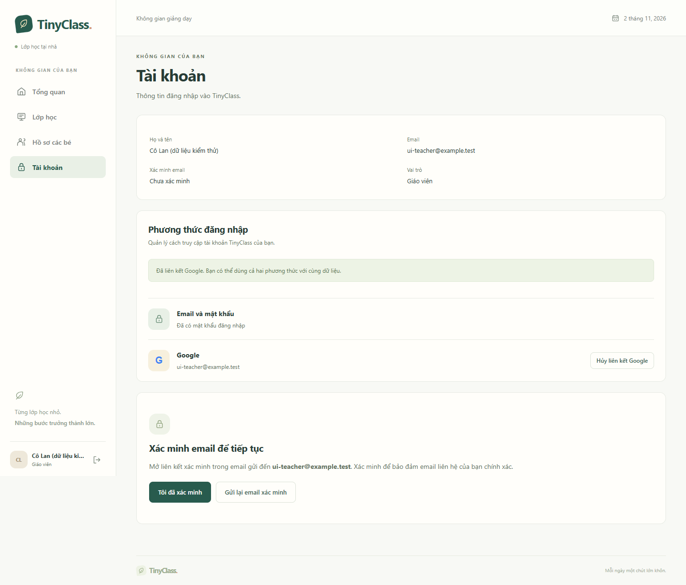

# TinyClass — Google và phương thức đăng nhập

Ngày kiểm tra: 02/11/2026, Asia/Ho_Chi_Minh. Phạm vi: phần mã và kiểm thử TC-009, tiếp nối TC-001–TC-008. TC-009 vẫn **IN_PROGRESS** vì chưa có cấu hình/kiểm tra với Google thật. [Hướng dẫn cấu hình](../07-google-login-local.md), [backlog](../plan/02-backlog.md#tc-009), [OpenAPI](../spec/openapi.yaml).

## Phần đã triển khai

- Google OIDC authorization code/PKCE S256; state/nonce trong session, intent ngắn hạn; xác minh issuer/audience/chữ ký/hạn ID token bằng Spring Security. Callback đổi sang principal của ứng dụng, role/trạng thái lấy từ database.
- Đăng ký phụ huynh qua lời mời đúng email. Gmail/Workspace đủ điều kiện nhận đúng quyền bé trong giao dịch; địa chỉ bên thứ ba cần thêm email challenge. Google-only giữ password hash NULL, không cần mật khẩu giả.
- Identity tra bằng issuer/subject; email trùng tài khoản local yêu cầu đăng nhập cách cũ rồi liên kết. Không tạo thêm giáo viên hoặc tự merge email. Liên kết giữ user ID, role và dữ liệu.
- Trang Tài khoản liệt kê phương thức, xác thực lại bằng mật khẩu/Google, liên kết và hủy Google. Proof gắn user/credential version, hạn 5 phút và một lần; kiểm tra dưới khóa user khi thực hiện thay đổi. Sai mật khẩu reauth không làm mất phiên hiện tại.
- Chặn hủy phương thức cuối cùng và identity của người khác. Thêm mật khẩu Google-only qua SET_PASSWORD đúng chủ tài khoản đang đăng nhập, email đã xác minh, token băm/một lần/hạn 30 phút. Luồng reset không tự thêm phương thức.
- V4 thêm auth_identities/unique active và credential_version. Thay đổi phương thức/mật khẩu vô hiệu snapshot các phiên cũ; hủy/thêm mật khẩu đăng xuất phiên hiện tại. Google login chỉ xin openid/email/profile, không lưu authorized-client token làm quyền Drive.
- Google mặc định tắt. Khi bật, backend yêu cầu Web OAuth credentials/public URL hợp lệ; frontend chỉ hiện nút khi provider khả dụng. Secret không trả xuống React.

## Kết quả kiểm tra

| Kiểm tra | Kết quả |
|---|---|
| Maven Wrapper `verify` | 57 test; 0 failures/errors/skipped; BUILD SUCCESS |
| GoogleOidcTests | 16 test đạt trên HTTP/Spring Security, PostgreSQL và SMTP/Mailpit |
| Migration | V1–V4 từ schema rỗng và nâng từ V1 đạt; local startup/schema validation đạt |
| Frontend build/lint | Thành công; lint không warning |
| Playwright/Edge | 10/10 đạt: 7 luồng cũ và 3 luồng Google/phương thức |
| OpenAPI | 45 path, 51 operation, 60 schema; kiểm tra cú pháp và các `$ref` nội bộ |
| Giao diện | Đã xem ảnh desktop/mobile 390 px; không tràn ngang tại màn hình phương thức |

Kiểm thử protocol dùng **provider OIDC local trong src/test**, có RSA/JWKS, authorization code một lần, token endpoint và kiểm tra PKCE. Test đi qua authorization redirect, trao đổi code và xác minh JWT thực sự; không chèn principal để bỏ qua các bước giao thức. Provider có thể tạo trường hợp sai chữ ký/audience/issuer/hạn/state/nonce, hủy và replay. ID token thử nghiệm cố tình có claim role TEACHER; ứng dụng vẫn tạo PARENT đúng quyền.

Provider và test main không được đóng gói trong JAR production. Màn hình chọn tài khoản E2E ghi rõ đây là giả lập, không nhập thông tin thật. PostgreSQL test 55433, SMTP 11026/Mailpit 18026 tách khỏi phát triển; E2E dùng backend 18080, Vite 5174, provider 19090.

## Đối chiếu nghiệm thu trong phạm vi thử nghiệm

| AC | Bằng chứng đã chạy | Giới hạn |
|---|---|---|
| AC-42 | Đăng ký Google tạo một PARENT/identity/liên kết bé, không password hash; E2E nhận lời mời | Chưa thực hiện bằng Google thật |
| AC-43 | Thiếu lời mời/sai email bị chặn; email ngoài cần SMTP xác minh trước nhận quyền | Thư bắt bởi Mailpit, chưa gửi ra nhà cung cấp thật |
| AC-44 | Email collision không auto-merge; password reauth rồi link giữ ID/data; UI đăng nhập lại cùng giáo viên | Chưa nghiệm thu consent/callback Google thật |
| AC-45 | Sáu lỗi state/nonce/issuer/audience/chữ ký/hạn bị chặn; callback replay không đăng nhập trình duyệt khác | Provider ký token local để tái lập lỗi |
| AC-46 | Scope chỉ danh tính, không lưu access/refresh token hoặc tự tạo kho Drive | Kho Drive và consent Drive ở TC-011 chưa triển khai |
| AC-47 | Google-only reset không thêm hash; reauth đúng identity; setup token đúng chủ/mục đích; thêm password rồi hủy Google, password login còn dùng được | Email thiết lập đi qua SMTP thử nghiệm |
| AC-48 | User khóa bị từ chối; role từ token không nâng quyền; family không gọi được API giáo viên | Kiểm tra HTTP/UI trong môi trường test |

E2E còn kiểm tra sai mật khẩu reauth giữ phiên, hủy OAuth có thông báo, không tạo phiên ngoài ý muốn. Google-only phải thêm mật khẩu trước khi UI cho hủy Google. Các luồng reset, lời mời, nhiều bé và quyền cũ vẫn đạt.

## Ảnh giao diện

Dữ liệu tài khoản/hồ sơ trong ảnh là giả; provider Google đang bật chỉ trong ứng dụng E2E.

[Phương thức trên mobile](assets/2026-11-02-google-methods-mobile.png) · [Google-only của phụ huynh](assets/2026-11-02-google-only-parent.png) · [Màn hình đăng nhập](assets/2026-11-02-google-login.png)

## Tái lập và phần còn lại

Chạy Maven verify, frontend build/lint, sau đó E2E lần lượt theo [README](../../README.md). Playwright tự chạy/dừng backend/Vite/OIDC test; không chạy cùng Maven vì dùng chung database test. Log local: `Backend/target/google-verification.log` và `frontend/test-e2e-google.log`. Ảnh nguồn ở frontend/test-results; các ảnh chọn lọc được lưu cùng báo cáo.

Chưa có Google OAuth client thật, nên chưa kiểm tra consent screen, test users, redirect đăng ký tại Google, môi trường HTTPS/proxy hoặc quy trình với tài khoản Google thật. Thực hiện theo [hướng dẫn](../07-google-login-local.md), ghi kết quả rồi mới chuyển TC-009 sang DONE. SMTP production, Drive và vận hành nhiều instance chưa nghiệm thu. Phiên/proof/OAuth context hiện trong bộ nhớ một instance; backend restart kết thúc các phiên.

Kho LOCAL ở TC-010 đã đủ phụ thuộc để phát triển tiếp trong khi chuẩn bị cấu hình Google thật.
