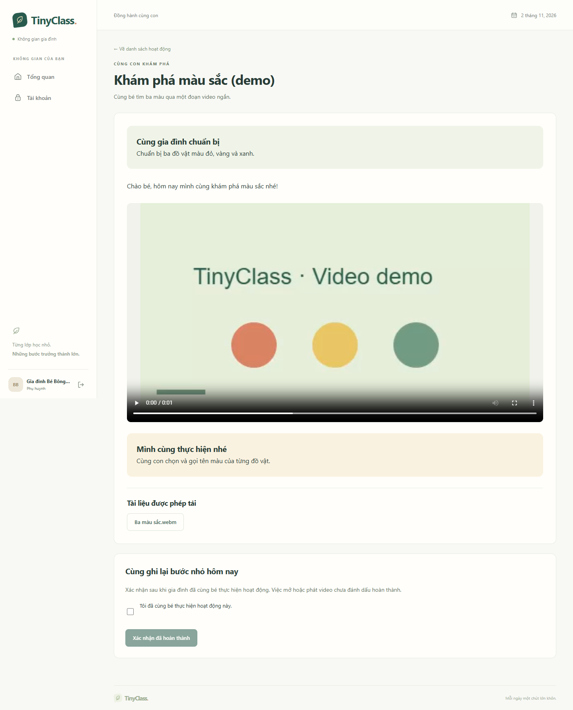

# TinyClass — LOCAL, học liệu và giao bài

Ngày kiểm tra: 02/11/2026, Asia/Ho_Chi_Minh. Phạm vi: TC-010/012/013/014, tiếp nối tài khoản/lớp/gia đình và phần mã Google. Người dùng yêu cầu tạm hoãn cấu hình đăng nhập Google thật; luồng học liệu chạy bằng email/mật khẩu. [Hướng dẫn](../08-hoc-lieu-local.md), [backlog](../plan/02-backlog.md), [OpenAPI](../spec/openapi.yaml).

## Kết quả

| Kiểm tra | Quan sát |
|---|---|
| Maven Wrapper verify | 70 test, 0 failures/errors/skipped, BUILD SUCCESS |
| LocalStorageTests | 6 test: upload/metadata/Range, MIME/đuôi/giới hạn, quota đồng thời, ownership/policy, thiếu byte và EBML WebM |
| LearningTests | 7 test: publish/version/shared update, khóa/snapshot, recipient/quyền tệp, giờ mở, open/confirm và tiến độ |
| Migration | V1–V7 từ schema rỗng và nâng từ V1; local startup/schema validation đạt |
| Frontend | build/lint thành công, không warning |
| Playwright/Edge | 13/13 luồng đạt; 10 luồng cũ và 3 luồng học liệu mới |
| OpenAPI 0.0.5 | 75 path, 89 operation, 99 schema; cú pháp và các reference nội bộ hợp lệ |
| Giao diện | Đã xem ảnh giáo viên/gia đình, desktop và 390 px; không tràn ngang trong bài học mobile |

## Hành vi đã có

V5 tạo storage_connections/files, FK cover/avatar và ngữ cảnh tệp. LOCAL có thư mục riêng ngoài public/build/Git, server tự sinh key, SHA-256, ghi tệp tạm rồi atomic move. Upload giữ trạng thái UPLOADING/READY/FAILED; không tự đổi kho khi lỗi. Quota đặt chỗ dưới khóa user để hai upload đồng thời không vượt giới hạn.

MIME được nhận dạng bằng Tika Core 3.3.3 và đối chiếu đuôi/loại khai báo. WebM xác minh EBML DocType để phân biệt Matroska đổi đuôi. Giới hạn ảnh/âm thanh/PDF/video tương ứng 10/20/50/200 MiB. Resource hỗ trợ 200/206/416, inline/attachment, no-store và nosniff. Byte vẫn đọc được qua instance adapter mới với cùng root; thiếu byte trả 503 và giữ metadata.

V6 tạo chủ đề, khối bài, khóa và thứ tự. Soạn plain text/media, chọn hoặc tải tệp trong bài, lưu nháp/xuất bản/lưu trữ/khôi phục, kiểm tra version và xác nhận cập nhật dùng chung. PDF đặt vào khối ảnh bị từ chối; tệp chưa READY hoặc khóa chứa bài nháp không được xuất bản. Xuất bản thư viện chưa tự mở quyền gia đình.

V7 tạo assignment/item/recipient/progress. Nháp giữ danh sách/yêu cầu sao chép; thay khóa nguồn không viết lại snapshot. client_request_id/request hash chống tạo lặp; xuất bản chốt người nhận trong giao dịch và retry không tạo thêm bản ghi. Có giờ mở/hạn gợi ý, thu hồi toàn lần giao và cấp thêm bé hiện đang tham gia với lý do.

Family list/count/item/file kiểm tra liên kết gia đình, recipient và trạng thái hiện tại. Trước giờ mở không trả nội dung/item/tệp. File phải thuộc đúng bài/item của đúng bé; download cần cờ hiện tại. Rút lớp thu hồi recipient cùng giao dịch, quay lại không tự phục hồi. Giao riêng độc lập; cấp lại có chủ đích giữ lịch sử.

Mở trang/video tạo OPENED, không hoàn thành. PARENT_CONFIRM ghi đúng người/mốc đầu và xử lý gửi lại; tỷ lệ chỉ đếm item bắt buộc không phải REFERENCE, không có mẫu số thì phần trăm null. Cùng bài giao lại dùng item/progress mới. Lớp COMPLETED được xem lại, không xác nhận mới.

## Các luồng E2E mới

1. Giáo viên tải ảnh và WebM được tạo bằng canvas/MediaRecorder trong trình duyệt, xem trước và thay cờ tải; kiểm tra Range qua API.
2. Tạo chủ đề → soạn bài có chữ/video → xuất bản → sắp khóa → giao lớp → đăng ký/xác minh/nhận lời mời phụ huynh qua SMTP thử nghiệm → Góc học → xem video và xác nhận → kiểm tra 100% ở gia đình và 1/1 ở giáo viên.
3. Rời lớp → bài và byte file trả 404 → quay lại vẫn chưa có quyền bài cũ → giáo viên cấp thêm có lý do → truy cập lại được.

Tài khoản/trẻ/media đều là dữ liệu giả. PostgreSQL/Mailpit test và root upload test/E2E tách khỏi dữ liệu phát triển. Script E2E kiểm tra đúng database tinyclass_test, xử lý cả schema rỗng sau khi tmpfs được tạo lại, rồi để Flyway migrate khi backend khởi động.

## Đối chiếu nghiệm thu

| Nhóm AC | Phần đã kiểm tra | Phần còn lại |
|---|---|---|
| AC-07, AC-12, AC-32 | Vai trò/ownership, sai bé/item/file, giờ mở, CSRF/quyền HTTP hiện tại | Sản phẩm/nhận xét/Drive theo module sau |
| AC-08, AC-09, AC-10 | Chủ đề/bài dùng lại trong khóa, chống bài trùng, xuất bản nháp/không READY, không tự cấp quyền khi xuất bản thư viện | Các nguồn media ngoài allowlist chưa mở |
| AC-11, AC-13–AC-16, AC-30 | Snapshot/chống tạo lặp, version/cập nhật nguồn, rút/quay lại/cấp bài cũ theo phạm vi assignment | Các tình huống vận hành/lịch sử mở rộng nghiệm thu TC-026 |
| AC-17, AC-18, AC-22 | Open không hoàn thành, PARENT_CONFIRM, mẫu số/REFERENCE và tiến độ từng lần giao | TEACHER_REVIEW cần TC-015/016 |
| AC-31, AC-34, AC-35, AC-36 | Giới hạn/MIME/Range LOCAL, cờ tải hiện tại, quyền sau rời lớp | Chọn/đổi default hai kho, upload gia đình và tình huống đã thu tiền trước chưa nghiệm thu |
| AC-41 | Byte LOCAL còn khi dùng lại root bằng instance mới | Deploy/restart/backup/restore môi trường thật và Drive chưa nghiệm thu |

Không coi toàn bộ các AC trong một nhóm đã đạt cho mọi module. Đây là bằng chứng phạm vi LOCAL/thư viện/giao bài/xem/xác nhận; sản phẩm, Drive, lịch và tiền có task/kiểm tra riêng.

## Ảnh giao diện

[Bài học mobile](assets/2026-11-02-family-learning-mobile.png) · [Kho tệp](assets/2026-11-02-files-desktop.png) · [Thư viện](assets/2026-11-02-library-desktop.png) · [Chi tiết giao bài](assets/2026-11-02-assignment-desktop.png)

## Tái lập và giới hạn

Chạy theo [README](../../README.md): Compose local/test → Maven verify → frontend build/lint → E2E; không chạy Maven và E2E đồng thời. Log: Backend/target/learning-verification.log, frontend/learning-e2e-verification.log. Tệp phát triển mặc định `.local/uploads`, JUnit `.local/test-uploads`, E2E `.local/e2e-uploads`.

Phụ thuộc nhận dạng theo [Apache Tika](https://tika.apache.org/download.html), với [content detection](https://tika.apache.org/3.2.3/detection.html); stream theo [Spring MVC Range requests](https://docs.spring.io/spring/reference/web/webmvc/mvc-range.html). Không có CDN/public static hoặc URL Drive làm đường bỏ qua kiểm tra quyền.

Chưa có adapter Drive, nộp/duyệt sản phẩm, feedback, lịch/điểm danh hoặc học phí. TEACHER_REVIEW đã lưu được yêu cầu nhưng chưa có luồng hoàn thành qua sản phẩm. Chưa chuyển mã video, tự dọn tệp rời, giao diện xóa tệp, hoặc kiểm tra volume/backup/khôi phục production. Các tệp/đường dẫn/buffer đã truyền không thu lại được sau đổi quyền. Google thật tạm hoãn; không thêm credentials thật vào môi trường trong mốc này.
